# Layer 7 Security Controls: Local Traffic Policies, Sensitive URI Blocking & Method Filtering

## Summary & Engineering Objectives

This project documents the architectural design, implementation, and empirical verification of **Layer 7 Security Controls** on an **F5 BIG-IP Local Traffic Manager (LTM)** deployed in Microsoft Azure.

Modern enterprise web applications are continuously exposed to automated reconnaissance scans, unauthorized directory traversal attempts, and HTTP verb tampering. Specifically:
- **Administrative Path Exposure:** Attackers routinely scan for sensitive control panels and staging endpoints (e.g., `/admin`, `/private`) to discover administrative interfaces or unauthenticated APIs.
- **HTTP Method Tampering & Cross-Site Tracing (XST):** Obsolete or dangerous HTTP verbs such as `TRACE` reflect client headers (enabling attackers to bypass `HttpOnly` cookie protections and harvest session credentials), while `CONNECT` can be abused for unauthorized proxy tunneling through perimeter proxies.
- **Resource Exhaustion & Backend Overhead:** Allowing malicious requests to traverse the perimeter to backend compute nodes forces backend web servers (e.g., NGINX, Apache, Node.js) to allocate worker threads, parse HTTP headers, and generate `403`/`405` responses, unnecessarily consuming CPU and memory.

To eliminate these threats at the perimeter, this project implements **F5 Local Traffic Policies (LTM Policies)** on Virtual Server `VS-NGINX-HTTPS`. Local Traffic Policies operate natively within the **Traffic Management Microkernel (TMM)** in compiled C++ kernel space, evaluating inbound requests at wire speed and executing an immediate **Layer 7 Connection Reset (`Reset traffic flow`)** before any malicious packet can reach backend application servers.

---

## Architecture & Traffic Flow Topology

The architecture consists of a client endpoint (`F5-CLIENT-01`) originating encrypted HTTPS requests toward the BIG-IP Virtual Server (`VS-NGINX-HTTPS`). Traffic matching sensitive paths (`/admin`, `/private`) or unauthorized verbs (`TRACE`, `CONNECT`) is instantly terminated with a TCP RST by BIG-IP, while legitimate requests (`GET /`) are forwarded to the backend NGINX application pool.

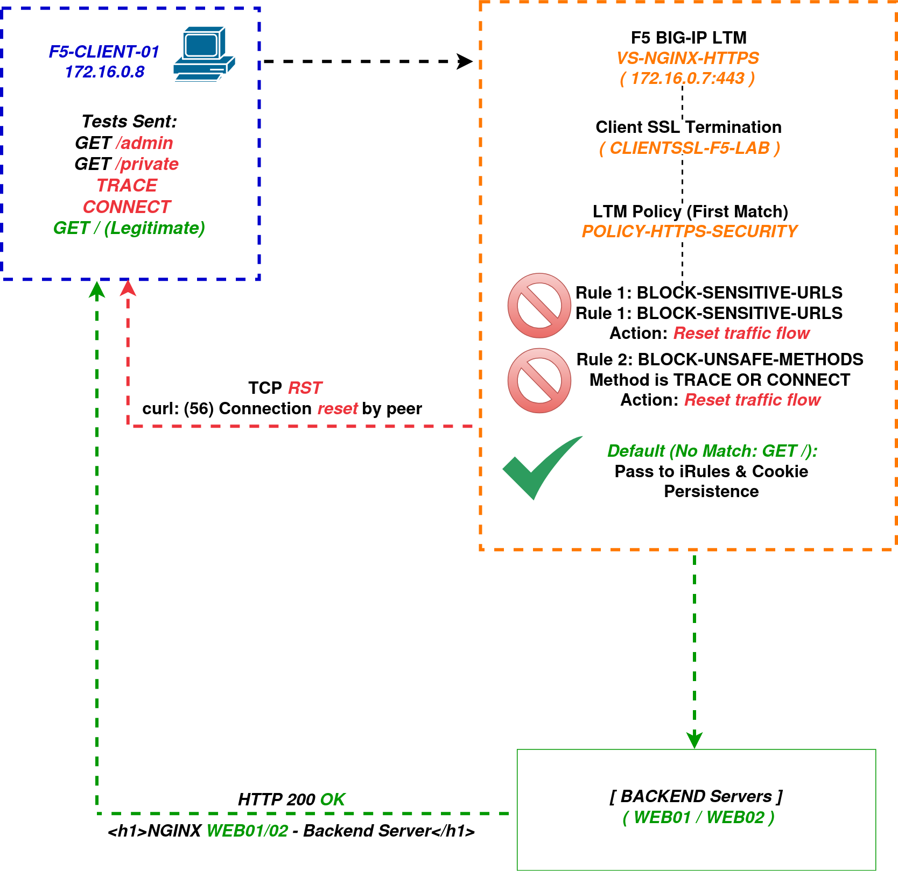


### Infrastructure Addressing & Node Roles

| Component | IP Address | Port / Protocol | Profile / Mechanism | Architectural Role |
|---|---|---|---|---|
| **F5-CLIENT-01** | `172.16.0.8` | Ephemeral &rarr; `443` | Ubuntu Linux Client | Generates attack simulations and legitimate validation requests via `curl` |
| **VS-NGINX-HTTPS** | `172.16.0.7` | `TCP/443` (HTTPS) | Standard Virtual Server | Terminates client TLS, inspects Layer 7 headers, enforces `POLICY-HTTPS-SECURITY` |
| **F5 BIG-IP Self-IP** | `172.16.0.4` | System / Self-IP | Internal Gateway | Initiates backend health monitoring probes and handles connection resets |
| **NGINX-WEB01** | `172.16.0.5` | `TCP/443` (HTTPS) | Backend Node 1 | Production web server hosting application content |
| **NGINX-WEB02** | `172.16.0.6` | `TCP/443` (HTTPS) | Backend Node 2 | Production web server hosting application content |

---

## Phase 1: Pre-Enforcement Baseline Analysis (The Vulnerability)

Prior to deploying security controls, `VS-NGINX-HTTPS` forwarded all inbound HTTP requests directly to the backend servers regardless of the HTTP method requested.

To illustrate this security risk, `curl` tests using `TRACE` and `CONNECT` methods were executed against `https://app1.f5-lab.local/`:

```bash
azureuser@F5-CLIENT-01:~$ curl -ik -X TRACE https://app1.f5-lab.local/
HTTP/1.1 405 Not Allowed
Server: nginx/1.24.0 (Ubuntu)
Date: Thu, 19 Nov 2026 14:09:54 GMT
Content-Type: text/html
Content-Length: 166
Connection: close
Set-Cookie: BIGipServerPOOL-APP1-HTTPS=83890348.47873.0000; path=/; Httponly; Secure

azureuser@F5-CLIENT-01:~$ curl -ik -X CONNECT https://app1.f5-lab.local/
HTTP/1.1 405 Not Allowed
Server: nginx/1.24.0 (Ubuntu)
Date: Thu, 19 Nov 2026 14:10:13 GMT
Content-Type: text/html
Content-Length: 166
Connection: close
Set-Cookie: BIGipServerPOOL-APP1-HTTPS=83890348.47873.0000; path=/; Httponly; Secure
```
**Baseline Test: Unrestricted HTTP TRACE**

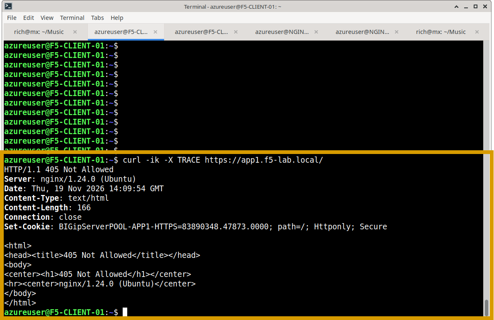

**Baseline Test: Unrestricted HTTP CONNECT**

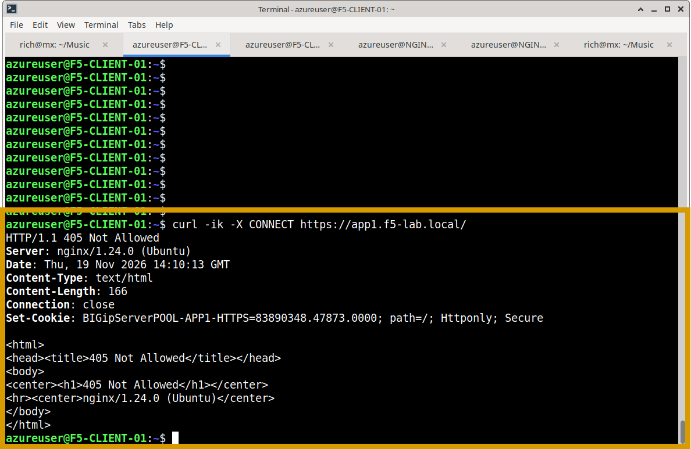


### Engineering Risk Analysis:
1. **Backend Server Disclosure:** Even though NGINX rejected the methods with `HTTP 405 Not Allowed`, the server disclosed its software banner (`Server: nginx/1.24.0 (Ubuntu)`), facilitating targeted exploit matching.
2. **Persistence Cookie Leakage:** The F5 persistence engine issued a session cookie (`BIGipServerPOOL-APP1-HTTPS`), unnecessarily allocating load-balancing state for an illegitimate client.
3. **Compute Node Resource Waste:** The backend server was forced to allocate worker processes, parse HTTP headers, and generate response payloads for traffic that should have been rejected at the network edge.

---

## Phase 2: Local Traffic Policy Engineering (`POLICY-HTTPS-SECURITY`)

To enforce perimeter protection, a custom **Local Traffic Policy** named `POLICY-HTTPS-SECURITY` was engineered under **Local Traffic &rarr; Policies &rarr; Policy List**.

### 1. Rule 1: Sensitive URI Protection (`BLOCK-SENSITIVE-URLS`)
Blocks unauthorized access to administrative portals, configuration directories, and private endpoints.
- **Condition:** `HTTP URI path starts with any of /admin, /private at request time`
- **Action:** `Reset traffic flow at request time`

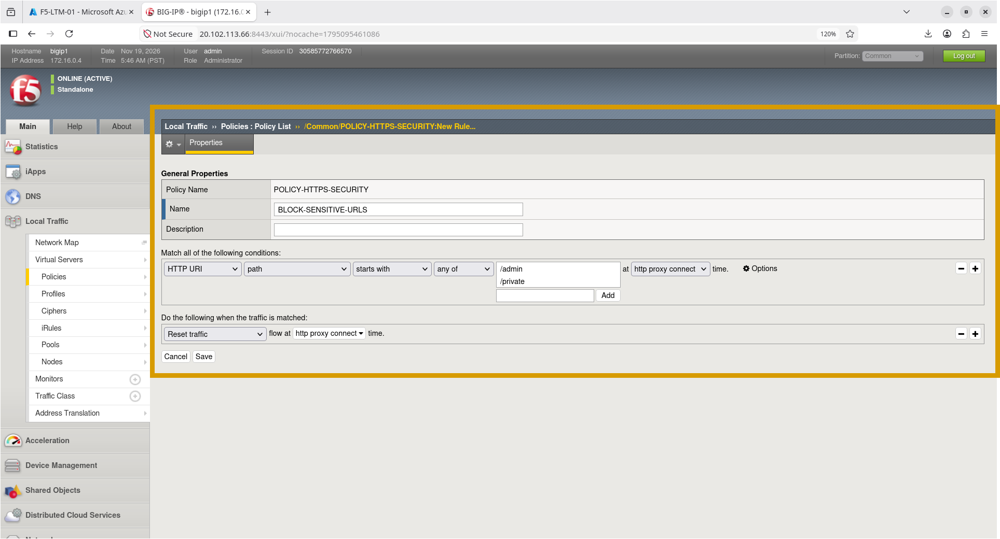

---

### 2. Rule 2: Unsafe HTTP Method Filtering (`BLOCK-UNSAFE-METHODS`)
Mitigates HTTP verb tampering, Cross-Site Tracing (XST), and unauthorized HTTP tunneling attempts.
- **Condition:** `HTTP Method full string is any of TRACE, CONNECT at request time`
- **Action:** `Reset traffic flow at request time`

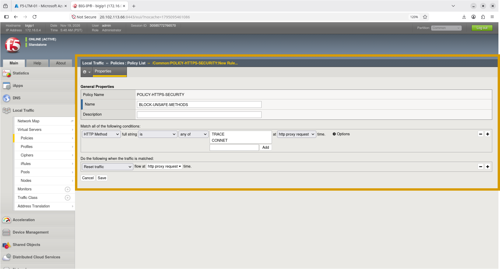

---

### 3. Policy Compilation & Strategy
The policy configuration applies the **Execute first matching rule** strategy. If an incoming request matches any security rule in the chain, BIG-IP immediately resets the connection without evaluating downstream load-balancing logic.

**Draft Policy**

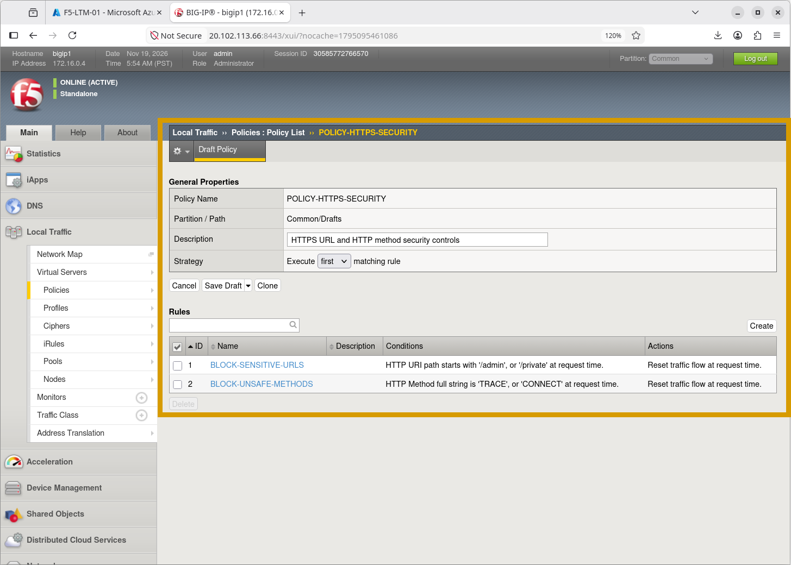

**Published Policy**

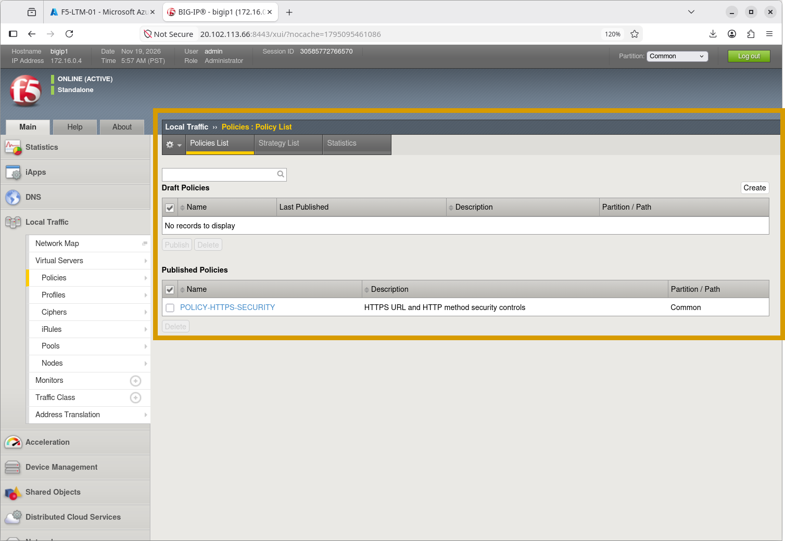

---

## Phase 3: Virtual Server Policy Attachment (`VS-NGINX-HTTPS`)

To activate protection, the published policy was bound to Virtual Server `VS-NGINX-HTTPS` under **Local Traffic &rarr; Virtual Servers &rarr; Virtual Server List &rarr; VS-NGINX-HTTPS &rarr; Resources**:

**Attaching Policy to Virtual Server Resources**

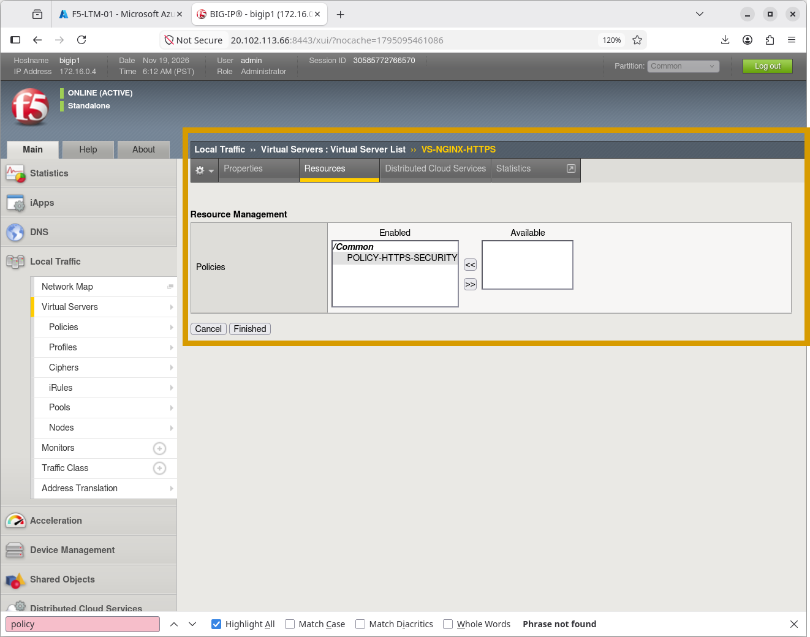

**Virtual Server Resource Overview**

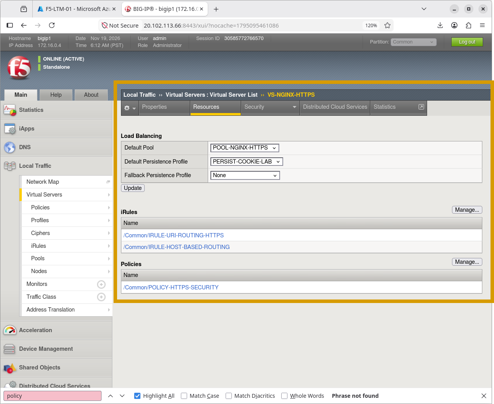

### Applied Virtual Server Architecture:
- **Default Pool:** `POOL-NGINX-HTTPS`
- **Persistence Profile:** `PERSIST-COOKIE-LAB` (HTTP cookie persistence)
- **Active iRules:** `IRULE-URI-ROUTING-HTTPS`, `IRULE-HOST-BASED-ROUTING`
- **Active Security Policy:** `/Common/POLICY-HTTPS-SECURITY`

---

## Phase 4: Empirical Security Validation & Attack Simulation

From test client `F5-CLIENT-01` (`172.16.0.8`), multiple attack simulations and legitimate validation requests were executed against `https://app1.f5-lab.local/`:

```bash
# Test 1: Sensitive URI Scan (/admin)
azureuser@F5-CLIENT-01:~$ curl -ik https://app1.f5-lab.local/admin
curl: (56) Recv failure: Connection reset by peer

# Test 2: Sensitive URI Scan (/private)
azureuser@F5-CLIENT-01:~$ curl -ik https://app1.f5-lab.local/private
curl: (56) Recv failure: Connection reset by peer

# Test 3: Unsafe HTTP Method (TRACE)
azureuser@F5-CLIENT-01:~$ curl -ik -X TRACE https://app1.f5-lab.local/
curl: (56) Recv failure: Connection reset by peer

# Test 4: Unsafe HTTP Method (CONNECT)
azureuser@F5-CLIENT-01:~$ curl -ik -X CONNECT https://app1.f5-lab.local/
curl: (56) Recv failure: Connection reset by peer

# Test 5: Legitimate Request (GET /)
azureuser@F5-CLIENT-01:~$ curl -k https://app1.f5-lab.local/
<h1>NGINX WEB01 - Backend Server 1</h1>
```

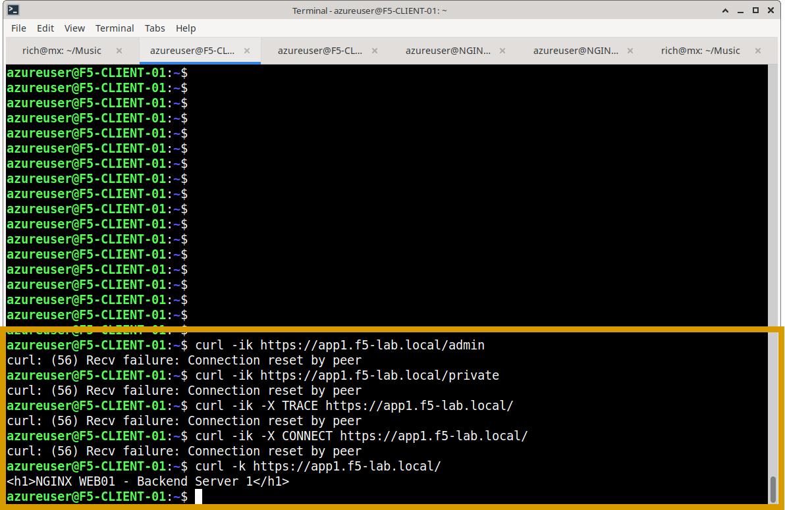

### Findings:
1. **Zero Backend Exposure:** Every probe targeting `/admin`, `/private`, `TRACE`, and `CONNECT` was terminated instantly with `curl: (56) Recv failure: Connection reset by peer`. No packets reached backend servers.
2. **Transparent Legitimate Access:** Legitimate HTTP `GET /` requests passed unhindered, returning `<h1>NGINX WEB01 - Backend Server 1</h1>`.

---

## Phase 5: Policy Telemetry & Kernel Statistics Verification

BIG-IP tracks policy execution metrics directly in kernel memory, enabling real-time monitoring and auditing of security drops.

### 1. Web GUI Policy Statistics
Navigating to **Statistics &rarr; Module Statistics : Local Traffic &rarr; Policies** confirms that `POLICY-HTTPS-SECURITY` invoked and succeeded on all 5 enforcement actions:

**Module Statistics Overview (`5 Invoked / 5 Succeeded`)**

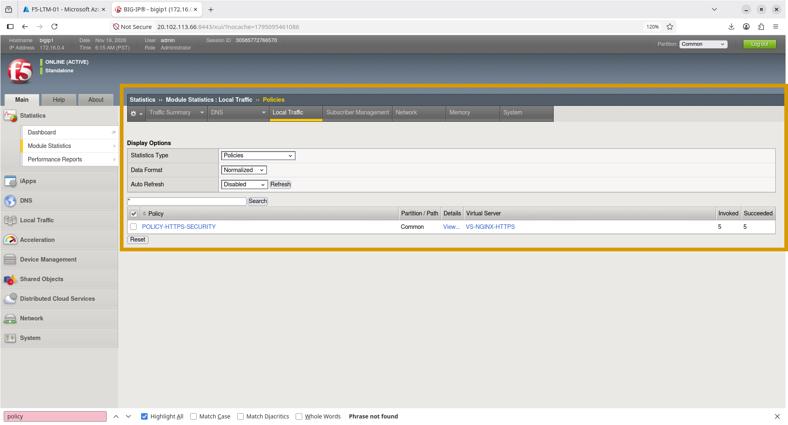

**Detailed Rule Breakdown**

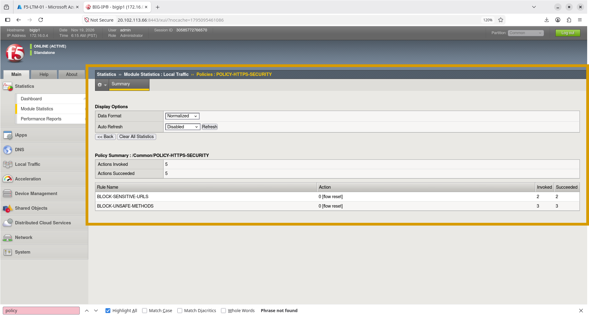 |

#### Exact Rule Execution Telemetry:
- **`BLOCK-SENSITIVE-URLS`:** `2 Invoked`, `2 Succeeded` (Matched `/admin` and `/private`)
- **`BLOCK-UNSAFE-METHODS`:** `3 Invoked`, `3 Succeeded` (Matched `TRACE` and `CONNECT` probes)

---

### 2. TMSH CLI Verification
Operational metrics can be queried from the command line using the Traffic Management Shell (TMSH):

```bash
azureuser@(localhost)(tmos)# show ltm policy POLICY-HTTPS-SECURITY
```

#### CLI Output:
```text
-------------------------------------
Ltm::Policy: POLICY-HTTPS-SECURITY
-------------------------------------
Virtual Server Name   N/A

Status
  Actions invoked   :   5
  Actions succeeded :   5

--------------------------------------------------
| Rule                 Action         Invoked Succeeded
--------------------------------------------------
| BLOCK-SENSITIVE-URLS 0 [flow reset] 2       2
| BLOCK-UNSAFE-METHODS 0 [flow reset] 3       3
```

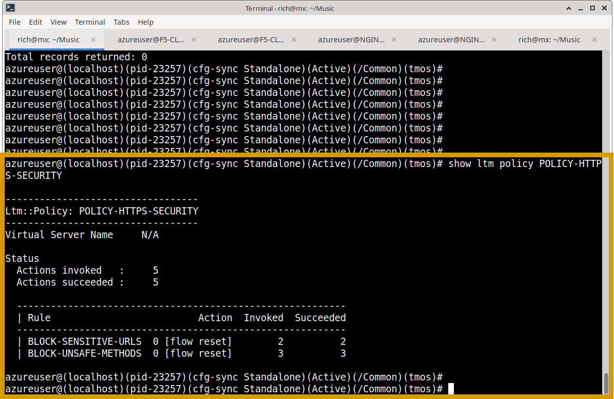

---

## Phase 6: Wire-Level Packet Analysis (`policies.pcap`)

A packet capture was captured during test execution to inspect the exact wire behavior of the TCP reset action.

Capture file reference: [policies.pcap](pcaps/policies.pcap)

### Wireshark Filter: `tcp.port == 443`

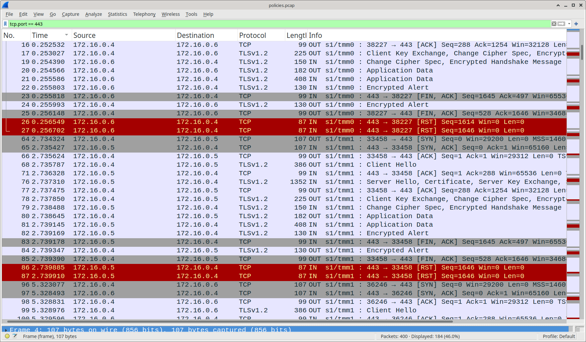

### Deep Packet Inspection:

1. **Client TLS Handshake:** Frames 17–20 show TLSv1.2 completing between client `172.16.0.8` and VIP `172.16.0.7:443`.
2. **HTTP Request Arrival:** Frame 21 transmits the encrypted `Application Data` (the `/admin` or `TRACE` request).
3. **Immediate Kernel TCP Reset:** Frames 26–27 show `[RST]` issued **from `172.16.0.7:443` → `172.16.0.8`** — connection killed at the edge before any backend packet is generated.

---

### What's Next?

With comprehensive Layer 7 security policies and attack mitigation fully validated, the next step is to optimize how traffic is distributed among those healthy nodes based on real-time server load rather than static algorithms.

Continue to the next module to explore dynamic load balancing:
- **[Dynamic Load Balancing & Least Connections Algorithm](../least-connections/)** – Configuring adaptive traffic distribution to prevent backend hot-spotting and ensure equitable connection handling under asymmetrical workloads.
