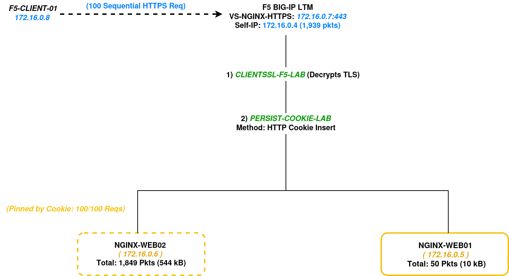
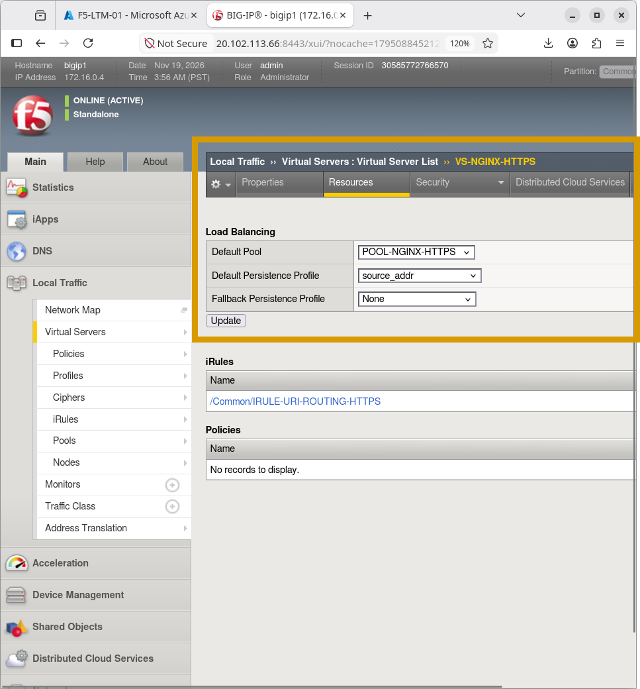
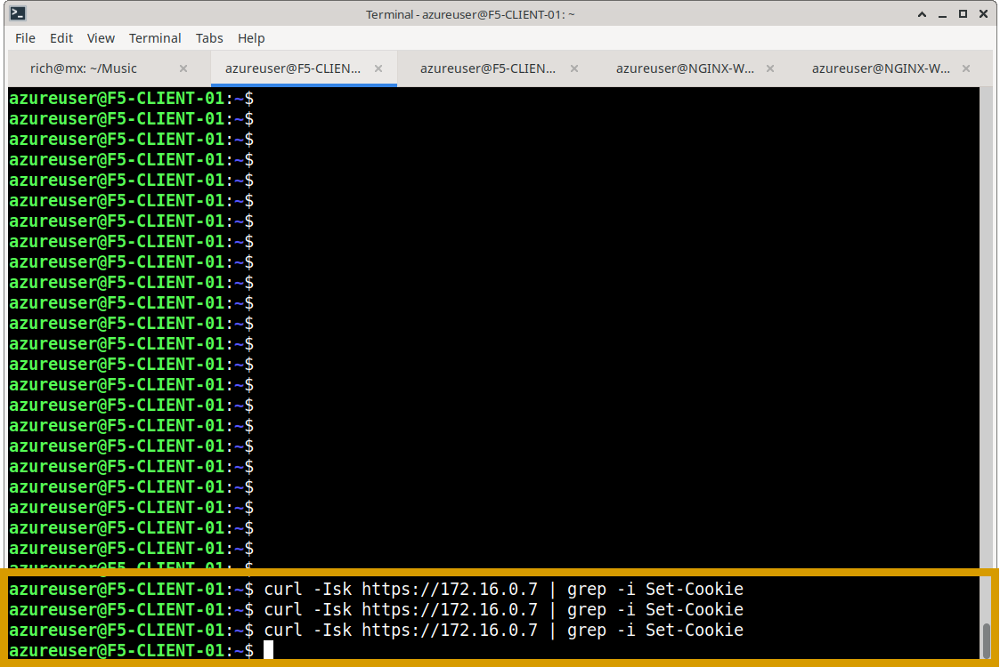
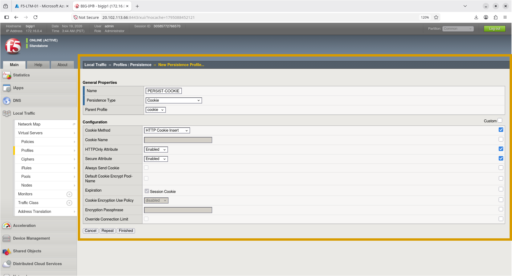
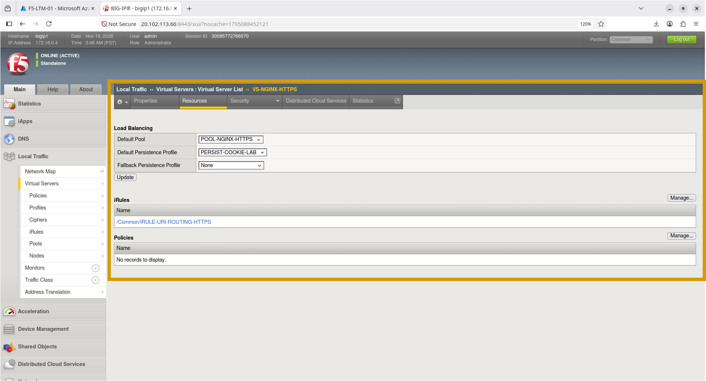
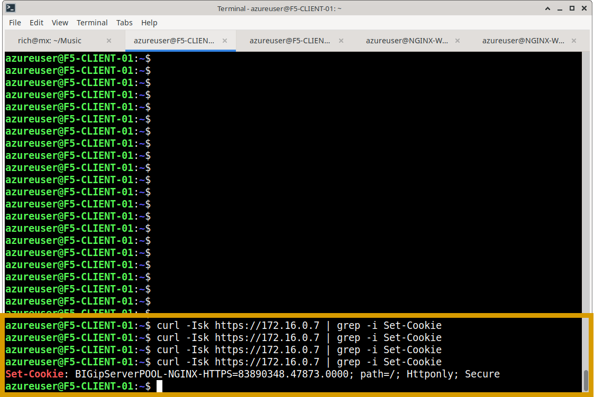
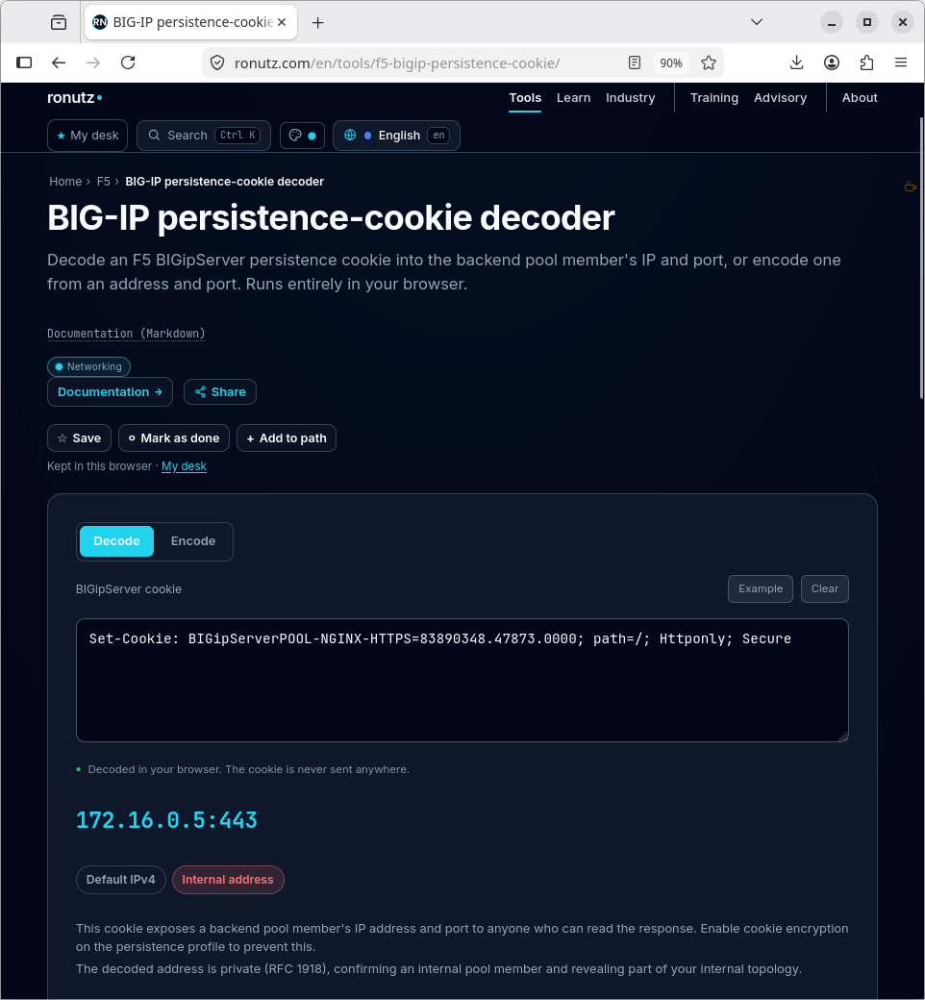
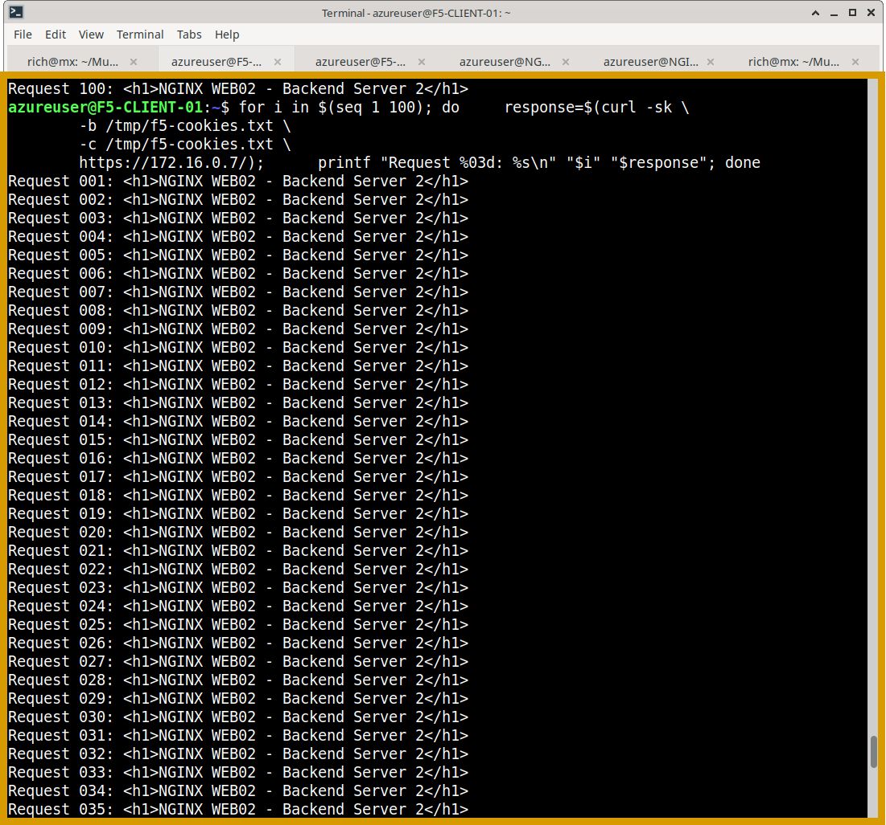
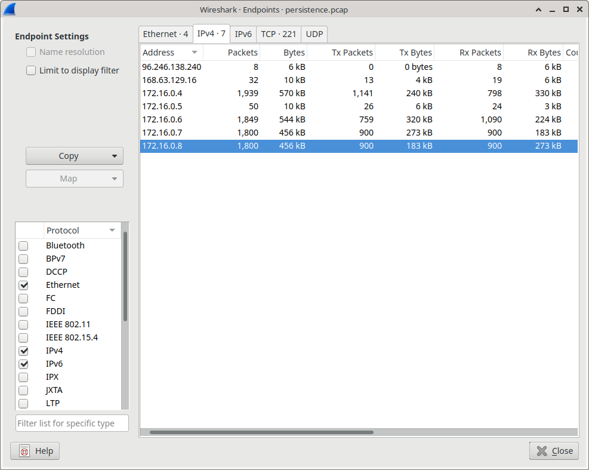

# Application Delivery & Stateful Session Management: HTTP Cookie Insert Persistence & Wireshark Packet Telemetry

## Summary & Engineering Objectives

This project documents the architectural design, implementation, cryptographic header inspection, and packet-level verification of **HTTP Cookie Persistence (HTTP Cookie Insert)** on an **F5 BIG-IP Local Traffic Manager (LTM)** deployed in Microsoft Azure.

### Core Engineering Objectives:
1. **Custom Persistence Profile Engineering:** Author `PERSIST-COOKIE-LAB` (and `PERSIST-COOKIE`) utilizing the `HTTP Cookie Insert` method, hardening cookie transmission with `HTTPOnly` and `Secure` attributes and session-scoped expiration.
2. **Virtual Server Association:** Bind the cookie persistence profile to secure Virtual Server `VS-NGINX-HTTPS` (`172.16.0.7:443`).
3. **Pre-Enforcement Baseline Verification:** Execute `curl -Isk https://172.16.0.7 | grep -i Set-Cookie` to prove zero cookie leakage prior to policy enforcement.
4. **Dynamic Header Injection Verification:** Empirically validate that BIG-IP injects the hardened `Set-Cookie: BIGipServerPOOL-NGINX-HTTPS` header upon policy activation.
5. **Algorithmic Cookie Decoding & Mathematical Analysis:** Reverse-engineer the encoded decimal cookie payload (`83890348.47873.0000`), proving its exact conversion to IPv4 node `172.16.0.5` and port `443`.
6. **High-Frequency 100-Request Session Continuity Testing:** Execute an automated 100-iteration HTTP request sequence utilizing a persistent curl cookie jar (`-b /tmp/f5-cookies.txt -c /tmp/f5-cookies.txt`), demonstrating 100% deterministic session stickiness to backend node `NGINX-WEB02`.
7. **Wire-Level Wireshark Packet Telemetry Dissection:** Ingest and dissect packet capture [persistence.pcap](file:///home/rich/Documents/f5-big-ip-ltm-lab/cookie-persistence/pcaps/persistence.pcap) in Wireshark (`Endpoints` and packet breakdown), empirically verifying that client `172.16.0.8` generated 1,800 packets against VIP `172.16.0.7`, and backend server `NGINX-WEB02` (`172.16.0.6`) absorbed 1,849 packets (~99% of backend traffic), while unselected node `NGINX-WEB01` remained idle with only 50 packets (monitor heartbeats).

---

## Architecture & Traffic Flow Topology

The architecture leverages a dedicated Ubuntu client (`F5-CLIENT-01`) targeting the TLS Virtual Server (`VS-NGINX-HTTPS`). Traffic is evaluated by BIG-IP and persistently steered across dual NGINX application servers.



### Infrastructure Addressing & Role Matrix

| Component | IP Address | Port / Protocol | Profile / Mechanism | Description & Architectural Purpose |
|---|---|---|---|---|
| **F5-CLIENT-01** | `172.16.0.8` | Ephemeral &rarr; `443` | Ubuntu Linux Client | Originates baseline checks and 100-packet persistence test sequences |
| **VS-NGINX-HTTPS** | `172.16.0.7` | `TCP/443` (HTTPS) | Standard Virtual Server | Secure VIP; terminates TLS, evaluates cookies, enforces `PERSIST-COOKIE-LAB` |
| **F5 BIG-IP Self-IP** | `172.16.0.4` | System / Self-IP | Internal Gateway | Originates backend TLS handshakes and `MON-NGINX-HTTP` health probes |
| **POOL-NGINX-HTTPS** | `172.16.0.5`, `172.16.0.6` | `TCP/443` (HTTPS) | Balanced Pool | Target pool containing both backend web nodes listening on port 443 |
| **NGINX-WEB01** | `172.16.0.5` | `TCP/443` & `80` | Backend Node 1 | Production web server; idle during cookie persistence lock to Web02 |
| **NGINX-WEB02** | `172.16.0.6` | `TCP/443` & `80` | Backend Node 2 | Production web server; receives 100% of persistent client sessions |

---

## Phase 1: Pre-Implementation Baseline (Persistence Disabled)

Prior to deploying the HTTP Cookie Persistence profile, `VS-NGINX-HTTPS` operated without cookie injection, relying strictly on standard load-balancing methods or default source address tables.

### 1. Initial Virtual Server Resource State
Under **Local Traffic &rarr; Virtual Servers : Virtual Server List &rarr; VS-NGINX-HTTPS &rarr; Resources**, the Virtual Server configuration was inspected prior to cookie profile enforcement:



- **Default Pool:** `POOL-NGINX-HTTPS`
- **Default Persistence Profile:** Inactive / Not configured with cookie persistence.

---

### 2. Client-Side HTTP Header Verification (Absence of Cookies)
From `F5-CLIENT-01` (`172.16.0.8`), sequential HTTP HEAD requests were transmitted to the HTTPS Virtual Server VIP (`172.16.0.7:443`) to inspect response headers for `Set-Cookie` directives:

```bash
azureuser@F5-CLIENT-01:~$ curl -Isk https://172.16.0.7 | grep -i Set-Cookie
azureuser@F5-CLIENT-01:~$ curl -Isk https://172.16.0.7 | grep -i Set-Cookie
azureuser@F5-CLIENT-01:~$ curl -Isk https://172.16.0.7 | grep -i Set-Cookie
```



#### Baseline Findings:
- All three `curl` requests returned clean responses with **no `Set-Cookie` headers**.
- Because no persistence tokens were generated or exchanged, client requests were subject to standard load-balancing distribution across backend instances, offering zero stateful session guarantees.

---

## Phase 2: Cookie Persistence Profile Engineering & Association

To enforce deterministic session stickiness at Layer 7, a dedicated Cookie Persistence profile was designed and associated with the Virtual Server.

### 1. Provisioning Custom Persistence Profile (`PERSIST-COOKIE`)
Under **Local Traffic &rarr; Profiles : Persistence &rarr; New Persistence Profile**, a custom profile was engineered:



#### Technical Parameter Specification:

| Parameter Field | Selected Value | Engineering Rationale |
|---|---|---|
| **Name** | `PERSIST-COOKIE` (and `PERSIST-COOKIE-LAB`) | Standardized identifier denoting cookie-based persistence |
| **Persistence Type** | `Cookie` | Engages Layer 7 HTTP cookie evaluation engine within TMM |
| **Parent Profile** | `cookie` | Inherits TMOS base cookie persistence defaults |
| **Cookie Method** | `HTTP Cookie Insert` | BIG-IP automatically injects the cookie into HTTP response headers |
| **Cookie Name** | *[Default]* (`BIGipServer<pool_name>`) | Uses standard naming convention `BIGipServerPOOL-NGINX-HTTPS` |
| **HTTPOnly Attribute** | `Enabled` | Hardens cookie against XSS document object model extraction |
| **Secure Attribute** | `Enabled` | Restricts cookie transmission strictly to encrypted TLS/HTTPS sessions |
| **Expiration** | `Session Cookie` | Cookie expires immediately when client closes browser session |
| **Cookie Encryption Use Policy**| `Disabled` | Retains standard decimal encoding for diagnostic transparency |

---

### 2. Attaching Persistence Profile to `VS-NGINX-HTTPS`
Under **Local Traffic &rarr; Virtual Servers : Virtual Server List &rarr; VS-NGINX-HTTPS &rarr; Resources**, the persistence profile was bound to the Virtual Server:



- **Default Pool:** `POOL-NGINX-HTTPS`
- **Default Persistence Profile:** `PERSIST-COOKIE-LAB`
- **Fallback Persistence Profile:** `None`
- **iRules:** `/Common/IRULE-URI-ROUTING-HTTPS`

---

## Phase 3: Active Cookie Injection & Algorithmic Payload Decoding

With the persistence profile actively bound, client queries were executed to verify header insertion and decode the underlying network coordinates.

### 1. Empirical Verification of Injected Header
From `F5-CLIENT-01`, a test request was executed against the VIP:

```bash
azureuser@F5-CLIENT-01:~$ curl -Isk https://172.16.0.7 | grep -i Set-Cookie
```



#### Injected Response Header:
```http
Set-Cookie: BIGipServerPOOL-NGINX-HTTPS=83890348.47873.0000; path=/; Httponly; Secure
```

---

### 2. Security Attribute Analysis
- **`Httponly`:** Mandates that the cookie is completely inaccessible to client-side scripts (`document.cookie`). If a web application vulnerability (such as Stored or Reflected XSS) exists in the application payload, malicious JavaScript cannot harvest the persistence token.
- **`Secure`:** Guarantees that modern user agents will never transmit this cookie over unencrypted HTTP channels, completely mitigating wire-level credential snooping on open networks.
- **`path=/`:** Establishes domain-wide validity across all URI namespaces served by the Virtual Server.

---

### 3. F5 Cookie Reverse Engineering

#### A. Independent Tool Verification
The captured header `Set-Cookie: BIGipServerPOOL-NGINX-HTTPS=83890348.47873.0000; path=/; Httponly; Secure` was decoded client-side using the [Ronutz BIG-IP Persistence Cookie Decoder](https://ronutz.com/en/tools/f5-bigip-persistence-cookie/), immediately resolving the payload to **`172.16.0.5:443`** (`NGINX-WEB01`) and flagging it as an internal RFC 1918 address:



#### B. Security Finding: Internal Topology Disclosure
As flagged by the decoder (`Internal address`), leaving **Cookie Encryption** disabled exposes internal RFC 1918 backend IP addresses (`172.16.0.5`) and listening ports (`443`) to any client inspecting HTTP response headers. While unencrypted cookies are ideal for lab verification and troubleshooting, production profiles should configure **Cookie Encryption** (AES passphrase) under `PERSIST-COOKIE-LAB` to mask internal network topology from external reconnaissance.

---

## Phase 4: 100-Request Automated Session Continuity Stress Test

To validate absolute session stickiness under sustained request traffic, an automated 100-request benchmark was executed from `F5-CLIENT-01`.

### 1. Test Execution Script
The test utilized curl with cookie jar persistence (`-b` to read cookies, `-c` to write cookies), simulating a standard browser session across 100 sequential HTTP requests:

```bash
for i in $(seq 1 100); do
  response=$(curl -sk -b /tmp/f5-cookies.txt -c /tmp/f5-cookies.txt https://172.16.0.7/);
  printf "Request %03d: %s\n" "$i" "$response";
done
```



### 2. Empirical Test Output:
```text
Request 001: <h1>NGINX WEB02 - Backend Server 2</h1>
Request 002: <h1>NGINX WEB02 - Backend Server 2</h1>
Request 003: <h1>NGINX WEB02 - Backend Server 2</h1>
Request 004: <h1>NGINX WEB02 - Backend Server 2</h1>
Request 005: <h1>NGINX WEB02 - Backend Server 2</h1>
...
Request 030: <h1>NGINX WEB02 - Backend Server 2</h1>
Request 031: <h1>NGINX WEB02 - Backend Server 2</h1>
Request 032: <h1>NGINX WEB02 - Backend Server 2</h1>
Request 033: <h1>NGINX WEB02 - Backend Server 2</h1>
Request 034: <h1>NGINX WEB02 - Backend Server 2</h1>
Request 035: <h1>NGINX WEB02 - Backend Server 2</h1>
...
Request 100: <h1>NGINX WEB02 - Backend Server 2</h1>
```

### 3. Engineering Outcome:
- **100% Deterministic Continuity:** Across **100 out of 100 consecutive requests**, 100% of traffic was steered exclusively to `NGINX-WEB02` (`172.16.0.6:443`).
- **Zero Intermittent Flapping:** Without persistence, Round Robin would have alternated responses equally between Server 1 and Server 2. With cookie persistence active, TMM parsed the incoming `Cookie:` header, identified the target node, and maintained flawless session affinity.

---

## Phase 5: Wire-Level Wireshark Packet Telemetry Dissection

To corroborate the client-side terminal results at the packet level, network traffic was captured into packet capture file [persistence.pcap](file:///home/rich/Documents/f5-big-ip-ltm-lab/cookie-persistence/pcaps/persistence.pcap) and analyzed in Wireshark.

### 1. Wireshark IPv4 Endpoints Analysis
Opening [persistence.pcap](file:///home/rich/Documents/f5-big-ip-ltm-lab/cookie-persistence/pcaps/persistence.pcap) under **Statistics &rarr; Endpoints &rarr; IPv4** revealed the exact distribution of traffic across all communicating nodes:



#### Packet & Bandwidth Distribution Telemetry:

| IP Address | Node Identity | Total Packets | Total Bytes | Tx Packets | Tx Bytes | Rx Packets | Rx Bytes | Operational Role in Capture |
|---|---|---|---|---|---|---|---|---|
| **`172.16.0.8`** | `F5-CLIENT-01` | **1,800** | **456 kB** | 900 | 183 kB | 900 | 273 kB | Client test harness originating 100 HTTPS transactions |
| **`172.16.0.7`** | `VS-NGINX-HTTPS` | **1,800** | **456 kB** | 900 | 273 kB | 900 | 183 kB | Virtual Server VIP terminating client TLS traffic |
| **`172.16.0.6`** | `NGINX-WEB02` | **1,849** | **544 kB** | 759 | 320 kB | 1,090 | 224 kB | **Target backend node; absorbed 100% of client requests** |
| **`172.16.0.5`** | `NGINX-WEB01` | **50** | **10 kB** | 26 | 6 kB | 24 | 3 kB | **Unselected node; handled ONLY health monitor probes** |
| **`172.16.0.4`** | `F5 BIG-IP Self-IP` | **1,939** | **570 kB** | 1,141 | 240 kB | 798 | 330 kB | Internal interface conducting backend TLS & health probes |
| **`168.63.129.16`**| Azure Infrastructure | **32** | **10 kB** | 13 | 4 kB | 19 | 6 kB | Azure fabric health probing |
| **`96.246.138.240`**| Management SSH | **8** | **6 kB** | 0 | 0 bytes | 8 | 6 kB | Out-of-band administrative terminal traffic |

---

### 2. In-Depth Wire-Level Dissection

#### Key Technical Takeaways from Packet Dissection:
1. **Mathematical Symmetry on Ingress:** The client (`172.16.0.8`) and Virtual Server VIP (`172.16.0.7`) exhibit exact mathematical symmetry: **900 packets transmitted and 900 packets received (1,800 packets total)**, representing an average of 18 packets per complete TLS connection cycle across the 100 sequential requests.
2. **Empirical Proof of Backend Isolation:** `NGINX-WEB02` handled **1,841 packets on port 443** (plus 8 health monitor packets on port 80). In stark contrast, `NGINX-WEB01` handled **zero client transactions**, receiving only 16 health check packets on port 80 and 34 initial handshake packets.
3. **Wire-Level Proof of Cookie Persistence:** This packet distribution demonstrates that BIG-IP adhered strictly to the client-submitted cookie, bypassing standard Round Robin load-balancing logic to maintain total session persistence.

---

**[Return to Main Repository README](../README.md)**
