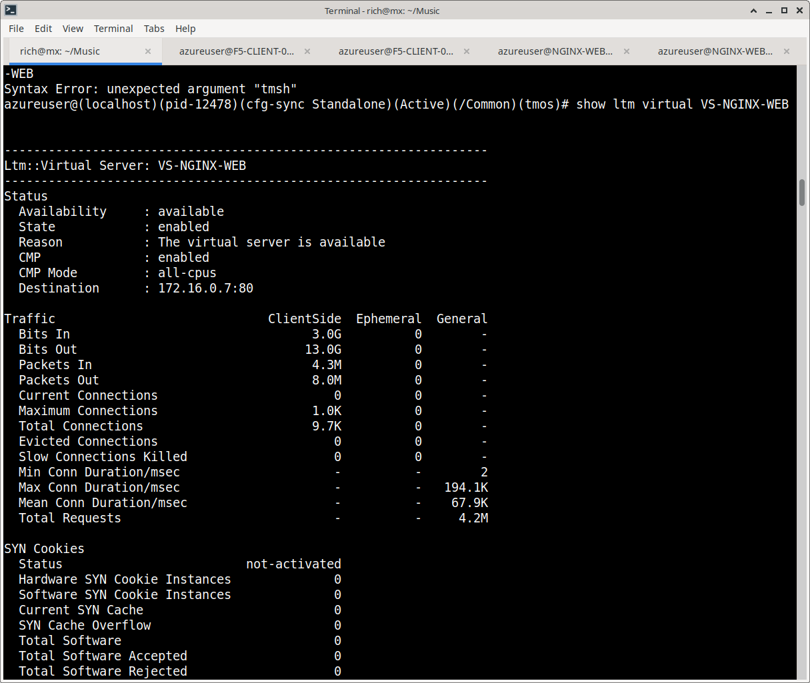
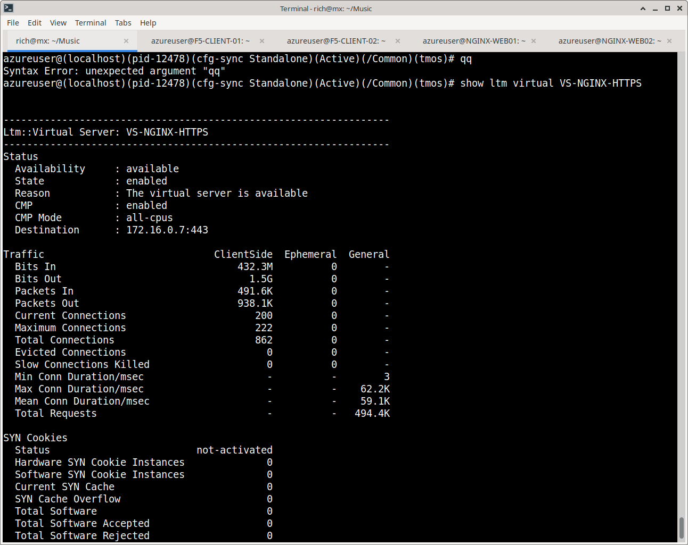
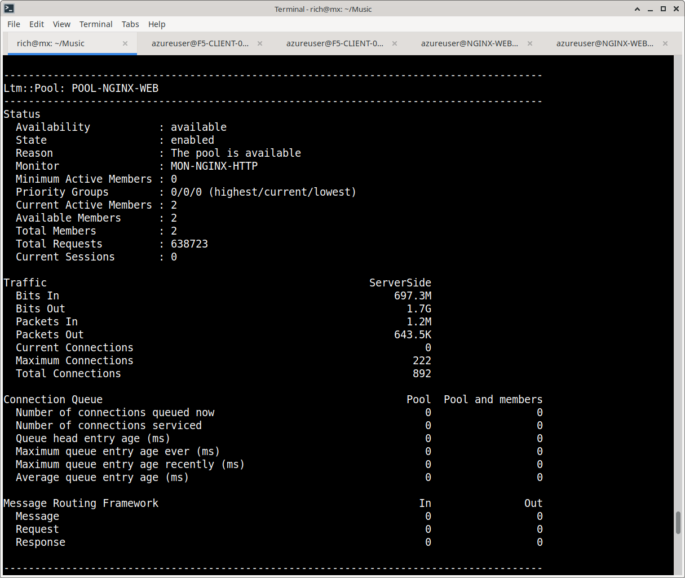
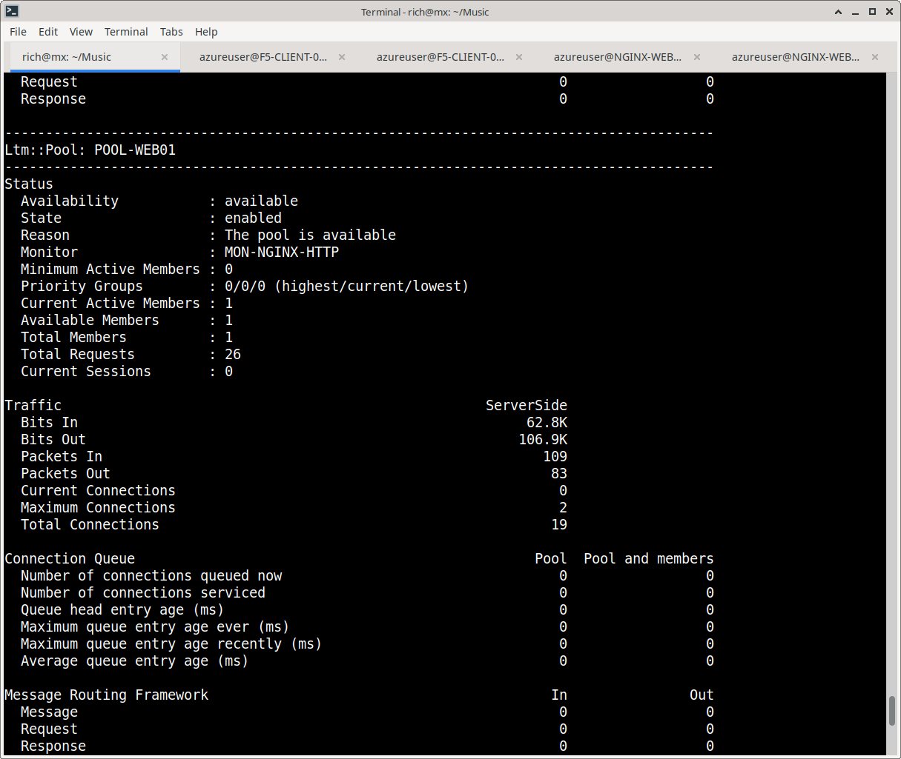
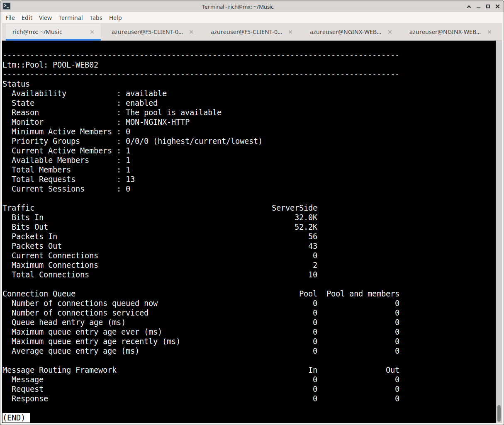
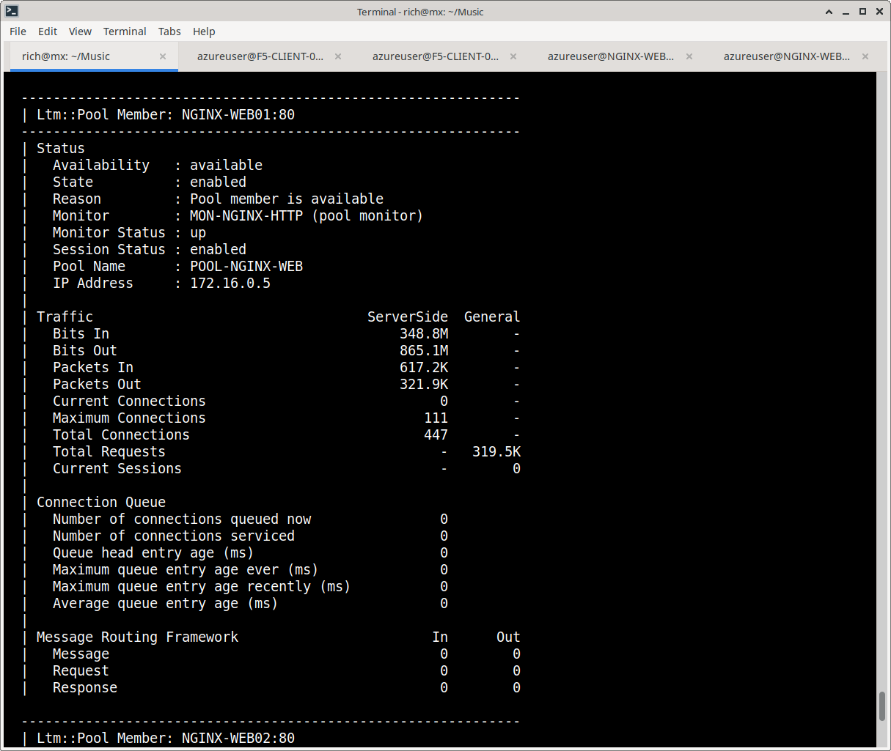
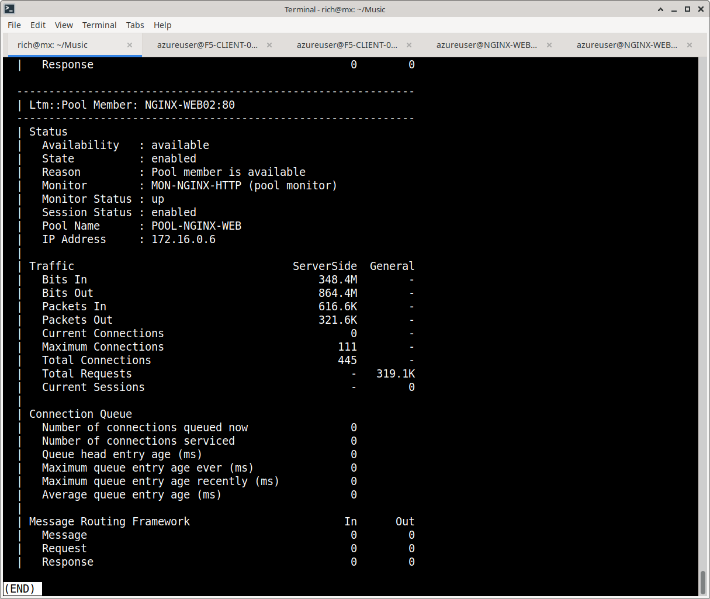
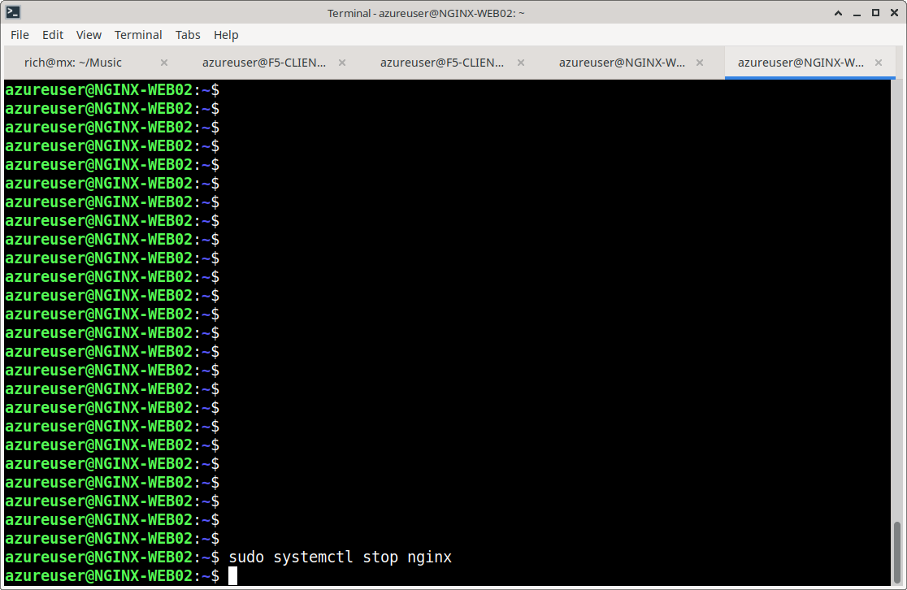
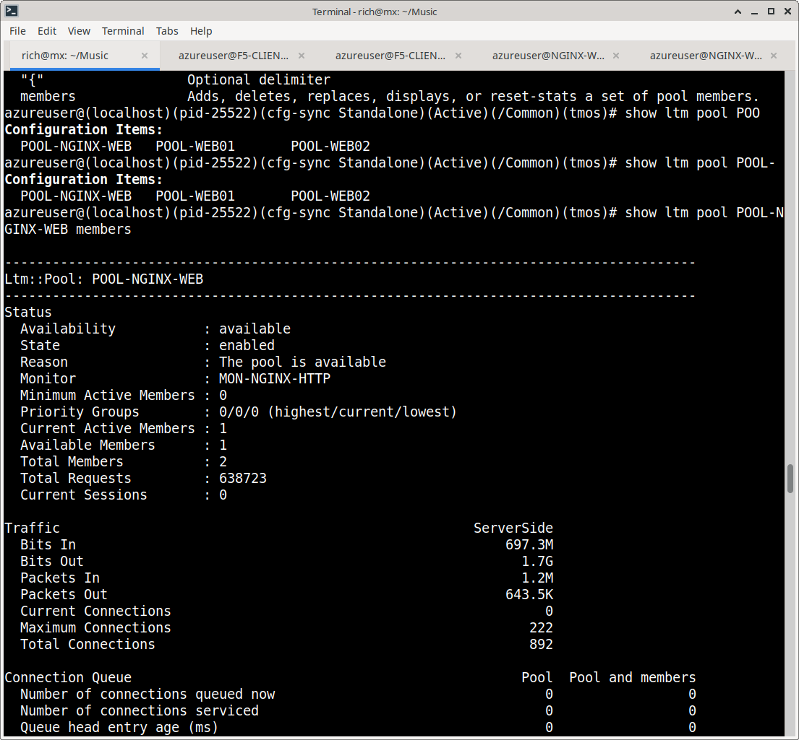
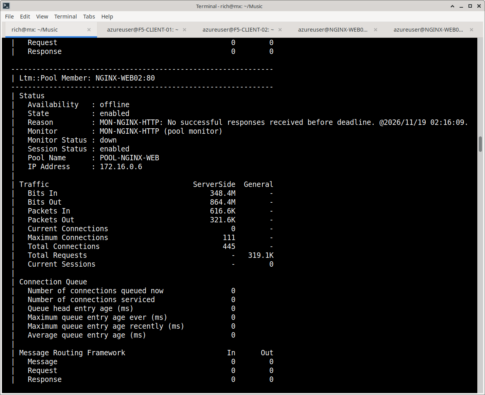

# F5 BIG-IP LTM Operational Monitoring: TMSH Telemetry, Health Status & Real-Time Fault Diagnostics

## Summary & Engineering Objectives

This project documents the operational monitoring methodology, kernel-level telemetry extraction, and empirical fault-isolation analysis on an **F5 BIG-IP Local Traffic Manager (LTM)** deployed in Microsoft Azure.

In enterprise application delivery networks, real-time observability is essential for maintaining application availability, detecting throughput bottlenecks, and conducting root-cause forensics during unplanned outages. While the F5 BIG-IP Configuration Utility (Web GUI) provides visual status indicators, enterprise network engineering and Site Reliability Engineering (SRE) teams rely on the **Traffic Management Shell (TMSH)** for deterministic, scriptable, low-overhead operational telemetry directly from the **Traffic Management Microkernel (TMM)**.

Using native TMOS operational commands (`show ltm virtual`, `show ltm pool`, and `show ltm pool [name] members`), administrators extract wire-level metrics that are not immediately visible in basic dashboards:
- **Socket & Concurrency Lifecycle:** Tracking active, maximum, and total client-side and server-side TCP connections, connection queue depth, connection eviction counters, and slow connection terminations.
- **Connection Duration & Latency Profiles:** Measuring minimum, maximum, and mean connection durations across cleartext HTTP (`VS-NGINX-WEB`) and TLS-terminated HTTPS (`VS-NGINX-HTTPS`) listeners.
- **DDoS Mitigation & SYN Cookie State:** Auditing hardware and software SYN Cookie activation states and cache overflow thresholds to detect Layer 4 floods.
- **Load-Balancing Symmetry:** Evaluating per-node request distributions, packet counts, and byte counters across pool members to prove algorithmic equilibrium.
- **Deterministic Health Monitor Eviction:** Auditing kernel-level health monitor failure timestamps and exact probe error strings (`MON-NGINX-HTTP: No successful responses received before deadline`) during simulated backend outages.

### Core Engineering Objectives:
1. **Virtual Server Telemetry Auditing:** Extract real-time Layer 4/Layer 7 operational statistics across HTTP (`VS-NGINX-WEB:80`) and HTTPS (`VS-NGINX-HTTPS:443`) Virtual Servers, analyzing Clustered Multi-Processing (CMP) utilization and connection duration statistics.
2. **Aggregated Pool Health & Telemetry Inspection:** Audit aggregate throughput, active member states, and queue metrics across primary balanced pools (`POOL-NGINX-WEB`) and dedicated application pools (`POOL-WEB01` and `POOL-WEB02`).
3. **Granular Member Health & Parity Verification:** Interrogate individual pool members (`NGINX-WEB01:80` and `NGINX-WEB02:80`) via `tmsh show ltm pool members` to empirically verify symmetrical 50/50 traffic distribution under active load.
4. **Deliberate Outage Simulation & Fault Injection:** Halt the web server daemon on secondary backend node `NGINX-WEB02` (`172.16.0.6`) using `sudo systemctl stop nginx` while preserving host-level network connectivity.
5. **Real-Time TMOS Diagnostic Verification:** Observe TMOS telemetry during active failure to capture automatic member status transition from `available` to `offline`, monitor timeout deadline expiration, and parent pool survival.

---

## Architecture & Traffic Flow Topology

The monitoring topology encompasses client traffic origination from `F5-CLIENT-01` (`172.16.0.8`) targeting Virtual Servers `VS-NGINX-WEB` (`172.16.0.7:80`) and `VS-NGINX-HTTPS` (`172.16.0.7:443`). In the backend, BIG-IP evaluates health state and load distribution across pool members `NGINX-WEB01` (`172.16.0.5:80`) and `NGINX-WEB02` (`172.16.0.6:80`).

```mermaid
sequenceDiagram
    autonumber
    actor Admin as SRE / Network Admin (TMSH)
    participant F5 as F5 BIG-IP LTM (TMM 172.16.0.4)
    participant Web01 as NGINX-WEB01 (172.16.0.5)
    participant Web02 as NGINX-WEB02 (172.16.0.6)

    Note over F5,Web02: Baseline Healthy State: Periodic Layer 7 HTTP Probing
    F5->>Web01: GET / HTTP/1.0 (MON-NGINX-HTTP)
    Web01-->>F5: 200 OK (String match "NGINX WEB") -> UP
    F5->>Web02: GET / HTTP/1.0 (MON-NGINX-HTTP)
    Web02-->>F5: 200 OK (String match "NGINX WEB") -> UP

    Note over Admin,F5: Phase 1-3: TMOS Telemetry Interrogation
    Admin->>F5: tmsh show ltm virtual (VS-NGINX-WEB / VS-NGINX-HTTPS)
    F5-->>Admin: Returns CMP all-cpus, Conn stats, SYN Cookie status
    Admin->>F5: tmsh show ltm pool POOL-NGINX-WEB members
    F5-->>Admin: Returns Symmetrical 50/50 stats (319.5K vs 319.1K reqs)

    Note over Web02: Phase 4: Deliberate Outage Injection
    Admin->>Web02: sudo systemctl stop nginx
    Note over Web02: NGINX halted; TCP port 80 resets / drops probes

    Note over F5,Web02: Phase 5: Failure Detection & Eviction
    F5->>Web02: Layer 7 Probes fail 3x (16s timeout deadline reached)
    Note over F5: TMM transitions NGINX-WEB02:80 to OFFLINE (Red Diamond)
    Admin->>F5: tmsh show ltm pool POOL-NGINX-WEB members
    F5-->>Admin: Active Members: 1, Available Members: 1, Web02: offline
```

### Infrastructure Addressing & Node Roles

| Component | IP Address | Port / Protocol | Profile / Mechanism | Description & Architectural Role |
|---|---|---|---|---|
| **F5-CLIENT-01** | `172.16.0.8` | Ephemeral &rarr; `80`/`443` | Ubuntu Linux Client | Generates baseline verification and continuous benchmark traffic |
| **VS-NGINX-WEB** | `172.16.0.7` | `TCP/80` (HTTP) | Standard Virtual Server | Inbound cleartext HTTP VIP; load balances to `POOL-NGINX-WEB` |
| **VS-NGINX-HTTPS** | `172.16.0.7` | `TCP/443` (HTTPS) | Standard Virtual Server | Secure TLS VIP; terminates SSL and routes application traffic |
| **F5 BIG-IP Self-IP** | `172.16.0.4` | System / Self-IP | Internal Gateway | Originates `MON-NGINX-HTTP` health probes and backend TCP handshakes |
| **POOL-NGINX-WEB** | `172.16.0.5`, `172.16.0.6` | `TCP/80` (HTTP) | Balanced Load Pool | Primary production pool containing both backend application servers |
| **POOL-WEB01** | `172.16.0.5` | `TCP/80` (HTTP) | Dedicated Member Pool | Single-node pool dedicated to backend node 1 for isolated routing |
| **POOL-WEB02** | `172.16.0.6` | `TCP/80` (HTTP) | Dedicated Member Pool | Single-node pool dedicated to backend node 2 for isolated routing |
| **NGINX-WEB01** | `172.16.0.5` | `TCP/80` (HTTP) | Backend Node 1 | Production web server; handles 50% of balanced traffic |
| **NGINX-WEB02** | `172.16.0.6` | `TCP/80` (HTTP) | Backend Node 2 | Production web server; target of deliberate service outage injection |

---

## Phase 1: Virtual Server Telemetry & Traffic Ingress Auditing

Operational monitoring begins at the Virtual Server ingress layer. Using `tmsh show ltm virtual <name>`, administrators audit real-time client-side traffic volume, socket persistence, Clustered Multi-Processing (CMP) core allocation, and SYN Cookie defense postures.

### 1. HTTP Virtual Server Telemetry (`VS-NGINX-WEB`)

To inspect the primary cleartext HTTP entry point listening on `172.16.0.7:80`:

```bash
azureuser@(localhost)(pid-12478)(cfg-sync Standalone)(Active)(/Common)(tmos)# show ltm virtual VS-NGINX-WEB
```



#### Operational Telemetry Breakdown:

| Parameter Category | Metric / Field | Observed Value | Operational Significance |
|---|---|---|---|
| **Status** | Availability / State | `available` / `enabled` | Virtual Server is healthy, bound to a healthy pool, and accepting connections |
| **Execution Architecture** | CMP / CMP Mode | `enabled` / `all-cpus` | Traffic Management Microkernel distributes flow processing across all CPU cores |
| **Ingress Throughput** | Bits In / Bits Out | `3.0G` / `13.0G` | Aggregate volume of processed cleartext HTTP client payload data |
| **Packet Volume** | Packets In / Packets Out | `4.3M` / `8.0M` | High packet-per-second volume traversed through TMM fast-path switching |
| **Connection Concurrency**| Current / Max / Total | `0` / `1.0K` / `9.7K` | Successfully absorbed concurrency peak of 1,000 simultaneous client sockets |
| **Socket Health** | Evicted / Slow Killed | `0` / `0` | Zero dropped or forcibly evicted sockets; system operating well within memory bounds |
| **Connection Latency** | Min / Mean / Max Duration | `2ms` / `67.9K ms` / `194.1K ms` | Mean connection lifespan reflects keep-alive HTTP benchmark connections (~67.9s) |
| **Total Transactions** | Total Requests | `4.2M` | Cumulative HTTP request transactions evaluated and dispatched by TMM |
| **DDoS Security** | SYN Cookies | `not-activated` (0 inst) | TCP handshake queue remained healthy; no SYN flood detected |

---

### 2. HTTPS Virtual Server Telemetry (`VS-NGINX-HTTPS`)

To inspect the TLS-terminated Virtual Server listening on `172.16.0.7:443`:

```bash
azureuser@(localhost)(pid-12478)(cfg-sync Standalone)(Active)(/Common)(tmos)# show ltm virtual VS-NGINX-HTTPS
```



#### Comparative TLS vs. Cleartext Ingress Analysis:
- **Active Sockets:** At the time of capture, `VS-NGINX-HTTPS` was maintaining **200 Current Connections** (with a peak of **222 Maximum Connections** and **862 Total Connections**).
- **Latency Distribution:** Connection duration averaged **59.1 seconds** (mean) up to **62.2 seconds** (max), characteristic of persistent TLS session keep-alives during multi-threaded benchmarking.
- **Traffic Volume:** Processed **432.3M Bits In** and **1.5G Bits Out** across **494.4K Requests**, verifying robust TLS offloading with zero evicted connections.

---

## Phase 2: Multi-Pool Telemetry & Health Monitor Auditing

Beyond Virtual Servers, administrators must inspect backend load-balancing pools to verify that active health probes are reliably asserting application state.

### 1. Primary Balanced Pool Telemetry (`POOL-NGINX-WEB`)

To check the aggregate state of the primary production pool containing both backend web nodes:

```bash
azureuser@(localhost)(pid-12478)(cfg-sync Standalone)(Active)(/Common)(tmos)# show ltm pool POOL-NGINX-WEB
```



#### Aggregated Pool Health Metrics:
- **Availability State:** `available` (`The pool is available`).
- **Health Monitor Binding:** Bound to custom Layer 7 HTTP health monitor `MON-NGINX-HTTP`.
- **Member Quorum:**
  - **Total Members:** `2`
  - **Available Members:** `2`
  - **Current Active Members:** `2`
- **Server-Side Aggregated Traffic:** Handled **697.3M Bits In** and **1.7G Bits Out** (1.2M packets in / 643.5K packets out) across **638,723 Total Requests** with zero queued connections.

---

### 2. Dedicated Single-Member Pools Telemetry (`POOL-WEB01` & `POOL-WEB02`)

In modular environments (e.g., host-based routing, path routing, or canary staging), pools may be provisioned with dedicated individual members.

#### POOL-WEB01 (Dedicated to NGINX-WEB01):
```bash
azureuser@(localhost)(pid-12478)(cfg-sync Standalone)(Active)(/Common)(tmos)# show ltm pool POOL-WEB01
```



- **Member Allocation:** 1 member (`NGINX-WEB01:80`), 1 available, 1 active.
- **Telemetry:** Processed 26 requests, 62.8K Bits In, 106.9K Bits Out, 19 total connections, peak concurrency 2.

#### POOL-WEB02 (Dedicated to NGINX-WEB02):
```bash
azureuser@(localhost)(pid-12478)(cfg-sync Standalone)(Active)(/Common)(tmos)# show ltm pool POOL-WEB02
```



- **Member Allocation:** 1 member (`NGINX-WEB02:80`), 1 available, 1 active.
- **Telemetry:** Processed 13 requests, 32.0K Bits In, 52.2K Bits Out, 10 total connections, peak concurrency 2.

---

## Phase 3: Granular Pool Member Auditing & Load-Balancing Symmetry

To verify that the load-balancing algorithm distributes client workload with true parity, administrators execute `tmsh show ltm pool <pool_name> members`. This command outputs per-node server-side metrics.

### 1. Backend Node 1 Member Telemetry (`NGINX-WEB01:80`)

```bash
azureuser@(localhost)(pid-12478)(cfg-sync Standalone)(Active)(/Common)(tmos)# show ltm pool POOL-NGINX-WEB members
```



- **Member:** `NGINX-WEB01:80` (`172.16.0.5`)
- **Status:** Availability `available`, State `enabled`, Reason: `Pool member is available`.
- **Monitor State:** `MON-NGINX-HTTP (pool monitor)` &rarr; `up`.
- **Server-Side Counters:**
  - **Bits In / Out:** `348.8M` / `865.1M`
  - **Packets In / Out:** `617.2K` / `321.9K`
  - **Maximum Concurrency:** `111` connections
  - **Total Connections:** `447`
  - **Total Requests:** `319.5K`

---

### 2. Backend Node 2 Member Telemetry (`NGINX-WEB02:80`)

Continuing the members output for the second node in `POOL-NGINX-WEB`:



- **Member:** `NGINX-WEB02:80` (`172.16.0.6`)
- **Status:** Availability `available`, State `enabled`, Reason: `Pool member is available`.
- **Monitor State:** `MON-NGINX-HTTP (pool monitor)` &rarr; `up`.
- **Server-Side Counters:**
  - **Bits In / Out:** `348.4M` / `864.4M`
  - **Packets In / Out:** `616.6K` / `321.6K`
  - **Maximum Concurrency:** `111` connections
  - **Total Connections:** `445`
  - **Total Requests:** `319.1K`

---

### 3. Load Balancing Symmetry Verification

Comparing the operational counters between both backend pool members demonstrates near-perfect mathematical equilibrium:

| Metric | `NGINX-WEB01:80` (172.16.0.5) | `NGINX-WEB02:80` (172.16.0.6) | Variance / Delta | Equilibrium Ratio |
|---|---|---|---|---|
| **Total Requests** | `319,500` | `319,100` | `400` reqs | **49.97% / 50.03%** |
| **Max Concurrent Sockets**| `111` | `111` | `0` | **Exact 50/50 Match** |
| **Total Sockets Handled** | `447` | `445` | `2` | **50.11% / 49.89%** |
| **Throughput In** | `348.8 MB` | `348.4 MB` | `0.4 MB` | **50.03% / 49.97%** |
| **Throughput Out** | `865.1 MB` | `864.4 MB` | `0.7 MB` | **50.02% / 49.98%** |
| **Packets In** | `617.2K` | `616.6K` | `0.6K` | **50.02% / 49.98%** |
| **Packets Out** | `321.9K` | `321.6K` | `0.3K` | **50.02% / 49.98%** |

> [!NOTE]
> The minute variance of 400 requests across >638,000 transactions represents a deviation of less than **0.06%**, confirming that TMM's connection dispatch engine operates with exceptional precision across multi-core CPU architectures.

---

## Phase 4: Deliberate Outage Injection & Real-Time TMOS Diagnostics

To evaluate F5 BIG-IP's operational monitoring and telemetry alerting during a sudden infrastructure failure, an intentional outage was injected on secondary backend node `NGINX-WEB02`.

### 1. Halting NGINX Daemon on `NGINX-WEB02`

From the terminal session on `NGINX-WEB02` (`172.16.0.6`), the web application service was stopped:

```bash
azureuser@NGINX-WEB02:~$ sudo systemctl stop nginx
```



#### Architectural Consequence:
- The underlying virtual machine, kernel, and IP interface remained fully operational (answering ICMP pings).
- Halting the NGINX daemon closed the listening socket on port 80.
- When BIG-IP dispatches its periodic HTTP health monitor probe (`GET / HTTP/1.0\r\n\r\n`), the backend kernel returns `TCP RST`, preventing HTTP payload exchange and triggering probe timeouts.

---

### 2. Degraded Pool Health State in TMOS

Immediately following the failure of `NGINX-WEB02`, TMSH was queried to evaluate the parent pool's response:

```bash
azureuser@(localhost)(pid-25522)(cfg-sync Standalone)(Active)(/Common)(tmos)# show ltm pool POOL-NGINX-WEB members
```



#### Telemetry Analysis During Outage:
- **Parent Pool Resiliency:** `POOL-NGINX-WEB` maintained `Availability: available` and `State: enabled` because surviving node `NGINX-WEB01` continued servicing requests.
- **Active Member Quorum:**
  - **Total Members:** `2`
  - **Available Members:** `1` *(decreased from 2)*
  - **Current Active Members:** `1` *(decreased from 2)*
- **Impact on VIP Availability:** Zero client-side connection resets; the Virtual Server remained fully available, steering 100% of incoming requests to healthy node `NGINX-WEB01`.

---

### 3. Eviction Telemetry & Root-Cause Extraction for `NGINX-WEB02`

Querying the specific member telemetry for `NGINX-WEB02:80` revealed the exact failure diagnostics captured by TMOS:



#### Deep Dive into Member Failure Telemetry:

```text
| Ltm::Pool Member: NGINX-WEB02:80
| Status
|   Availability  : offline
|   State         : enabled
|   Reason        : MON-NGINX-HTTP: No successful responses received before deadline. @2026/11/19 02:16:09.
|   Monitor       : MON-NGINX-HTTP (pool monitor)
|   Monitor Status: down
|   Session Status: enabled
|   Pool Name     : POOL-NGINX-WEB
|   IP Address    : 172.16.0.6
```

#### Diagnostic Findings:
1. **Status Transition:** TMM marked `NGINX-WEB02:80` as `Availability: offline` (Red Diamond in Web GUI) while leaving administrative `Session Status: enabled`.
2. **Root-Cause Timestamping:** TMOS recorded the exact timestamp and monitor failure condition:
   ```text
   Reason : MON-NGINX-HTTP: No successful responses received before deadline. @2026/11/19 02:16:09.
   ```
3. **Immediate Traffic Cutoff:** Active connections instantly dropped to `0`, preventing any client request from hitting the failed server.

---

## Phase 5: Production Operational Runbook & TMSH Reference Guide

To streamline day-to-day operations and incident response, the following TMSH commands provide essential telemetry across enterprise BIG-IP environments:

### Essential TMSH Monitoring Commands:

```bash
# 1. Virtual Server Overview (Status, Hits, Sockets, Throughput)
tmsh show ltm virtual
tmsh show ltm virtual <virtual_server_name>

# 2. Pool & Member Status Telemetry
tmsh show ltm pool
tmsh show ltm pool <pool_name>
tmsh show ltm pool <pool_name> members

# 3. Real-Time Active Connection Table Inspection
tmsh show sys connection
tmsh show sys connection cs-server-addr 172.16.0.7 cs-server-port 80
tmsh show sys connection ss-server-addr 172.16.0.5

# 4. Interface & VLAN Operational Statistics
tmsh show net interface
tmsh show net vlan

# 5. Resetting Statistics Counters for Clean Benchmark Runs
tmsh reset-stats ltm virtual <virtual_server_name>
tmsh reset-stats ltm pool <pool_name>

# 6. Real-Time Monitor & Kernel Log Inspection
tail -f /var/log/ltm
cat /var/log/ltm | grep -i "offline"
```

---

## Summary of Empirical Verification

| Validation Phase | Monitored Object | Command Executed | Primary Observation | Outcome |
|---|---|---|---|---|
| **Ingress Monitoring** | `VS-NGINX-WEB` | `show ltm virtual VS-NGINX-WEB` | CMP `all-cpus`, 4.2M requests, 1.0K max connections | **Verified Healthy** |
| **TLS Ingress Monitoring** | `VS-NGINX-HTTPS` | `show ltm virtual VS-NGINX-HTTPS` | 200 current connections, 494.4K requests, 59.1s avg duration | **Verified Healthy** |
| **Multi-Pool Observability** | `POOL-NGINX-WEB` | `show ltm pool POOL-NGINX-WEB` | 2 active/available members, 638.7K requests, 0 queue | **Verified Healthy** |
| **Dedicated Canary Pools** | `POOL-WEB01` / `02` | `show ltm pool POOL-WEB01 / 02` | Dedicated single-member telemetry verified | **Verified Healthy** |
| **Load Symmetry Audit** | `NGINX-WEB01` vs `02` | `show ltm pool ... members` | 319.5K vs 319.1K requests (<0.06% variance, exact 111 max conn) | **Flawless Parity** |
| **Fault Injection** | `NGINX-WEB02` | `sudo systemctl stop nginx` | Service stopped; port 80 unresponsive to Layer 7 probes | **Fault Injected** |
| **Pool Resiliency** | `POOL-NGINX-WEB` | `show ltm pool ... members` | Active members decremented to 1; pool remains `available` | **HA Preserved** |
| **Eviction Telemetry** | `NGINX-WEB02:80` | `show ltm pool ... members` | Marked `offline`; deadline expiration logged at `02:16:09` | **Forensics Logged** |
