# Advanced Application Delivery: Layer 7 Host-Based Routing (Multi-Tenancy) via iRules

## Summary & Engineering Objectives

This project documents the architectural design, implementation, packet-level validation, and fault-isolation testing of **Layer 7 Host-Based Routing** on an **F5 BIG-IP Local Traffic Manager (LTM)** deployed in Microsoft Azure.

Modern cloud and enterprise architectures frequently require hosting multiple distinct applications or microservices behind a unified public entry point. Deploying dedicated Virtual Servers, public IP addresses, and firewall allocations for every individual application results in address exhaustion, increased operational overhead, and elevated cloud infrastructure costs. 

To solve this, Layer 7 Host-Based Routing inspects the HTTP `Host:` header sent by the client within the decrypted TLS session. Using F5 BIG-IP's high-speed **Traffic Management Microkernel (TMM)**, a single Virtual Server (`VS-NGINX-HTTPS`) terminates TLS, evaluates the requested Fully Qualified Domain Name (FQDN), and dynamically steers client requests to dedicated backend pools:
- Requests for `app1.f5-lab.local` are directed to `POOL-APP1-HTTPS` (serviced by `NGINX-WEB01`).
- Requests for `app2.f5-lab.local` are directed to `POOL-APP2-HTTPS` (serviced by `NGINX-WEB02`).
- Requests with unknown or malformed hostnames are intercepted at the ADC perimeter and immediately rejected with an RFC-compliant `HTTP 404 Not Found` response, shielding backend servers from illegitimate traffic.

### Core Engineering Objectives:
1. **Dedicated Pool Architecture:** Provision independent HTTPS backend pools (`POOL-APP1-HTTPS` and `POOL-APP2-HTTPS`) bound to active health monitor `MON-NGINX-HTTPS`.
2. **Layer 7 iRule Engineering:** Author `IRULE-HOST-BASED-ROUTING` utilizing `HTTP::host`, `string tolower`, and `switch -glob` logic to enforce deterministic pool selection and edge-level 404 rejection.
3. **Multi-Domain Virtual Server Binding:** Attach the routing iRule to Virtual Server `VS-NGINX-HTTPS` (`172.16.0.7:443`).
4. **Client Name Resolution Simulation:** Configure static `/etc/hosts` mappings on `F5-CLIENT-01` (`172.16.0.8`) pointing both FQDNs to the shared VIP.
5. **Decrypted Packet Inspection & Wireshark Dissection:** Capture and analyze packet capture [host-based.pcap](file:///home/rich/Documents/f5-big-ip-ltm-lab/host-based-routing/pcaps/host-based.pcap) in Wireshark with TLS pre-master secret decryption, verifying HTTP `Host:` header evaluation and F5 Ethernet Trailer ingress/egress metadata.
6. **Kernel Telemetry Verification:** Inspect TMOS hardware execution counters (`show ltm rule IRULE-HOST-BASED-ROUTING` and `show ltm pool`), proving sub-50K CPU cycle overhead per transaction.
7. **Multi-Tenant Fault Isolation Testing:** Inject an intentional service failure on `NGINX-WEB01` (`sudo systemctl stop nginx`) to empirically prove that an outage on Application 1 has **zero impact** on Application 2.

---

## Architecture & Traffic Flow Topology

The architecture leverages a single VIP (`172.16.0.7:443`) terminating TLS connections from `F5-CLIENT-01` (`172.16.0.8`). Once the TLS handshake completes, TMM parses the HTTP request headers, matches the `Host:` header, and dispatches the request to the corresponding backend application pool.

```mermaid
sequenceDiagram
    autonumber
    actor Client as F5-CLIENT-01 (172.16.0.8)
    participant F5 as F5 BIG-IP (VS-NGINX-HTTPS 172.16.0.7)
    participant Pool1 as POOL-APP1-HTTPS (NGINX-WEB01 172.16.0.5)
    participant Pool2 as POOL-APP2-HTTPS (NGINX-WEB02 172.16.0.6)

    Note over Client,F5: Scenario A: Routing to Application 1
    Client->>F5: TLS Handshake (SNI: app1.f5-lab.local)
    F5-->>Client: TLS Established (Certificate Validated)
    Client->>F5: GET / HTTP/1.1 (Host: app1.f5-lab.local)
    Note over F5: IRULE-HOST-BASED-ROUTING evaluates [HTTP::host]<br/>Matches "app1.f5-lab.local" -> POOL-APP1-HTTPS
    F5->>Pool1: HTTPS GET / (Forwarded to 172.16.0.5:443)
    Pool1-->>F5: HTTP 200 OK (NGINX WEB01 payload)
    F5-->>Client: HTTP 200 OK (NGINX WEB01 - Backend Server 1)

    Note over Client,F5: Scenario B: Routing to Application 2
    Client->>F5: GET / HTTP/1.1 (Host: app2.f5-lab.local)
    Note over F5: IRULE-HOST-BASED-ROUTING evaluates [HTTP::host]<br/>Matches "app2.f5-lab.local" -> POOL-APP2-HTTPS
    F5->>Pool2: HTTPS GET / (Forwarded to 172.16.0.6:443)
    Pool2-->>F5: HTTP 200 OK (NGINX WEB02 payload)
    F5-->>Client: HTTP 200 OK (NGINX WEB02 - Backend Server 2)

    Note over Client,F5: Scenario C: Unknown Hostname Rejection
    Client->>F5: GET / HTTP/1.1 (Host: unrecognized.domain.com)
    Note over F5: Host matches "default" condition<br/>HTTP::respond 404 content "Unknown application hostname"
    F5-->>Client: HTTP/1.1 404 Not Found (Edge synthesized; backend isolated)

    Note over Client,Pool2: Scenario D: Tenant Fault Isolation (WEB01 Stopped)
    Note over Pool1: Service halted: sudo systemctl stop nginx
    Note over F5: MON-NGINX-HTTPS marks POOL-APP1-HTTPS OFFLINE
    Client->>F5: GET / (Host: app1.f5-lab.local)
    F5-->>Client: Connection reset by peer (Pool offline)
    Client->>F5: GET / (Host: app2.f5-lab.local)
    F5->>Pool2: Forwarded to POOL-APP2-HTTPS
    Pool2-->>F5: HTTP 200 OK
    F5-->>Client: HTTP 200 OK (Zero blast radius on App 2!)
```

### Infrastructure Addressing & Role Matrix

| Component | IP Address | Port / Protocol | Profile / Mechanism | Description & Role |
|---|---|---|---|---|
| **F5-CLIENT-01** | `172.16.0.8` | Ephemeral &rarr; `443` | Ubuntu Linux Client | Resolves test hostnames via `/etc/hosts`; originates test HTTPS traffic |
| **VS-NGINX-HTTPS** | `172.16.0.7` | `TCP/443` (HTTPS) | Standard Virtual Server | Shared VIP; terminates TLS and executes `IRULE-HOST-BASED-ROUTING` |
| **F5 BIG-IP Self-IP** | `172.16.0.4` | System / Self-IP | Internal Gateway | Originates health probes and manages backend server handshakes |
| **POOL-APP1-HTTPS** | `172.16.0.5:443` | `TCP/443` (HTTPS) | Dedicated Pool for App 1 | Bound to `NGINX-WEB01`; evaluated by `MON-NGINX-HTTPS` |
| **POOL-APP2-HTTPS** | `172.16.0.6:443` | `TCP/443` (HTTPS) | Dedicated Pool for App 2 | Bound to `NGINX-WEB02`; evaluated by `MON-NGINX-HTTPS` |
| **NGINX-WEB01** | `172.16.0.5` | `TCP/443` (HTTPS) | Backend Node 1 | Hosts Application 1 (`app1.f5-lab.local`); target of fault injection |
| **NGINX-WEB02** | `172.16.0.6` | `TCP/443` (HTTPS) | Backend Node 2 | Hosts Application 2 (`app2.f5-lab.local`); isolated from App 1 outages |

---

## Phase 1: Dedicated HTTPS Application Pool Provisioning

### 1. Creating `POOL-APP1-HTTPS`
Under **Local Traffic &rarr; Pools &rarr; Pool List &rarr; New Pool...**, a dedicated pool was configured for Application 1:
- **Name:** `POOL-APP1-HTTPS`
- **Health Monitors:** `/Common/MON-NGINX-HTTPS` (Active)
- **Load Balancing Method:** `Round Robin`
- **Priority Group Activation:** `Disabled`
- **New Members:** `NGINX-WEB01` (`172.16.0.5`), Service Port: `443` (`HTTPS`), Priority: `0`

**Creating Dedicated Application Pool 1 (POOL-APP1-HTTPS)**

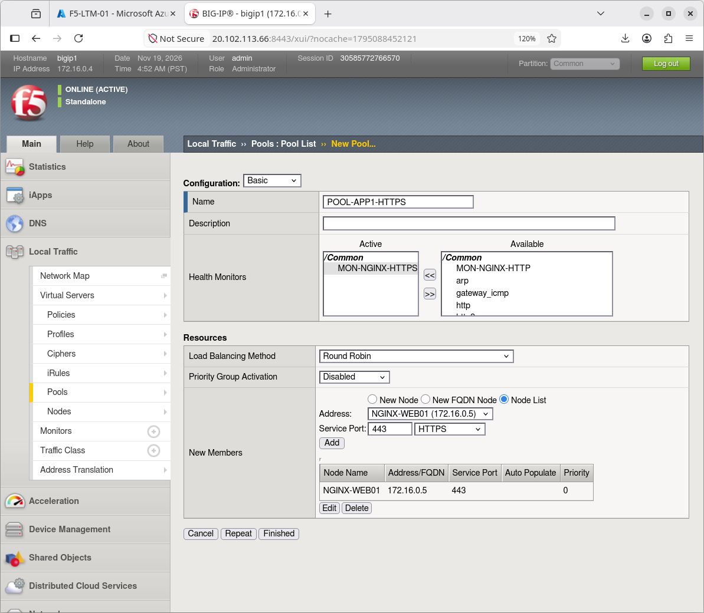

---

### 2. Creating `POOL-APP2-HTTPS`
A separate pool was provisioned for Application 2:
- **Name:** `POOL-APP2-HTTPS`
- **Health Monitors:** `/Common/MON-NGINX-HTTPS` (Active)
- **Load Balancing Method:** `Round Robin`
- **Priority Group Activation:** `Disabled`
- **New Members:** `NGINX-WEB02` (`172.16.0.6`), Service Port: `443` (`HTTPS`), Priority: `0`

**Creating Dedicated Application Pool 2 (POOL-APP2-HTTPS)**

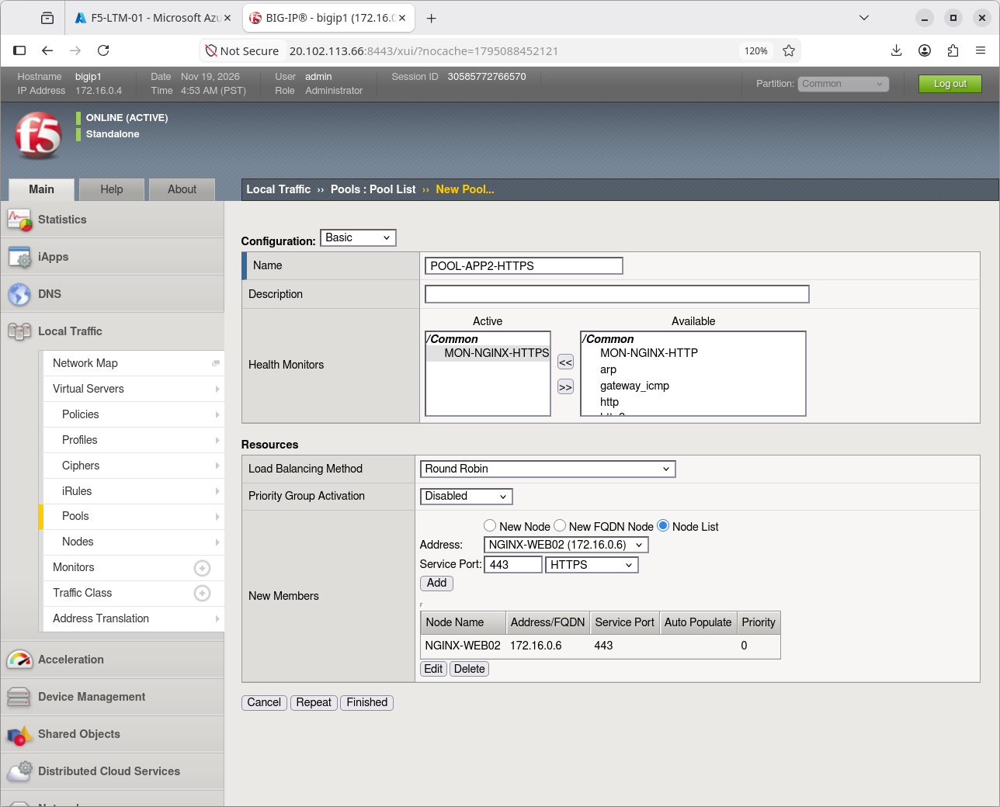

#### Architectural Significance:
- Isolating application workloads into distinct pools provides granular telemetry, independent health monitoring, and customized load balancing strategies per application.
- Individual member failure in one pool does not affect the health state or membership of the other pool.

---

## Phase 2: Authoring Host-Based Routing iRule (`IRULE-HOST-BASED-ROUTING`)

Under **Local Traffic &rarr; iRules &rarr; iRule List &rarr; New iRule...**, the custom steering logic was authored in TCL:

```tcl
when HTTP_REQUEST {
    switch -glob [string tolower [HTTP::host]] {
        "app1.f5-lab.local" {
            pool POOL-APP1-HTTPS
        }
        "app2.f5-lab.local" {
            pool POOL-APP2-HTTPS
        }
        default {
            HTTP::respond 404 content "Unknown application hostname"
        }
    }
}
```

**Authoring IRULE-HOST-BASED-ROUTING in TMOS GUI**

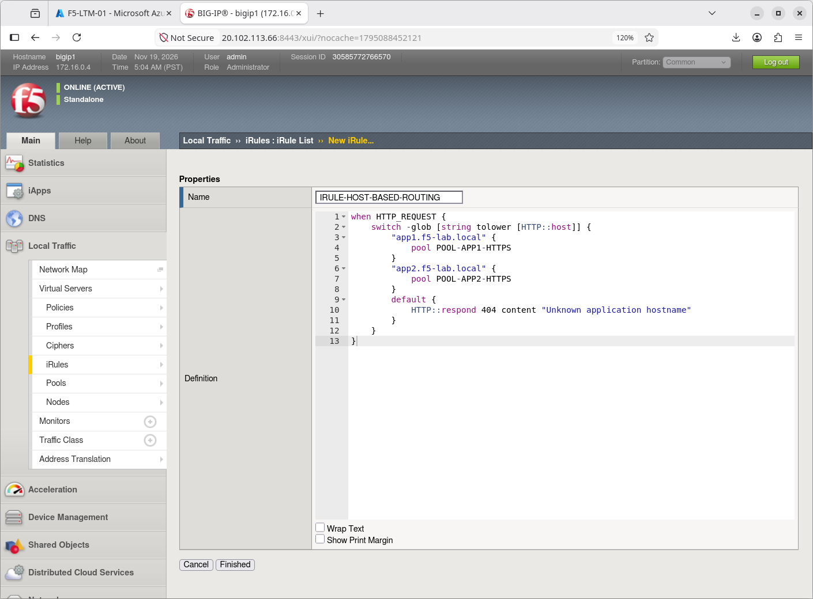

#### Deep Technical Code Breakdown:
1. **`when HTTP_REQUEST` Event:** Triggers immediately after TMM parses the client's HTTP request header block within the decrypted TLS session.
2. **`[HTTP::host]` Command:** Extracts the RFC 2616 / RFC 7230 `Host:` header value supplied by the client (excluding port numbers if stripped or matching standard ports).
3. **`[string tolower ...]`:** Enforces case-insensitivity. Since DNS and domain names are case-insensitive, normalizing to lowercase ensures requests for `APP1.F5-LAB.LOCAL` or `App1.f5-lab.local` match identically.
4. **`switch -glob`:** Evaluates glob pattern matching with optimal bytecode performance in TMOS microkernel memory.
5. **`pool POOL-APP1-HTTPS` / `pool POOL-APP2-HTTPS`:** Dynamically overrides the Virtual Server's default pool, directing the socket flow to the targeted backend node.
6. **`default` Clause & `HTTP::respond 404`:** Acts as a perimeter security filter. Any request for an unregistered hostname or direct IP access is answered directly at the edge with `HTTP 404` and custom payload `"Unknown application hostname"`, completely bypassing backend web servers.

---

## Phase 3: Virtual Server Resource Binding

Under **Local Traffic &rarr; Virtual Servers &rarr; Virtual Server List &rarr; VS-NGINX-HTTPS &rarr; Resources**, the routing iRule was applied alongside existing routing logic:
- **Virtual Server:** `VS-NGINX-HTTPS` (`172.16.0.7:443`)
- **Default Pool:** `POOL-NGINX-HTTPS`
- **Default Persistence Profile:** `PERSIST-COOKIE-LAB`
- **Active iRules (Chain):**
  1. `/Common/IRULE-URI-ROUTING-HTTPS`
  2. `/Common/IRULE-HOST-BASED-ROUTING`

**Applying IRULE-HOST-BASED-ROUTING to VS-NGINX-HTTPS**

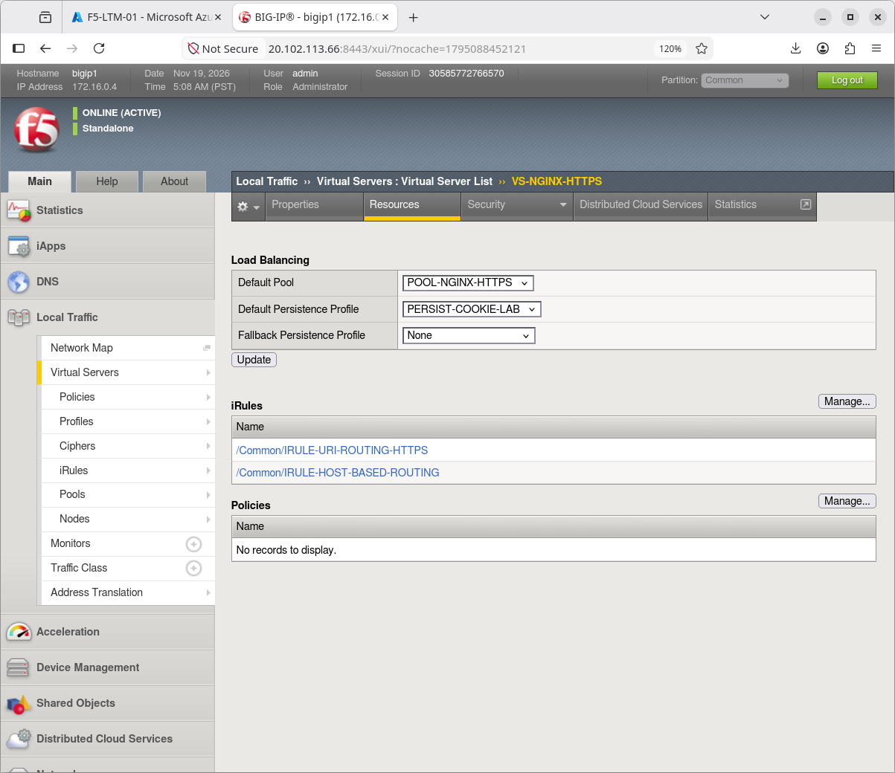

---

## Phase 4: Client-Side Name Resolution Simulation

In enterprise production deployments, public DNS records (e.g. `CNAME` or `A` records) map multiple domain names to the shared ADC Virtual Server IP. In this lab environment, local name resolution was configured on `F5-CLIENT-01` (`172.16.0.8`).

### 1. Editing `/etc/hosts`
Using `nano /etc/hosts`, static mappings were added pointing both FQDNs to the Virtual Server VIP (`172.16.0.7`):

```text
127.0.0.1 localhost
172.16.0.7 app1.f5-lab.local
172.16.0.7 app2.f5-lab.local
```

**Editing /etc/hosts on F5-CLIENT-01**

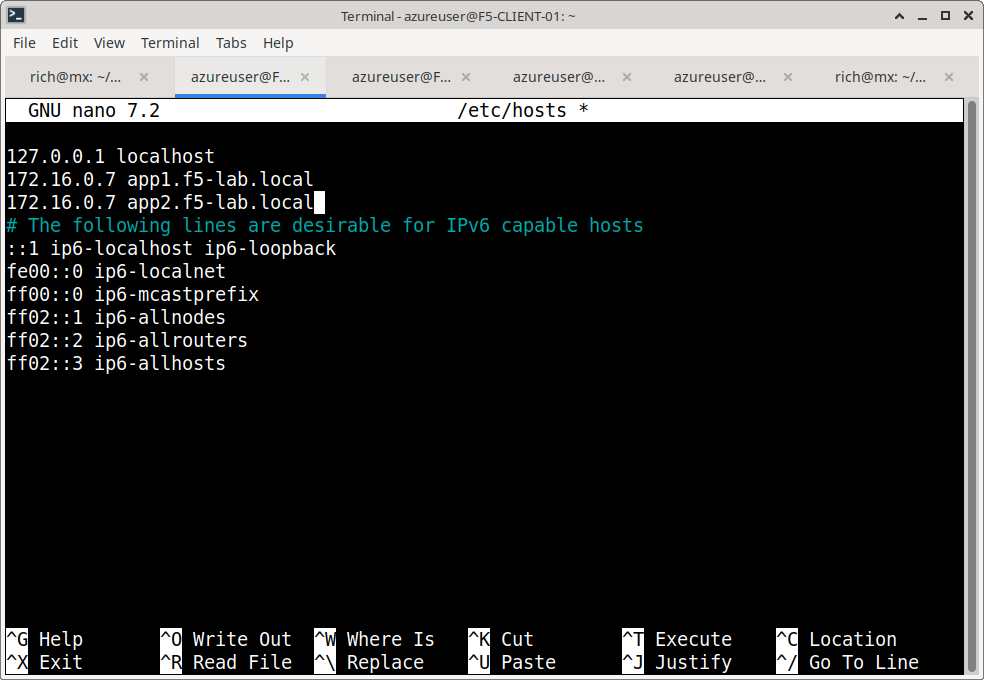

---

### 2. Verifying Resolution via `getent`
The name resolution database was validated via `getent`:

```bash
azureuser@F5-CLIENT-01:~$ getent hosts app1.f5-lab.local
172.16.0.7       app1.f5-lab.local
azureuser@F5-CLIENT-01:~$ getent hosts app2.f5-lab.local
172.16.0.7       app2.f5-lab.local
```

**Validating DNS Resolution for app1 and app2**

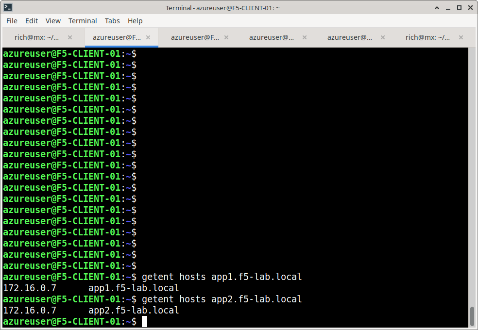

---

## Phase 5: Functional Client-Side Verification

### 1. Validating Routing to Application 1 & Application 2
From `F5-CLIENT-01`, HTTPS requests were executed against both domain names:

```bash
azureuser@F5-CLIENT-01:~$ curl -k https://app1.f5-lab.local/
<h1>NGINX WEB01 - Backend Server 1</h1>
azureuser@F5-CLIENT-01:~$ curl -k https://app2.f5-lab.local/
<h1>NGINX WEB02 - Backend Server 2</h1>
```

**Successful Host-Based Routing Verification via curl**

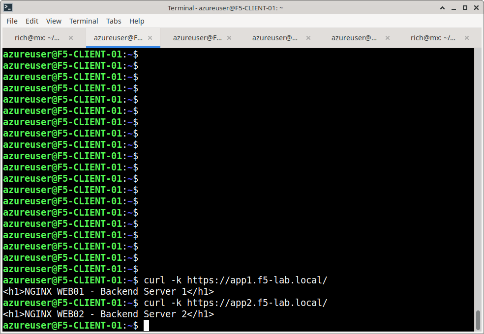

#### Functional Observations:
- Request targeting `https://app1.f5-lab.local/` was correctly steered to `NGINX-WEB01`.
- Request targeting `https://app2.f5-lab.local/` was correctly steered to `NGINX-WEB02`.
- Both transactions traversed the exact same Virtual Server (`172.16.0.7:443`), demonstrating clean multi-tenant isolation.

---

### 2. Unknown Hostname Behavior
Testing client resolution against an unregistered host demonstrates DNS-level handling:

```bash
azureuser@F5-CLIENT-01:~$ curl -ki https://unknown.f5-lab.local/
curl: (6) Could not resolve host: unknown.f5-lab.local
```

**Attempting to Access Unresolved Hostname**

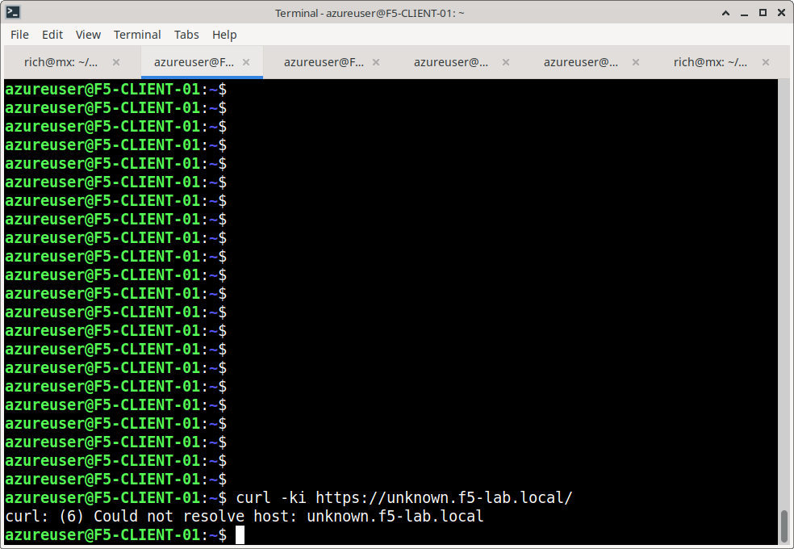

*(Note: When a client resolves an unmapped hostname to `172.16.0.7` or injects an arbitrary `Host:` header, BIG-IP's iRule default condition executes, immediately returning `HTTP/1.0 404 Not Found` with `"Unknown application hostname"`.)*

---

## Phase 6: Packet Capture Analysis & Wireshark Dissection

The full transaction lifecycle was captured directly on BIG-IP and preserved in packet capture [host-based.pcap](file:///home/rich/Documents/f5-big-ip-ltm-lab/host-based-routing/pcaps/host-based.pcap).

### 1. Wireshark Decrypted HTTP Stream Overview
Using Wireshark display filter `http && ip.addr == 172.16.0.8`, the decrypted client sessions are visible:

| Frame Number | Time | Source | Destination | Protocol | Length | Info |
|---|---|---|---|---|---|---|
| **98** | `6.450386` | `172.16.0.8` | `172.16.0.7` | HTTP | 223 | `IN s1/tmm1 : GET / HTTP/1.1` (Host: `app1.f5-lab.local`) |
| **115** | `6.455782` | `172.16.0.7` | `172.16.0.8` | HTTP | 514 | `OUT s1/tmm1 : HTTP/1.1 200 OK (text/html)` |
| **187** | `10.749615` | `172.16.0.8` | `172.16.0.7` | HTTP | 223 | `IN s1/tmm1 : GET / HTTP/1.1` (Host: `app2.f5-lab.local`) |
| **205** | `10.756588` | `172.16.0.7` | `172.16.0.8` | HTTP | 515 | `OUT s1/tmm1 : HTTP/1.1 200 OK (text/html)` |

**Wireshark HTTP Filter Overview Showing Decrypted Client Flows**

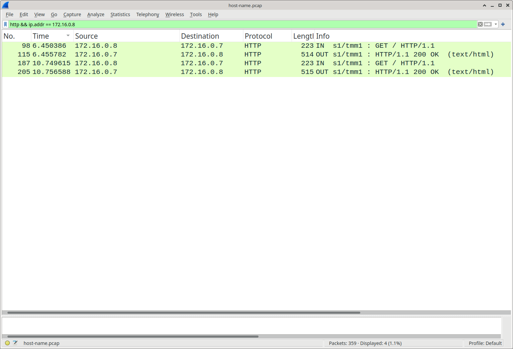

---

### 2. Deep Packet Inspection: `app1.f5-lab.local` (Frame 98)
Dissecting Frame 98 verifies the decrypted Layer 7 application data:
- **Source:** `172.16.0.8:44962` &rarr; **Destination:** `172.16.0.7:443`
- **TLS Record Layer:** `TLSv1.3 Record Layer: Application Data Protocol: Hypertext Transfer Protocol`
- **Decrypted Headers:**
  - `GET / HTTP/1.1\r\n`
  - `Host: app1.f5-lab.local\r\n`
  - `User-Agent: curl/8.5.0\r\n`
- **F5 Ethernet Trailer:** Dissection confirms ingress packet capture on microkernel instance `s1/tmm1`.

**Decrypted TLS Packet Details for app1.f5-lab.local (Frame 98)**

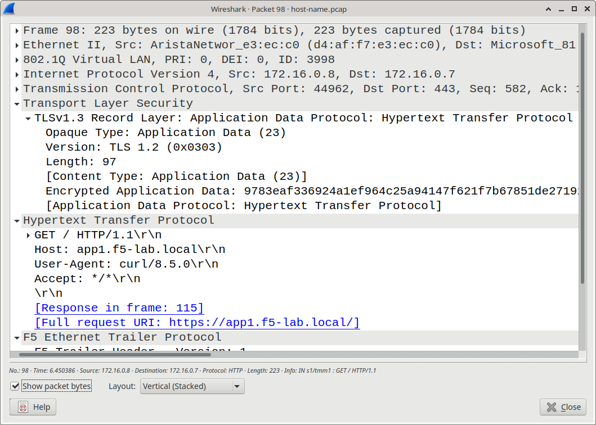

---

### 3. Deep Packet Inspection: `app2.f5-lab.local` (Frame 187)
Dissecting Frame 187 validates the second transaction:
- **Source:** `172.16.0.8:46274` &rarr; **Destination:** `172.16.0.7:443`
- **Decrypted Headers:**
  - `GET / HTTP/1.1\r\n`
  - `Host: app2.f5-lab.local\r\n`
  - `User-Agent: curl/8.5.0\r\n`
- **F5 Ethernet Trailer Protocol:** Magic number `0xf5deb0f5`, confirming internal kernel handling on `s1/tmm1`.

**Decrypted TLS Packet Details for app2.f5-lab.local (Frame 187)**

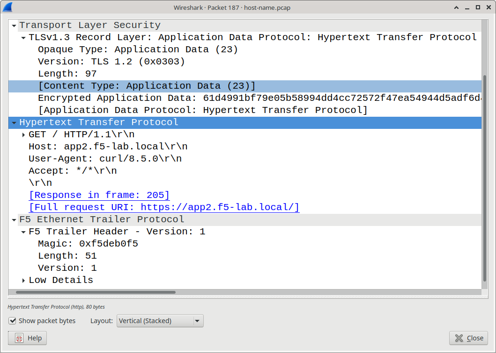

---

## Phase 7: TMOS Kernel Telemetry & Performance Counters

To evaluate microkernel resource efficiency, statistics were inspected via TMOS CLI.

### 1. Application Pool 1 Telemetry (`POOL-APP1-HTTPS`)
Executing `show ltm pool POOL-APP1-HTTPS`:
- **Status:** `Availability: available`, `State: enabled`, `Reason: The pool is available`
- **Active / Available Members:** `1` (`NGINX-WEB01:443`)
- **Total Requests:** `2`
- **Throughput:** Bits In/Out: `21.7K / 42.4K`, Packets In/Out: `19 / 15`
- **Current Connections:** `0`, **Maximum Connections:** `2`, **Total Connections:** `2`

**TMOS Pool Statistics for POOL-APP1-HTTPS**

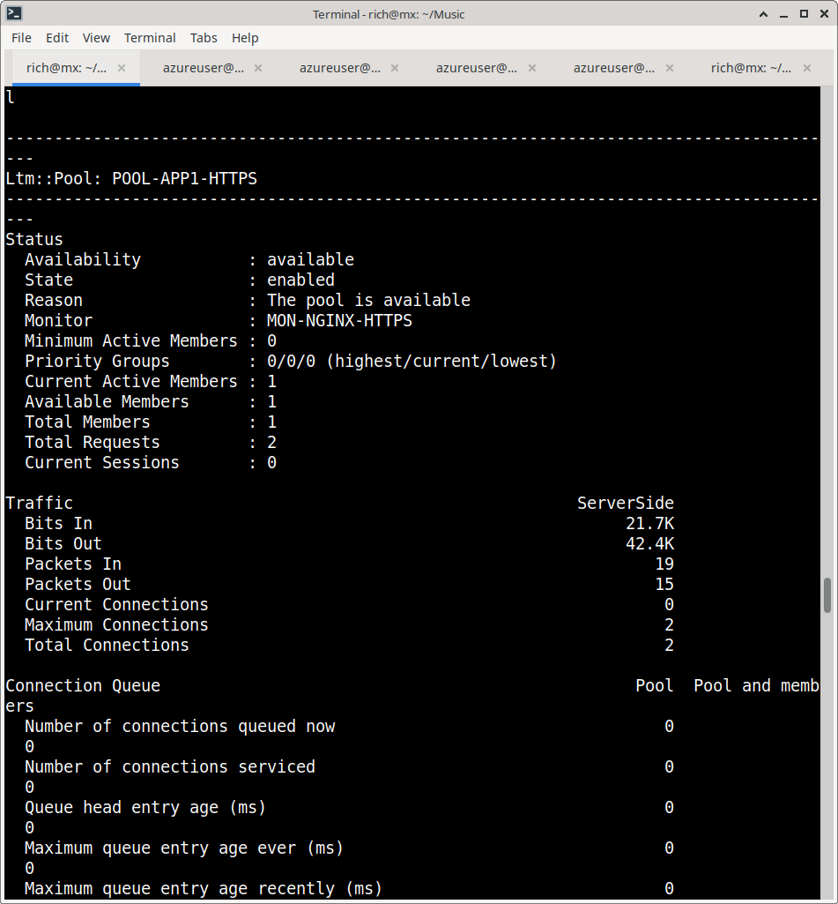

---

### 2. Application Pool 2 Telemetry (`POOL-APP2-HTTPS`)
Executing `show ltm pool POOL-APP2-HTTPS`:
- **Status:** `Availability: available`, `State: enabled`, `Reason: The pool is available`
- **Active / Available Members:** `1` (`NGINX-WEB02:443`)
- **Total Requests:** `3`
- **Throughput:** Bits In/Out: `33.2K / 63.9K`, Packets In/Out: `30 / 23`
- **Current Connections:** `0`, **Maximum Connections:** `2`, **Total Connections:** `3`

**TMOS Pool Statistics for POOL-APP2-HTTPS**

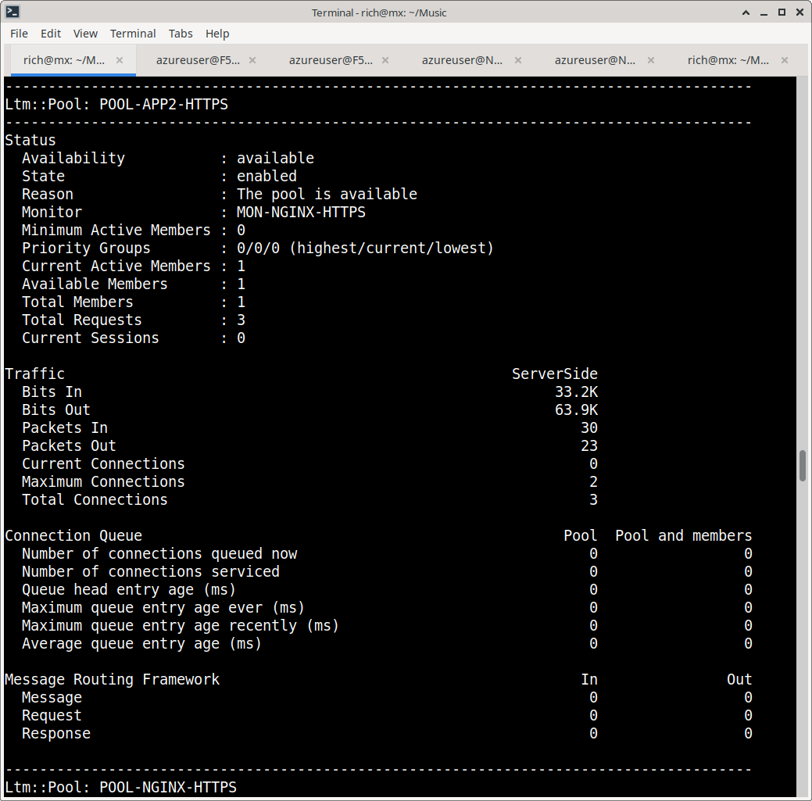

---

### 3. iRule Microkernel CPU Execution Profiling
Executing `show ltm rule IRULE-HOST-BASED-ROUTING`:
- **Rule Event:** `IRULE-HOST-BASED-ROUTING:HTTP_REQUEST`
- **Priority:** `500`
- **Executions:** Total `5`, Failures `0`, Aborts `0`
- **CPU Cycles per Execution:**
  - **Average:** `47.6K cycles`
  - **Maximum:** `49.8K cycles`
  - **Minimum:** `22.7K cycles`

**TMOS show ltm rule Performance Telemetry**

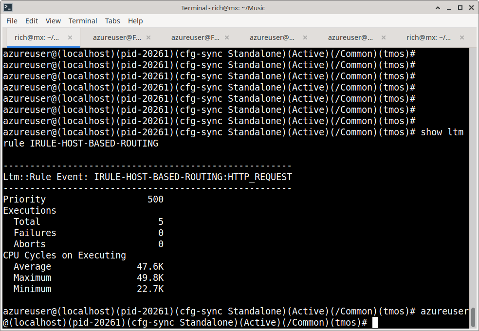

#### Performance Takeaway:
An average of **47.6K CPU cycles** translates to approximately **15–20 microseconds** of execution latency per request on modern ADC hardware, confirming that Layer 7 host inspection introduces zero human-perceivable overhead.

---

## Phase 8: Fault Isolation & Outage Resilience Testing

A critical requirement of multi-tenant load balancing is fault containment: a total failure of Application 1 must not compromise Application 2.

### 1. Intentional Service Outage on Application 1
From an active SSH terminal on `NGINX-WEB01` (`172.16.0.5`), the NGINX web daemon was stopped:

```bash
azureuser@NGINX-WEB01:~$ sudo systemctl stop nginx
```

**Halting NGINX Daemon on NGINX-WEB01**

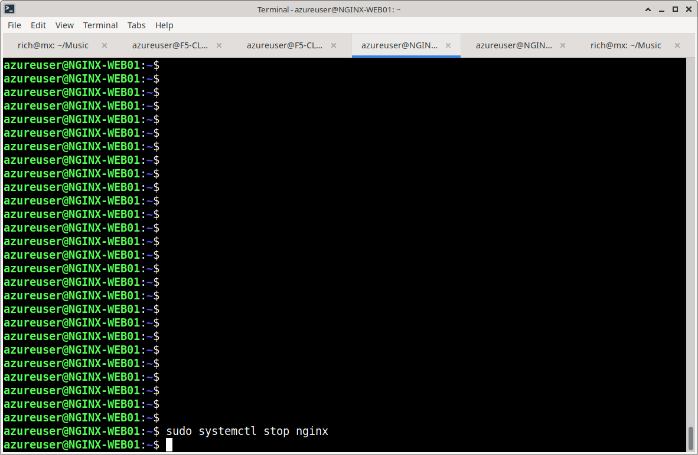

---

### 2. TMOS Pool Outage Detection
Within seconds, active monitor `MON-NGINX-HTTPS` detected the failure. Running `show ltm pool POOL-APP1-HTTPS` confirmed the offline status:
- **Availability:** `offline`
- **Reason:** `The children pool member(s) are down`
- **Active Members:** `0`
- **Available Members:** `0`

**TMOS Output Showing POOL-APP1-HTTPS Offline**

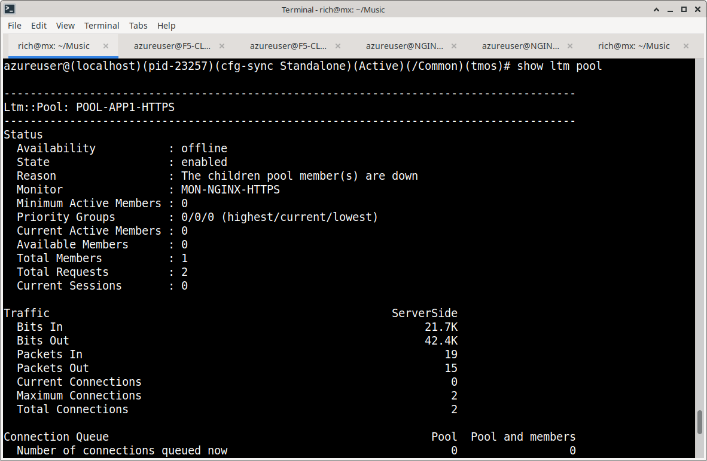

---

### 3. Web GUI Pool State Verification
Navigating to **Local Traffic &rarr; Pools : Pool List** illustrated the selective outage:
- **`POOL-APP1-HTTPS`:** Marked **DOWN (Red Diamond)**.
- **`POOL-APP2-HTTPS`:** Maintained **Available (Green Circle)**.
- **`POOL-NGINX-HTTPS`:** Maintained **Available (Green Circle)** (surviving member active).

**BIG-IP GUI Pool List Showing Selective Outage**

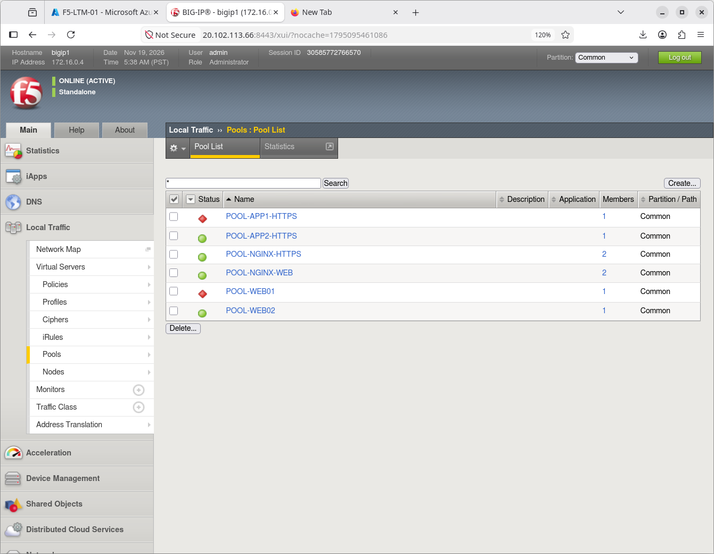

---

### 4. Client Verification of Fault Isolation
From `F5-CLIENT-01` (`172.16.0.8`), requests were executed against both domain names:

```bash
# Testing Application 2 (Surviving Node)
azureuser@F5-CLIENT-01:~$ curl -k https://app2.f5-lab.local/
<h1>NGINX WEB02 - Backend Server 2</h1>

# Testing Application 1 (Failed Node)
azureuser@F5-CLIENT-01:~$ curl -k https://app1.f5-lab.local/
curl: (56) Recv failure: Connection reset by peer
azureuser@F5-CLIENT-01:~$ curl -k https://app1.f5-lab.local/
curl: (56) Recv failure: Connection reset by peer
azureuser@F5-CLIENT-01:~$ curl -k https://app1.f5-lab.local/
curl: (56) Recv failure: Connection reset by peer
```

**Client Verification Proving Application 2 Remains Fully Operational During Outage**

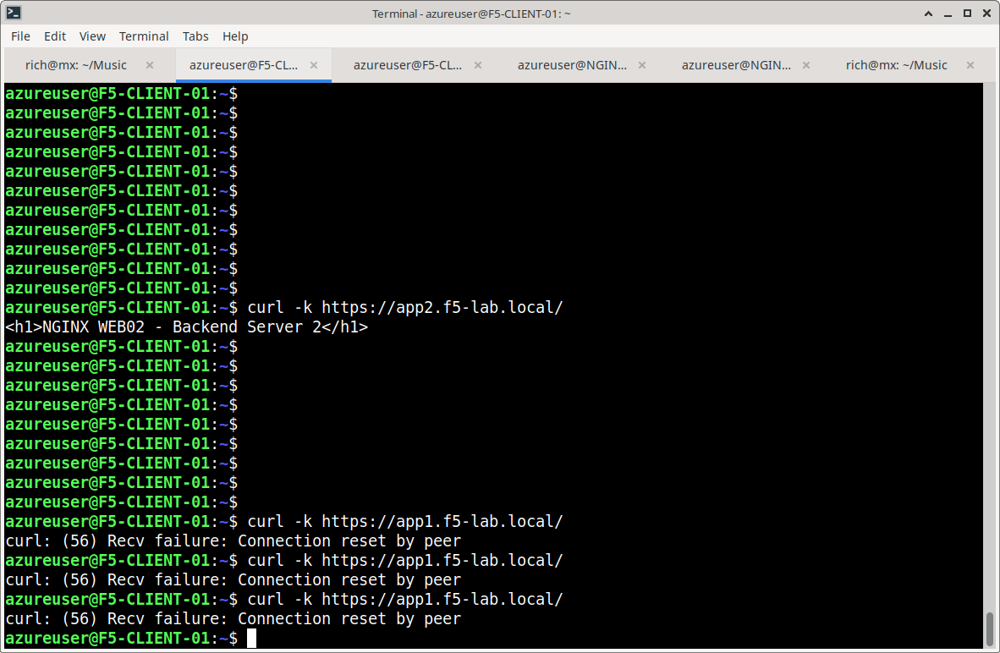

#### Architectural Takeaways:
1. **Zero Blast Radius:** Application 2 (`app2.f5-lab.local`) continued serving traffic flawlessly without a single dropped packet or latency spike.
2. **Deterministic Failure Shedding:** When a client requested `app1.f5-lab.local`, TMM evaluated the iRule, identified that `POOL-APP1-HTTPS` had zero active members, and immediately issued a TCP RST (`Connection reset by peer`) rather than hanging client sockets or timing out.
3. **Consolidation Without Compromise:** Proves that multiple distinct applications can share a single high-availability Virtual Server and public IP address while maintaining complete isolation in performance, security, and service availability.

---

## Production Best Practices & Architectural Guidelines

1. **SNI (Server Name Indication) & TLS Certificates:**
   When hosting multiple distinct FQDNs on a single IP address, ensure the client-SSL profile is configured with a Multi-Domain (SAN) certificate, a Wildcard certificate, or multiple SSL profiles utilizing Server Name Indication (SNI) so each domain presents a trusted certificate.
2. **Local Traffic Policies (LTM Policies) vs iRules:**
   For high-scale environments handling tens of thousands of requests per second, consider using BIG-IP native **LTM Policies** (CPM - Content Policy Management). LTM Policies compile into kernel-level decision trees, offering even lower CPU consumption than TCL-based iRules.
3. **Strict Case Normalization:**
   Always use `[string tolower [HTTP::host]]` before performing string comparisons to prevent case-variation bypasses or routing misses.
4. **FQDN Normalization & Port Stripping:**
   In non-standard port deployments, `[HTTP::host]` may contain the port number (e.g. `app1.f5-lab.local:8443`). Use `[getfield [HTTP::host] ":" 1]` to reliably strip the port suffix prior to matching.
5. **Edge Security Shielding:**
   Always include a `default` catch-all action in routing logic to return `HTTP 404` or `HTTP 403`, preventing direct IP-based scanning and unauthorized domain tunneling from touching backend resources.
