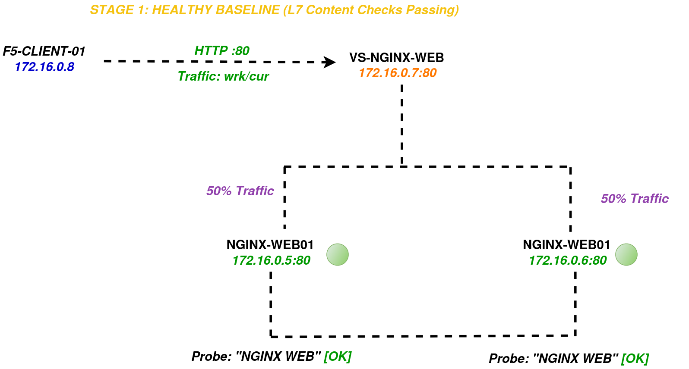
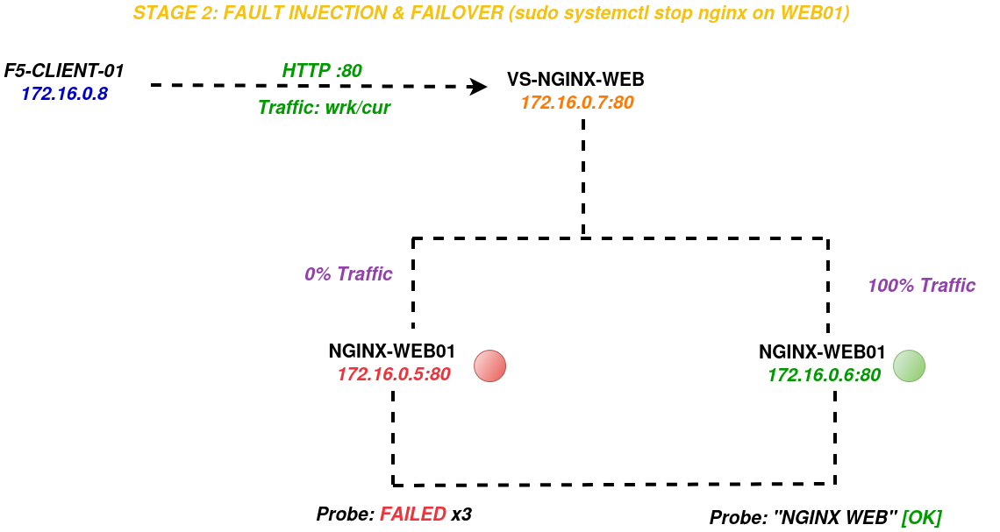
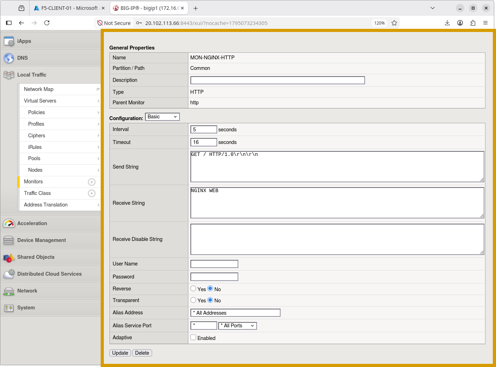
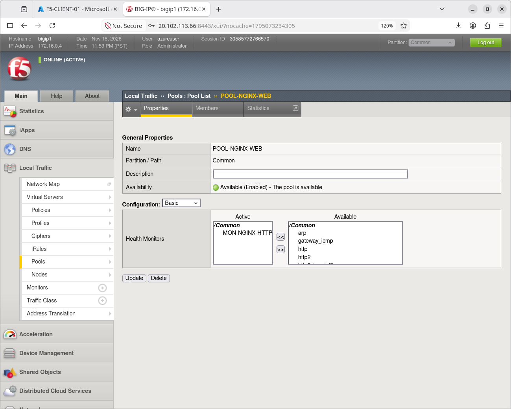
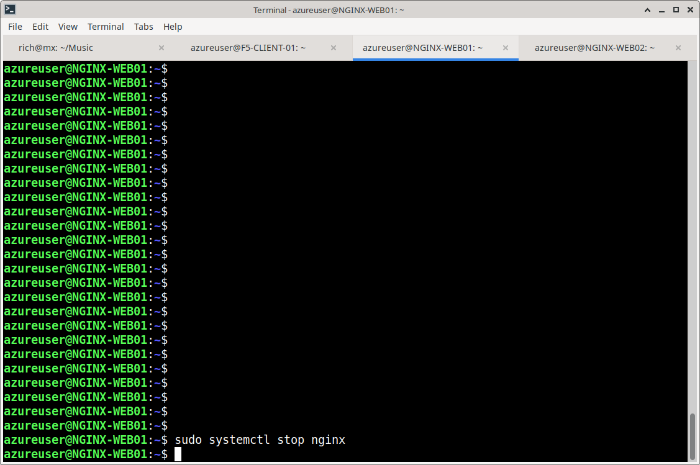
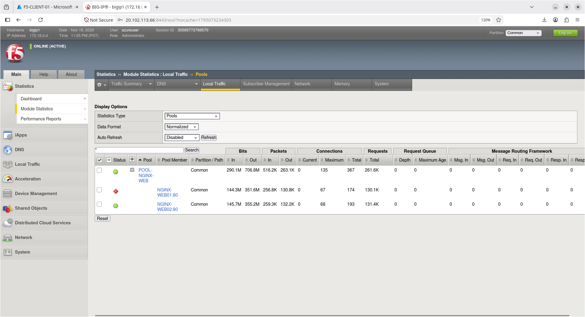
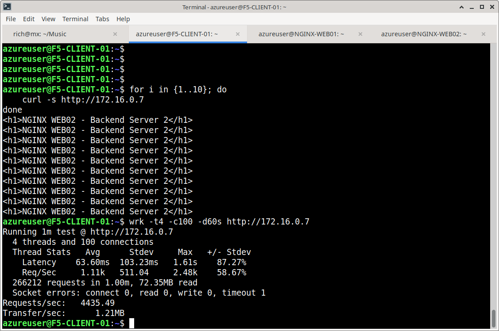
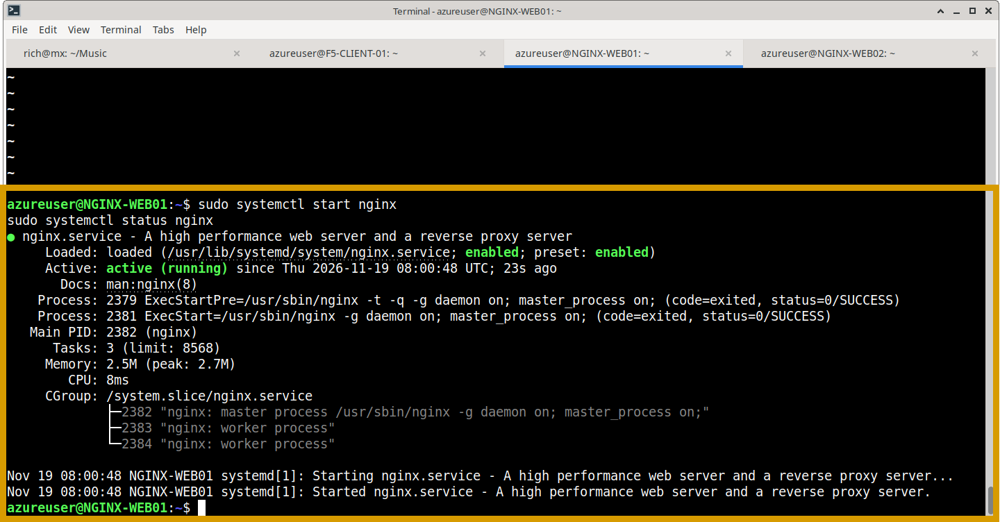
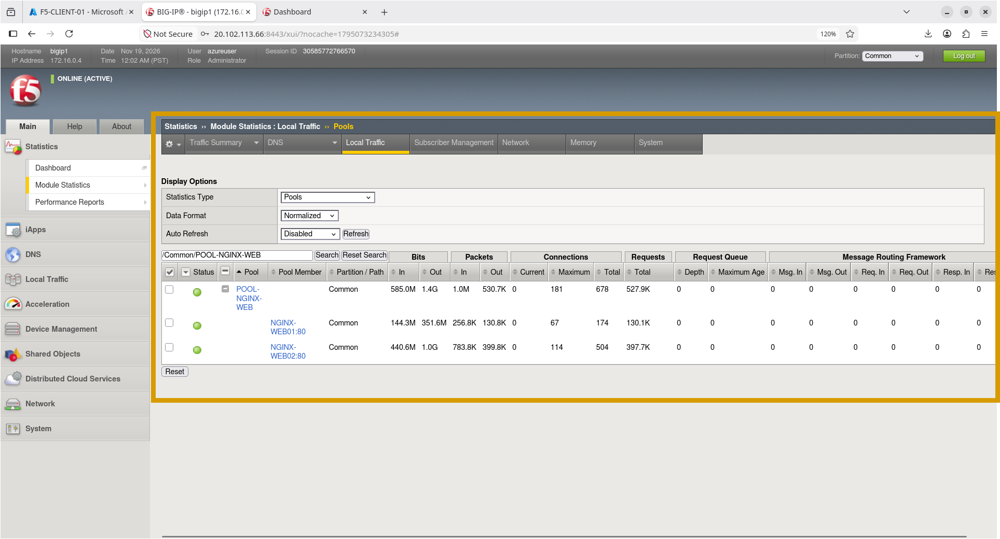
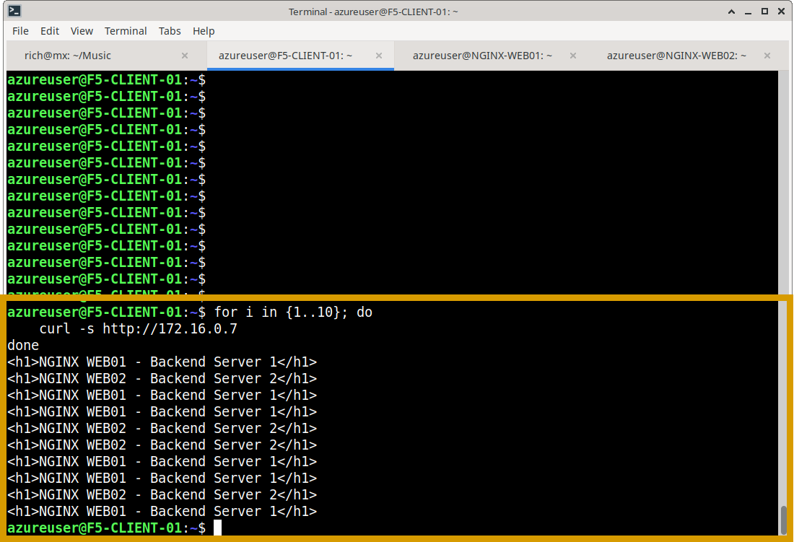

# Application Health Monitoring: Layer 7 HTTP Probing & High-Availability Failover Testing

## Summary & Engineering Objectives

This project documents the architectural design, deployment, and empirical verification of **Layer 7 HTTP Application Health Monitoring** on an **F5 BIG-IP Local Traffic Manager (LTM)** deployed in Microsoft Azure.

In enterprise application delivery, load balancers must continuously determine whether backend application servers are capable of correctly processing client requests. Traditional network-level health checks only verify shallow connectivity:
- **Layer 3 (ICMP Echo):** Only confirms that the host's network interface and IP stack respond to pings. It cannot detect whether web daemons (such as NGINX or Apache) have crashed or hung.
- **Layer 4 (TCP Half-Open / Port Connect):** Confirms that a TCP socket can complete the three-way handshake on port 80. However, if the backend application is throwing `HTTP 500 Internal Server Error`, experiencing database connection pool exhaustion, or serving corrupted responses, Layer 4 checks report the node as fully healthy.
- **Layer 7 (Application-Level HTTP Probing):** Actively transmits an HTTP request (`GET / HTTP/1.0\r\n\r\n`) and performs payload inspection on the response to verify that a specific expected token (`NGINX WEB`) is returned within the defined timeout window.

By utilizing Layer 7 health monitoring, F5 BIG-IP's **Traffic Management Microkernel (TMM)** detects application-level degradation or crashes immediately, evicts the impaired pool member from active load balancing, and steers 100% of incoming and active traffic to healthy nodes with **zero client-perceived downtime or dropped sockets**.

### Core Engineering Objectives:
1. **Custom Layer 7 Monitor Provisioning:** Author `MON-NGINX-HTTP` with an **Interval of 5 seconds**, a **Timeout of 16 seconds**, a formatted Send String of `GET / HTTP/1.0\r\n\r\n`, and a Receive String of `NGINX WEB`.
2. **Pool-Level Association:** Bind `MON-NGINX-HTTP` as the active health monitor on `POOL-NGINX-WEB`.
3. **Intentional Fault Injection:** Simulate an abrupt web application crash on primary node `NGINX-WEB01` (`172.16.0.5`) by terminating the NGINX daemon (`sudo systemctl stop nginx`).
4. **Kernel Telemetry & Node Eviction Verification:** Observe F5 BIG-IP's real-time pool statistics to verify that TMM marks `NGINX-WEB01:80` as **DOWN (Red Diamond)** while keeping `POOL-NGINX-WEB` **Available (Green Circle)** via `NGINX-WEB02:80`.
5. **High-Concurrency Stress Benchmarking During Active Outage:** Execute multi-threaded benchmarking from `F5-CLIENT-01` (`172.16.0.8`) using `wrk` generating 100 concurrent connections across 4 threads for 60 seconds (handling **266,212 requests** at **4,435.49 req/sec**) with zero connect socket errors.
6. **Backend Service Restoration & Zero-Touch Reintegration:** Restore NGINX on `NGINX-WEB01` and verify automatic status transition back to **Available (Green Circle)** and immediate restoration of balanced traffic distribution.

---

## Architecture & Traffic Flow Topology

The lab topology consists of a dedicated Linux client (`F5-CLIENT-01`) targeting the Virtual Server VIP (`VS-NGINX-WEB`). In the backend, F5 BIG-IP dispatches periodic Layer 7 probes across the internal network to both `NGINX-WEB01` and `NGINX-WEB02`.





### Infrastructure Addressing & Node Roles

| Component | IP Address | Port / Protocol | Profile / Mechanism | Description & Role |
|---|---|---|---|---|
| **F5-CLIENT-01** | `172.16.0.8` | Ephemeral &rarr; `80` | Ubuntu Linux Client | Generates sequential verification curl loops and high-throughput `wrk` benchmarking |
| **VS-NGINX-WEB** | `172.16.0.7` | `TCP/80` (HTTP) | Standard Virtual Server | Virtual Server VIP listening on port 80; passes traffic to `POOL-NGINX-WEB` |
| **F5 BIG-IP Self-IP** | `172.16.0.4` | System / Self-IP | Internal Gateway | Originates periodic Layer 7 HTTP health monitor probe heartbeats |
| **POOL-NGINX-WEB** | `172.16.0.5`, `172.16.0.6` | `TCP/80` (HTTP) | Load Balancing Pool | Bound to `MON-NGINX-HTTP`; dynamically tracks node health |
| **NGINX-WEB01** | `172.16.0.5` | `TCP/80` (HTTP) | Backend Node 1 | Production web server hosting application; target of intentional fault injection |
| **NGINX-WEB02** | `172.16.0.6` | `TCP/80` (HTTP) | Backend Node 2 | Production web server hosting application; absorbs 100% of traffic during outage |

---

## Phase 1: HTTP Health Monitor Design & Configuration

### 1. Creating Custom Health Monitor (`MON-NGINX-HTTP`)
Under **Local Traffic &rarr; Monitors**, a new health monitor was created with the following parameters:
- **Name:** `MON-NGINX-HTTP`
- **Type:** `HTTP`
- **Parent Monitor:** `http`
- **Interval:** `5` seconds
- **Timeout:** `16` seconds
- **Send String:** `GET / HTTP/1.0\r\n\r\n`
- **Receive String:** `NGINX WEB`
- **Alias Address:** `* All Addresses`
- **Alias Service Port:** `* All Ports`

**Configuring Custom HTTP Health Monitor (MON-NGINX-HTTP)**



#### Technical Parameter Details:
- **`GET / HTTP/1.0\r\n\r\n`:** Formats an RFC-compliant HTTP/1.0 GET request. The trailing double carriage-return line-feed (`\r\n\r\n`) signals the end of the HTTP request headers. Without the trailing `\r\n\r\n`, the web server would wait indefinitely for the header block to terminate, causing health check timeouts.
- **`NGINX WEB`:** Configured as the positive assertion string. TMM scans the returned HTTP response headers and body for this exact substring. If the backend returns `500 Internal Server Error`, `502 Bad Gateway`, or an empty response, the token is not found and the check fails.
- **`Interval: 5` / `Timeout: 16`:** Evaluates backend instances every 5 seconds. If no valid response is received within 16 seconds (accounting for 3 consecutive failed attempts plus a 1-second margin), the member is marked DOWN.

---

### 2. Binding Health Monitor to `POOL-NGINX-WEB`
Under **Local Traffic &rarr; Pools &rarr; Pool List &rarr; POOL-NGINX-WEB &rarr; Properties**, `MON-NGINX-HTTP` was moved into the **Active Health Monitors** list:

**Assigning MON-NGINX-HTTP to POOL-NGINX-WEB**



#### Operational Impact:
- Both pool members (`NGINX-WEB01:80` and `NGINX-WEB02:80`) immediately began receiving Layer 7 probes originated from Self-IP `172.16.0.4`.
- The pool status immediately registered as **Available (Enabled) - The pool is available** with a green status indicator.

---

## Phase 2: Deliberate Outage Injection & Real-Time Pool Telemetry

### 1. Intentional Service Stoppage on `NGINX-WEB01`
To simulate a real-world application daemon failure while preserving host-level connectivity, the NGINX daemon was terminated on `NGINX-WEB01` (`172.16.0.5`):

```bash
azureuser@NGINX-WEB01:~$ sudo systemctl stop nginx
```

**Stopping NGINX Service on NGINX-WEB01**



#### Significance of Daemon Termination:
- The virtual machine and operating system remained fully operational.
- A ping/ICMP check would continue to return `0% packet loss`.
- Because the daemon was halted, incoming TCP handshakes on port 80 are met with `TCP RST`, preventing HTTP payload delivery and triggering probe failures.

---

### 2. Failure Detection in F5 Pool Statistics
Within 16 seconds of the service halt, F5 BIG-IP detected three consecutive failed HTTP probes. Navigating to **Statistics &rarr; Module Statistics : Local Traffic &rarr; Pools** revealed the real-time failover state:

| Pool / Member | Status | Bits In / Out | Packets In / Out | Current Conn | Maximum Conn | Total Conn | Total Requests |
|---|---|---|---|---|---|---|---|
| **`POOL-NGINX-WEB`** | **Available (Green)** | 290.1M / 706.8M | 516.2K / 263.1K | 0 | 135 | 367 | 261.6K |
| **`NGINX-WEB01:80`** | **DOWN (Red Diamond)** | 144.3M / 351.6M | 256.8K / 130.8K | 0 | 67 | 174 | 130.1K |
| **`NGINX-WEB02:80`** | **Available (Green)** | 145.7M / 355.2M | 259.3K / 132.2K | 0 | 68 | 193 | 131.4K |

**Pool Statistics Showing NGINX-WEB01 Marked Down (Red Diamond)**



#### Telemetry Analysis:
- **`NGINX-WEB01:80` Transition:** Marked **DOWN (Red Diamond)**. Active connections immediately dropped to `0`. TMM removed the node from the candidate dispatch list.
- **`POOL-NGINX-WEB` Resilience:** The parent pool retained **Available (Green)** status because surviving member `NGINX-WEB02:80` remained healthy, preserving VIP availability.

---

## Phase 3: High-Concurrency Stress Benchmarking & Failover Verification

### 1. Sequential Request Verification
From `F5-CLIENT-01` (`172.16.0.8`), 10 sequential HTTP requests were directed to the Virtual Server VIP (`172.16.0.7`):

```bash
azureuser@F5-CLIENT-01:~$ for i in {1..10}; do
  curl -s http://172.16.0.7
done
```

**Result:**
```html
<h1>NGINX WEB02 - Backend Server 2</h1>
<h1>NGINX WEB02 - Backend Server 2</h1>
<h1>NGINX WEB02 - Backend Server 2</h1>
<h1>NGINX WEB02 - Backend Server 2</h1>
<h1>NGINX WEB02 - Backend Server 2</h1>
<h1>NGINX WEB02 - Backend Server 2</h1>
<h1>NGINX WEB02 - Backend Server 2</h1>
<h1>NGINX WEB02 - Backend Server 2</h1>
<h1>NGINX WEB02 - Backend Server 2</h1>
<h1>NGINX WEB02 - Backend Server 2</h1>
```
100% of requests were seamlessly steered to `NGINX-WEB02`. Zero requests were routed to the failed `NGINX-WEB01`.

---

### 2. High-Concurrency Workload (`wrk`) Under Outage
To verify that failover holds under heavy concurrency without connection drops, a 60-second multi-threaded benchmark was executed:

```bash
azureuser@F5-CLIENT-01:~$ wrk -t4 -c100 -d60s http://172.16.0.7
Running 1m test @ http://172.16.0.7
  4 threads and 100 connections
  Thread Stats   Avg      Stdev     Max   +/- Stdev
    Latency    63.60ms  103.23ms   1.61s    87.27%
    Req/Sec     1.11k   511.04     2.48k    58.67%
  266212 requests in 1.00m, 72.35MB read
  Socket errors: connect 0, read 0, write 0, timeout 1
Requests/sec:   4435.49
Transfer/sec:      1.21MB
```

**Client Verification & wrk Concurrency Stress Test During Outage**



#### Performance Metrics & Analysis:
- **Aggregate Volume:** **266,212 requests** processed in 60 seconds with **72.35 MB** transferred.
- **Sustained Throughput:** **4,435.49 requests/sec** handled completely by surviving node `NGINX-WEB02`.
- **Zero Socket Errors:** **0 connect errors, 0 read errors, 0 write errors**, proving that TMM cleanly avoided routing any client handshakes to the offline node.

---

## Phase 4: Service Restoration & Zero-Touch Reintegration

### 1. Restoring Backend NGINX Daemon
On `NGINX-WEB01` (`172.16.0.5`), the web service was restarted:

```bash
azureuser@NGINX-WEB01:~$ sudo systemctl start nginx
azureuser@NGINX-WEB01:~$ sudo systemctl status nginx
```

**Restoring NGINX Service on NGINX-WEB01**



The service returned to `active (running)` status under systemd PID `2382`.

---

### 2. Health Monitor Recovery & Pool Telemetry
Within 5 seconds, BIG-IP's next scheduled probe dispatched `GET / HTTP/1.0\r\n\r\n` to `172.16.0.5:80`. Upon receiving the expected `NGINX WEB` string in the HTTP 200 response, TMM immediately cleared the offline state:

| Pool / Member | Status | Bits In / Out | Packets In / Out | Current Conn | Maximum Conn | Total Conn | Total Requests |
|---|---|---|---|---|---|---|---|
| **`POOL-NGINX-WEB`** | **Available (Green)** | 585.0M / 1.4G | 1.0M / 530.7K | 0 | 181 | 678 | 527.9K |
| **`NGINX-WEB01:80`** | **Available (Green)** | 144.3M / 351.6M | 256.8K / 130.8K | 0 | 67 | 174 | 130.1K |
| **`NGINX-WEB02:80`** | **Available (Green)** | 440.6M / 1.0G | 783.8K / 399.8K | 0 | 114 | 504 | 397.7K |

**Pool Statistics Showing NGINX-WEB01 Restored to Available (Green Circle)**



`NGINX-WEB01:80` transitioned cleanly from Red Diamond back to **Available (Green Circle)**. Total pool request counters reached `527.9K`.

---

### 3. Verification of Restored Traffic Equilibrium
A repeat sequential `curl` test from `F5-CLIENT-01` confirmed that inbound client traffic was once again load-balanced across both backend instances:

```bash
azureuser@F5-CLIENT-01:~$ for i in {1..10}; do
  curl -s http://172.16.0.7
done
```

**Result:**
```html
<h1>NGINX WEB01 - Backend Server 1</h1>
<h1>NGINX WEB02 - Backend Server 2</h1>
<h1>NGINX WEB01 - Backend Server 1</h1>
<h1>NGINX WEB01 - Backend Server 1</h1>
<h1>NGINX WEB02 - Backend Server 2</h1>
<h1>NGINX WEB02 - Backend Server 2</h1>
<h1>NGINX WEB01 - Backend Server 1</h1>
<h1>NGINX WEB01 - Backend Server 1</h1>
<h1>NGINX WEB02 - Backend Server 2</h1>
<h1>NGINX WEB01 - Backend Server 1</h1>
```

**Verification of Traffic Distribution Between Both Nodes Post-Recovery**



Both backend servers resumed sharing production traffic evenly, completing the automated self-healing cycle.

---

## Production Best Practices & Architectural Takeaways

1. **Layer 7 Content Verification is Crucial:**
   Layer 3 (ping) and Layer 4 (port check) probes cannot detect application-level deadlock, 500 errors, or database detachment. Always configure Layer 7 HTTP/HTTPS monitors with strict receive strings.
2. **Proper CRLF Header Delimitation:**
   When defining HTTP Send Strings, always include explicit trailing CRLFs (`\r\n\r\n`). In HTTP/1.1 Send Strings, always include a `Host:` header (e.g. `GET /health HTTP/1.1\r\nHost: example.local\r\nConnection: Close\r\n\r\n`).
3. **Dedicated Health Check Endpoints (`/healthz`):**
   In enterprise production setups, point monitors to dedicated lightweight endpoints (such as `/healthz` or `/status`) that verify backend dependency health (databases, cache, microservices) rather than polling static root HTML files.
4. **Flapping Mitigation & Up-Interval:**
   To prevent flapping nodes from repeatedly joining and dropping out of the pool during unstable restarts, configure an `Up-Interval` (a longer probe interval required before declaring a recovered node healthy).
5. **Zero Client Blast Radius:**
   By setting timeouts to `(Interval * 3) + 1`, BIG-IP achieves the ideal balance between rapid failover detection (~15 seconds) and immunity against momentary network micro-bursts or packet drops.
