# Multi-Layer Traffic Shaping: Layer 4 Connection Limiting & Layer 7 HTTP Rate Limiting via iRules

## Summary & Engineering Objectives

This project documents the architectural design, implementation, and empirical verification of a multi-tiered **Traffic Shaping and DoS Mitigation Architecture** on an **F5 BIG-IP Local Traffic Manager (LTM)** deployed in Microsoft Azure.

High-traffic web applications and mission-critical APIs are perpetually vulnerable to volumetric floods, brute-force credential stuffing, distributed denial-of-service (DDoS) attacks, and aggressive web scrapers. These threats operate across different OSI model layers:
- **Layer 4 Connection Exhaustion:** Attackers establish thousands of concurrent TCP sockets (e.g., SYN floods, Slowloris) to deplete socket buffers, file descriptors, and worker thread pools on backend servers without necessarily generating large amounts of Layer 7 bandwidth.
- **Layer 7 Request Floods & API Abuse:** Attackers target specific compute-intensive endpoints (e.g., login portals, search queries, database-backed microservices) with repeated rapid-fire HTTP requests, exhausting backend CPU and database connection pools while appearing as normal traffic.

To deliver end-to-end edge defense without burdening backend application instances, this lab implements a defense-in-depth traffic shaping strategy combining:
1. **Layer 4 Hardware-Accelerated Connection Limiting:** Enforcing an absolute concurrent connection threshold on the Virtual Server directly within the **Traffic Management Microkernel (TMM)**, instantly rejecting excess TCP handshakes via wire-level TCP resets (RST).
2. **Layer 7 Dynamic Session-Table Rate Limiting via iRules:** Utilizing BIG-IP's high-speed in-memory session table (`table` command) to track per-client IP request velocity over a sliding time window, immediately returning RFC 6585 `HTTP 429 Too Many Requests` responses with `Retry-After` headers directly from ADC kernel memory in **sub-millisecond turnaround time (~670 µs)**.

### Core Engineering Objectives:
1. **Virtual Server Connection Ceiling:** Configure a strict concurrency limit of **50 active connections** (`connection-limit 50`) on Virtual Server `VS-NGINX-HTTPS` via TMOS CLI.
2. **High-Concurrency Saturation Benchmarking:** Stress-test the Virtual Server from `F5-CLIENT-01` using `wrk` generating 100 concurrent connections across 4 threads to deliberately breach the 50-connection ceiling.
3. **Wire-Level TCP RST Inspection:** Analyze packet captures (`connection-limit.pcap`) in Wireshark to prove that BIG-IP's TMM kernel terminates excess connection attempts with TCP RST packets sent from internal gateway IP `172.16.0.4`.
4. **TCL Rate Limiting iRule Engineering:** Author `IRULE-HTTP-RATE-LIMIT` using lockless TMOS session tables (`table lookup`, `table set -notouch`, `table incr -notouch`) to track per-client IP request rates within a 10-second sliding expiration window.
5. **Edge HTTP 429 Synthesis:** Synthesize custom `429 Too Many Requests` responses directly within TMM memory once a client exceeds 20 requests per 10 seconds, including a `Retry-After: 10` throttling header.
6. **Client-Side Behavioral Verification:** Validate throttling dynamics from `F5-CLIENT-01` using bash loops: confirming 20 successful `HTTP 200 OK` responses followed by immediate `HTTP 429` rejections, and validating automatic service recovery after timer expiration.
7. **TLS Packet Decryption & Microsecond Latency Analysis:** Decrypt HTTPS captures (`irule-rate-limit.pcap`) using pre-master secrets in Wireshark to verify that HTTP 429 responses are delivered in **670 microseconds** with zero backend compute overhead.
8. **F5 Ethernet Trailer Dissection:** Inspect proprietary F5 Ethernet Trailer metadata in Wireshark to confirm out-of-band packet origination directly from `/Common/VS-NGINX-HTTPS` on `tmm1`.
9. **Kernel Performance Telemetry:** Extract and verify TMOS execution counters (`show ltm rule`) and Web GUI module statistics, proving near-zero CPU cycle consumption across test cycles.

---

## Technical Comparison: Defense-in-Depth Rate Limiting Architecture

| Feature / Metric | Layer 4 Connection Limiting | Layer 7 iRule Rate Limiting | Backend Web Server (NGINX `limit_req`) |
|---|---|---|---|
| **OSI Operating Layer** | Layer 4 (Transport / TCP) | Layer 7 (Application / HTTP) | Layer 7 (Application / HTTP) |
| **Enforcement Engine** | TMM Kernel Socket Table | TMM Memory Session Table (`table`) | NGINX Worker Threads / Memory Zone |
| **Trigger Mechanism** | Active Concurrent Sockets | Request Velocity per Client IP | Request Velocity per Zone Key |
| **Exceeded Action** | Immediate TCP RST / Reject | Edge `HTTP 429 Too Many Requests` | Local `HTTP 429` / `503` Response |
| **Response Turnaround** | Wire-speed (Nanoseconds) | **Sub-millisecond (~670 µs)** | Milliseconds (~5–30 ms) |
| **Backend CPU / RAM Impact** | **Zero** (Blocked at perimeter) | **Zero** (Terminated at edge) | High (Worker parsed request line & headers) |
| **Client Guidance Header** | None (Connection reset) | `Retry-After: 10` (RFC 6585) | Configurable / None |
| **Use Case Mitigation** | SYN/TCP floods, Slowloris, socket exhaustion | API scrapers, credential brute-force, DoS | Application-specific backend throttling |

---

## Architecture & Traffic Flow Topology

The architecture consists of a Linux client (`F5-CLIENT-01`) originating both high-concurrency TCP connections and rapid HTTP/HTTPS request sequences toward BIG-IP Virtual Server `VS-NGINX-HTTPS`. 

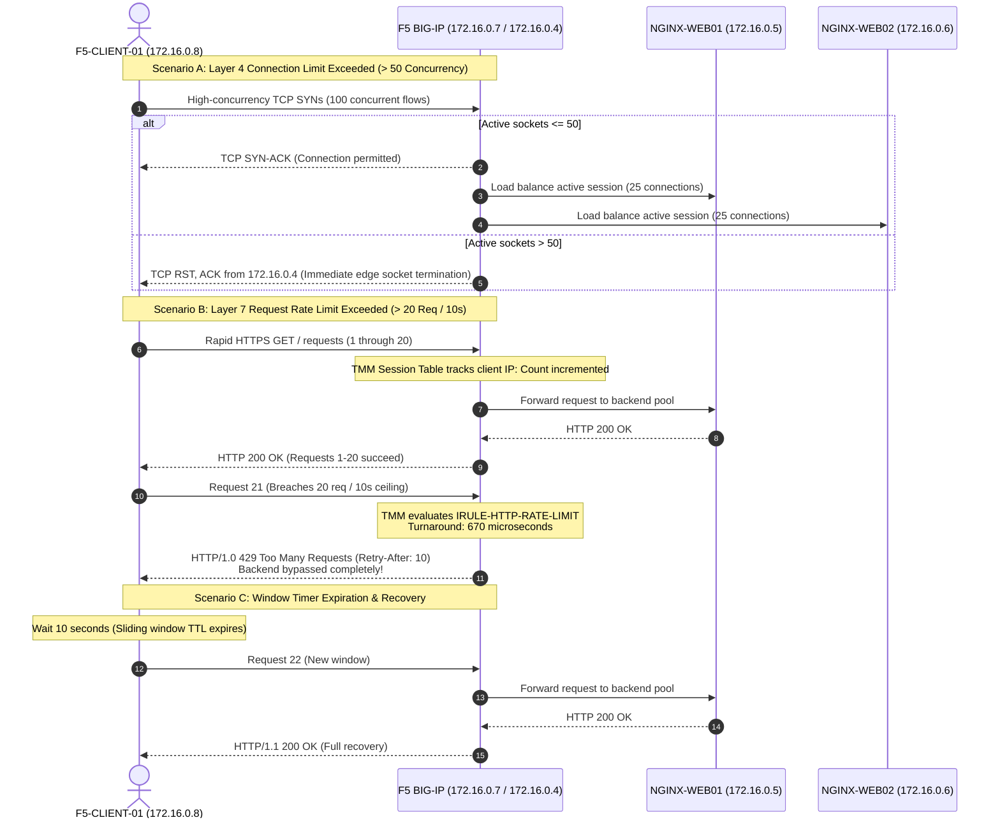

### Infrastructure Addressing & Role Matrix

| Component | IP Address | Port / Protocol | Profile / Mechanism | Description & Role |
|---|---|---|---|---|
| **F5-CLIENT-01** | `172.16.0.8` | Ephemeral &rarr; `443` | Ubuntu Linux Client | Generates `wrk` concurrency benchmarks and automated `curl` test sequences |
| **VS-NGINX-HTTPS** | `172.16.0.7` | `TCP/443` (HTTPS) | Standard Virtual Server | Terminates TLS, enforces L4 connection ceiling (50) and executes `IRULE-HTTP-RATE-LIMIT` |
| **F5 BIG-IP Self-IP** | `172.16.0.4` | System / Self-IP | Internal Gateway | Originates TCP RST packets to reject excess sockets; manages health probes |
| **POOL-NGINX-HTTPS** | `172.16.0.5`, `172.16.0.6` | `TCP/443` (HTTPS) | Least Connections Pool | Distributes active client connections equally across healthy backend nodes |
| **NGINX-WEB01** | `172.16.0.5` | `TCP/443` (HTTPS) | Backend Node 1 | Production web server hosting application content |
| **NGINX-WEB02** | `172.16.0.6` | `TCP/443` (HTTPS) | Backend Node 2 | Production web server hosting application content |

---

## Phase 1: Layer 4 Virtual Server Connection Limiting

### 1. Enforcing Connection Ceiling via TMOS CLI
In enterprise edge architectures, Virtual Servers must be protected against socket exhaustion attacks that attempt to consume TMM and backend connection tables. Using the TMOS shell, a hard limit of **50 concurrent connections** was applied to `VS-NGINX-HTTPS`:

```bash
azureuser@(localhost)(pid-23257)(cfg-sync Standalone)(Active)(/Common)(tmos)# modify ltm virtual VS-NGINX-HTTPS connection-limit 50
azureuser@(localhost)(pid-23257)(cfg-sync Standalone)(Active)(/Common)(tmos)# list ltm virtual VS-NGINX-HTTPS connection-limit
ltm virtual VS-NGINX-HTTPS {
    connection-limit 50
}
```

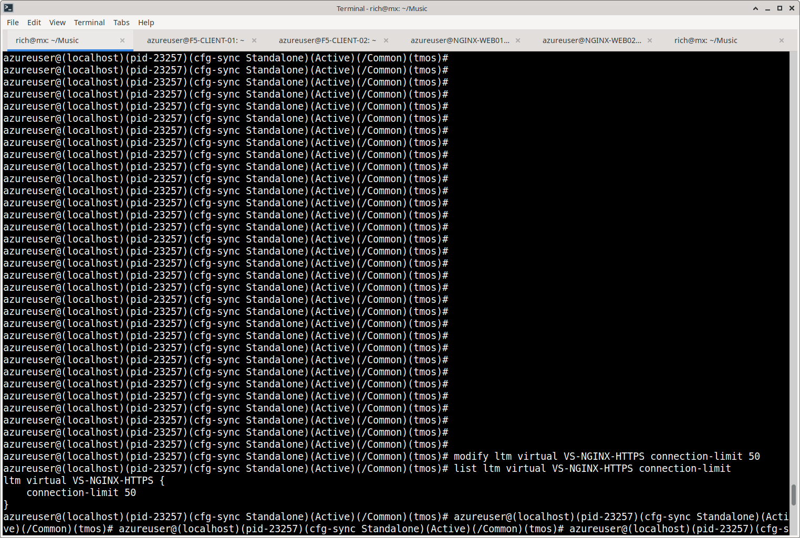

#### Architectural Significance:
- `connection-limit 50` establishes a strict cap on simultaneous client-side TCP connections maintained by `VS-NGINX-HTTPS`.
- Once 50 concurrent TCP handshakes are established, BIG-IP immediately resets subsequent inbound SYN packets, shielding backend web servers from overload.

---

### 2. High-Concurrency Stress Testing via `wrk`
To evaluate BIG-IP's connection limiting enforcement under heavy concurrency, multi-threaded stress testing was executed from `F5-CLIENT-01` (`172.16.0.8`) using `wrk`:

```bash
azureuser@F5-CLIENT-01:~$ wrk -t4 -c100 -d30s https://172.16.0.7/
Running 30s test @ https://172.16.0.7/
  4 threads and 100 connections
  Thread Stats   Avg      Stdev     Max   +/- Stdev
    Latency    40.91ms  95.82ms   1.41s    88.51%
    Req/Sec     1.58k    1.93k    8.29k    84.23%
  182549 requests in 30.01s, 19.67MB read
  Socket errors: connect 13261, read 0, write 0, timeout 4
  Non-2xx or 3xx responses: 182549
Requests/sec:   6082.19
Transfer/sec:    671.18KB
```

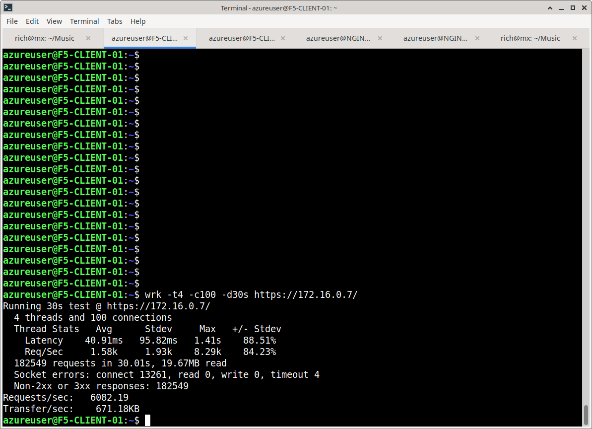

#### Performance & Failure Analysis:
- **100 Concurrent Connections Requested:** The benchmark requested double the permitted limit of 50 connections across 4 threads.
- **13,261 Socket Connect Errors:** The client recorded **13,261 connect errors**, proving that excess connection attempts beyond the 50-connection ceiling were immediately rejected by BIG-IP at the transport layer.
- **Zero Read / Write Errors:** Established connections operated with zero packet corruption or mid-stream socket aborts.

---

### 3. Real-Time Pool Telemetry Under Peak Concurrency
Navigating to **Statistics &rarr; Module Statistics : Local Traffic &rarr; Pools** while the benchmark was actively executing confirmed that BIG-IP strictly clamped concurrent backend load to exactly 50 connections:

| Pool / Member | Status | Bits In / Out | Packets In / Out | Current Conn | Maximum Conn | Total Conn | Total Requests |
|---|---|---|---|---|---|---|---|
| **`POOL-NGINX-HTTPS`** | **Active (Green)** | 154.4M / 327.0M | 221.2K / 114.2K | **50** | **52** | 1.0K | 116.1K |
| **`NGINX-WEB01:443`** | **Active (Green)** | 73.8M / 156.8M | 106.9K / 54.7K | **25** | 26 | 311 | 56.8K |
| **`NGINX-WEB02:443`** | **Active (Green)** | 80.6M / 170.2M | 114.2K / 59.4K | **25** | 26 | 710 | 59.3K |

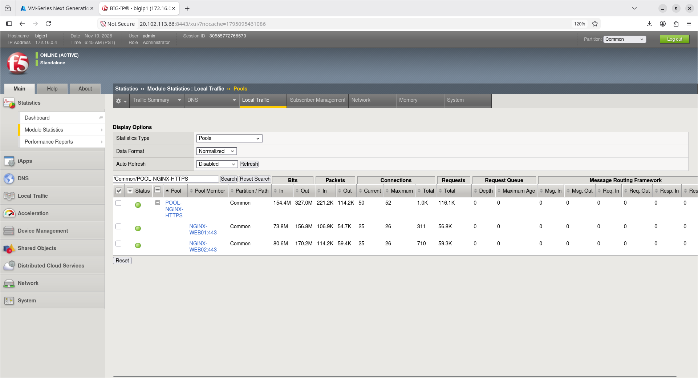

#### Telemetry Breakdown:
- **Exact 50 Concurrent Connection Ceiling:** Despite the client attempting 100 simultaneous flows, `Current Connections` on `POOL-NGINX-HTTPS` remained capped at **50**.
- **Equitable Backend Distribution:** Active sessions were split evenly across the pool members (**25 connections on WEB01**, **25 connections on WEB02**), proving seamless interoperability between Layer 4 connection limits and dynamic load balancing.

---

### 4. Wire-Level Verification & TCP RST Analysis
Packet capture file `connection-limit.pcap` was analyzed in Wireshark to verify how BIG-IP handled excess connections exceeding the threshold. Filtering on `(tcp.flags.reset == 1) && (ip.src == 172.16.0.4)`:

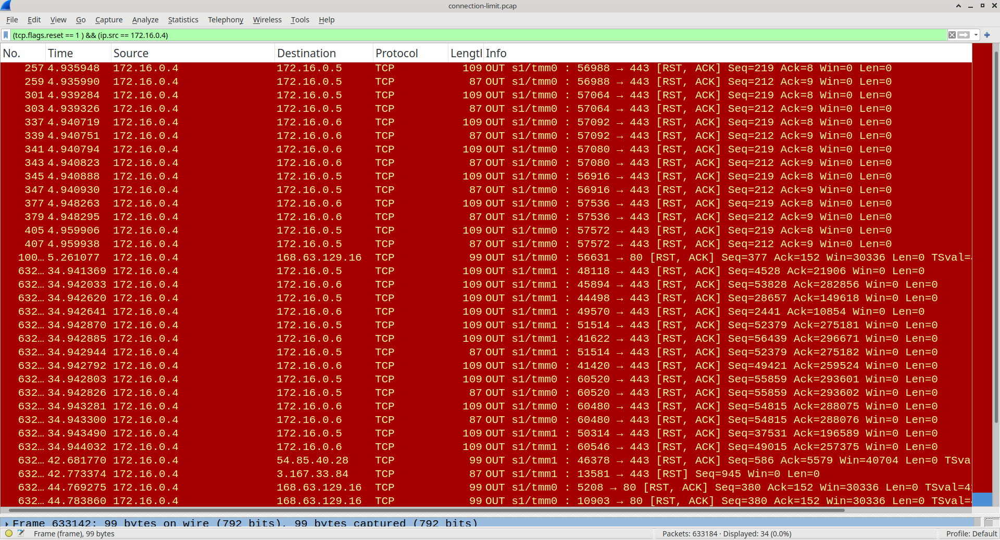

#### Packet-Level Observations:
1. **Source IP `172.16.0.4`:** The TCP RST packets originated directly from BIG-IP's internal Self-IP address (`172.16.0.4`).
2. **Dual-Core TMM Execution (`s1/tmm0` and `s1/tmm1`):** Wireshark's F5 dissection headers show reset packets generated across both `s1/tmm0` and `s1/tmm1`, demonstrating that multi-core TMM threads independently evaluate connection limit state.
3. **Immediate Connection Shedding:** Inbound SYNs that exceeded the 50-connection ceiling were answered with immediate `[RST, ACK]` packets (`Win=0, Len=0`), ensuring zero backend socket allocation.

---

## Phase 2: Layer 7 HTTP Rate Limiting iRule Architecture

### 1. TCL iRule Engineering (`IRULE-HTTP-RATE-LIMIT`)
While Layer 4 connection limits protect against socket exhaustion, malicious clients can still abuse open HTTP sessions with high-frequency request floods. To solve this, a custom Tool Command Language (TCL) iRule named `IRULE-HTTP-RATE-LIMIT` was authored under **Local Traffic &rarr; iRules &rarr; iRule List**:

```tcl
priority 100
when HTTP_REQUEST {
    set rl_key "rate_limit:[IP::client_addr]"
    set rl_count [table lookup -notouch $rl_key]

    if {$rl_count eq ""} {
        table set -notouch $rl_key 1 10
        set rl_count 1
    } else {
        set rl_count [table incr -notouch $rl_key]
    }

    if {$rl_count > 20} {
        HTTP::respond 429 content "Too Many Requests - Rate limit exceeded" \
            "Content-Type" "text/plain" \
            "Retry-After" "10"
    }
}
```

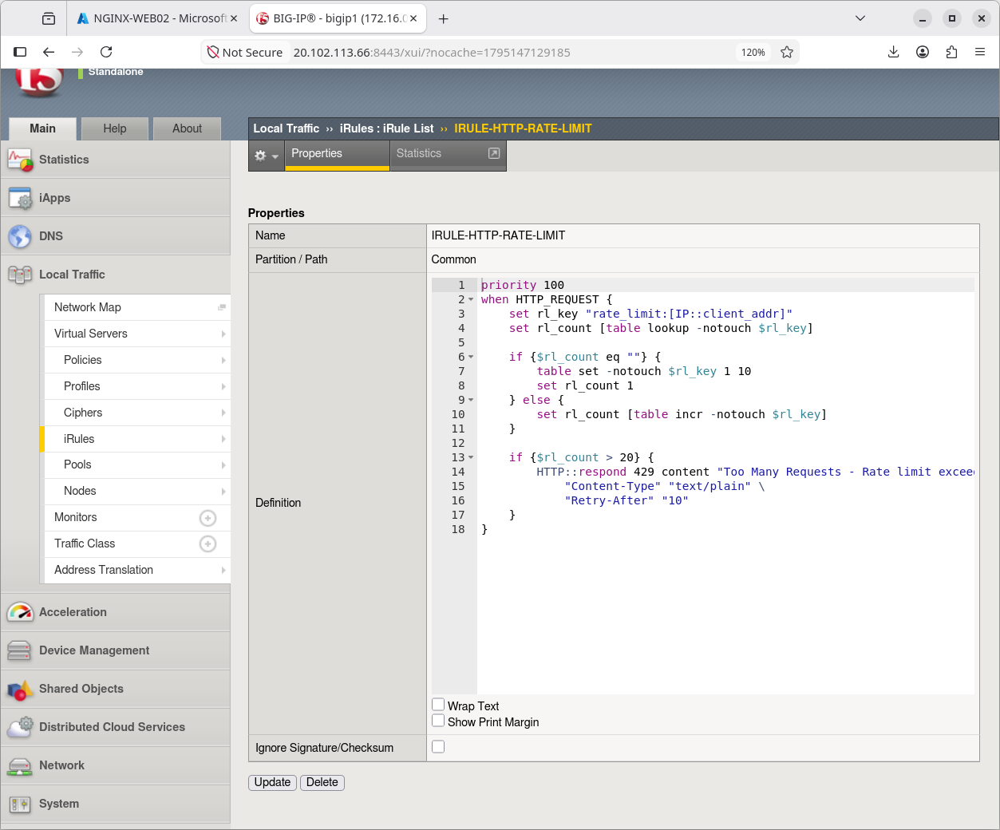

#### Technical Deep Dive:
- **`priority 100`:** Sets execution priority, ensuring rate limit verification executes before downstream URI routing or content inspection iRules.
- **`set rl_key "rate_limit:[IP::client_addr]"`:** Dynamically creates a unique hash key tied to the client's source IP address (e.g., `rate_limit:172.16.0.8`).
- **`table lookup -notouch $rl_key`:** Queries BIG-IP's high-speed in-memory session table without updating the entry's touch timer.
- **`table set -notouch $rl_key 1 10`:** If no previous entry exists, initializes the key with a count of `1` and a **10-second timeout**. The entry automatically expires and deletes itself from memory after 10 seconds.
- **`table incr -notouch $rl_key`:** Atomically increments the request counter for the client within the existing time window.
- **`HTTP::respond 429`:** When `$rl_count` exceeds 20 requests, BIG-IP intercepts the transaction and synthesizes an RFC 6585 `HTTP 429 Too Many Requests` status directly from TMM memory.
- **`"Retry-After" "10"`:** Standardized HTTP header instructing legitimate clients to pause requests for 10 seconds before retrying.

#### Architectural Advantage: Session Table (`table`) vs. Global Variables:
Using BIG-IP's native `table` abstraction ensures:
- **TMM Core Synchronization:** The table is maintained in shared kernel memory accessible across all TMM microkernel cores, preventing race conditions.
- **Automatic Garbage Collection:** Keys expire automatically via the kernel timer (`10` seconds) without requiring periodic cleanup cron jobs or memory sweeps.
- **Zero Backend Overhead:** Rate-limited requests are dropped and answered directly at the network edge, preserving backend application threads.

---

### 2. iRule Repository Overview
The compiled iRule was saved and verified in the BIG-IP system catalog under **Local Traffic &rarr; iRules &rarr; iRule List**, joining existing modular routing rules:

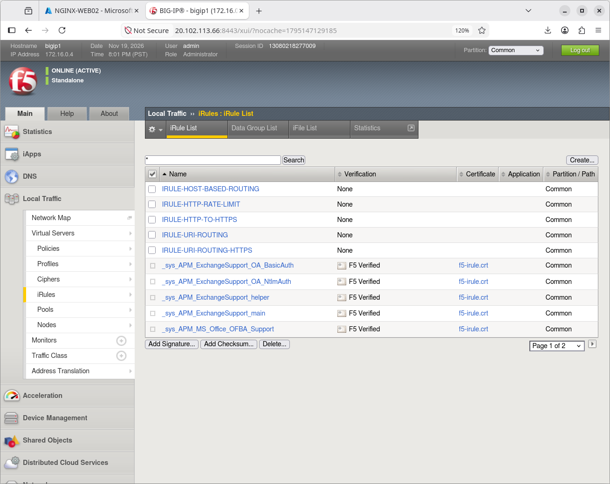

---

### 3. Virtual Server Resource Binding
The rate limiting iRule was bound to Virtual Server `VS-NGINX-HTTPS` under **Local Traffic &rarr; Virtual Servers &rarr; Virtual Server List &rarr; VS-NGINX-HTTPS &rarr; Resources**:

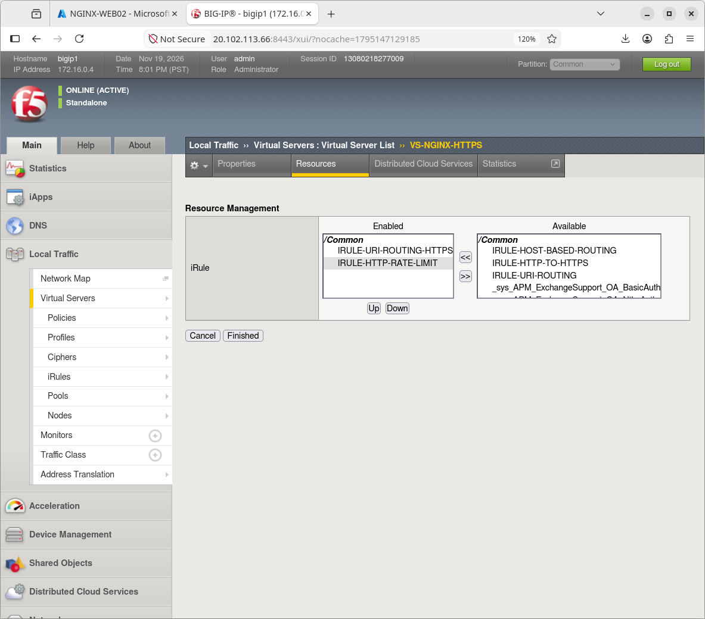

#### Virtual Server Configuration Matrix:
- **Virtual Server:** `VS-NGINX-HTTPS` (`172.16.0.7:443`)
- **Active iRules (Ordered Chain):**
  1. `IRULE-URI-ROUTING-HTTPS` (Layer 7 path steering)
  2. `IRULE-HTTP-RATE-LIMIT` (Layer 7 velocity throttling)
- **Default Pool:** `POOL-NGINX-HTTPS`

---

## Phase 3: Client Verification & Behavioral Testing

### 1. Sequential Rate Limit Breaching
To validate rate limiting behavior, a sequential test sequence of 25 HTTP requests was executed from `F5-CLIENT-01` (`172.16.0.8`):

```bash
azureuser@F5-CLIENT-01:~$ for i in $(seq 1 25); do echo -n "Req $i: "; curl -sk -o /dev/null -w "HTTP %{http_code}\n" https://172.16.0.7/; done
Req 1: HTTP 200
Req 2: HTTP 200
...
Req 19: HTTP 200
Req 20: HTTP 200
Req 21: HTTP 429
Req 22: HTTP 429
Req 23: HTTP 429
Req 24: HTTP 429
Req 25: HTTP 429

azureuser@F5-CLIENT-01:~$ curl -ik https://172.16.0.7
HTTP/1.0 429 Too Many Requests
Content-Type: text/plain
Retry-After: 10
Server: BigIP
Connection: Keep-Alive
Content-Length: 39

Too Many Requests - Rate limit exceeded
```

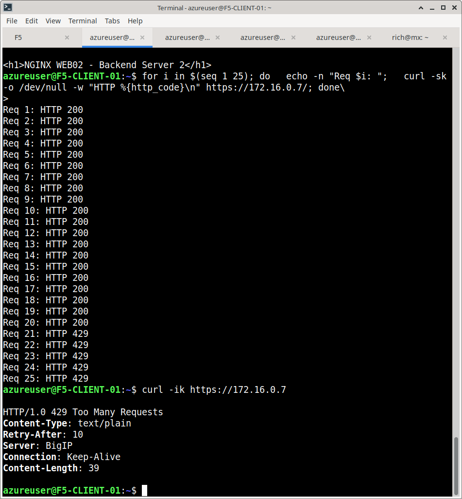

#### Empirical Observations:
1. **Deterministic Enforcement:** Requests 1 through 20 returned `HTTP 200 OK`. At exactly Request 21, the threshold was triggered and BIG-IP immediately returned `HTTP 429`.
2. **Edge Header Signature:** The response revealed `Server: BigIP` and `Retry-After: 10`, confirming that the response was synthesized natively by BIG-IP and never reached the NGINX backend.

---

### 2. Sliding Window Timer Expiration & Automatic Recovery
To verify that clients recover access once the 10-second throttling window expires, the client paused for 10 seconds before re-issuing an HTTPS request:

```bash
azureuser@F5-CLIENT-01:~$ curl -ik https://172.16.0.7
HTTP/1.1 200 OK
Server: nginx/1.24.0 (Ubuntu)
Date: Fri, 20 Nov 2026 04:26:14 GMT
Content-Type: text/html
Content-Length: 40
Last-Modified: Thu, 19 Nov 2026 07:23:47 GMT
Connection: keep-alive
ETag: "6afea403-28"
Accept-Ranges: bytes
Set-Cookie: BIGipServerPOOL-NGINX-HTTPS=83890348.47873.0000; path=/; Httponly; Secure

<h1>NGINX WEB01 - Backend Server 1</h1>
```

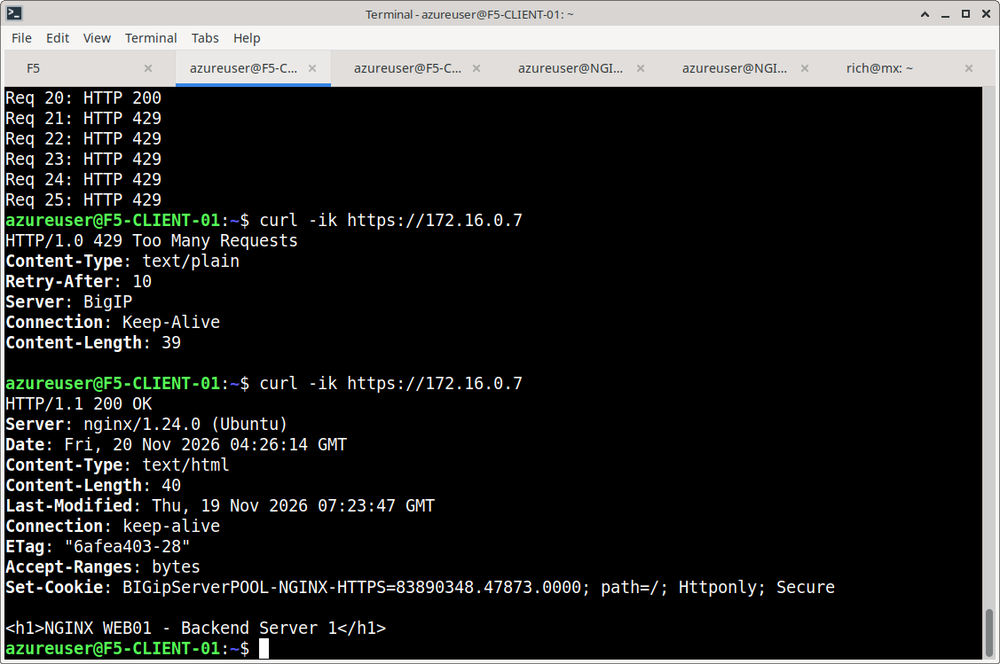

#### Recovery Verification:
- **Table Key Eviction:** Following 10 seconds of idle time, the `$rl_key` table entry expired from TMM memory.
- **Seamless Traffic Resumption:** The client's subsequent request was accepted, forwarded to backend node `NGINX-WEB01` (`172.16.0.5`), and returned `HTTP/1.1 200 OK` along with the standard application payload and persistence cookie.

---

## Phase 4: Wire-Level Decryption & Packet Analysis

### 1. Wireshark TLS Decryption Setup
Because traffic to `VS-NGINX-HTTPS` is encrypted via TLS 1.2/1.3, packet analysis requires decrypting the SSL/TLS payload. Under Wireshark **Preferences &rarr; Protocols &rarr; TLS**:
- **(Pre)-Master-Secret log filename:** `/home/rich/Documents/host-name-keys.log`
- Enabled: *Reassemble TLS records spanning multiple TCP segments*
- Enabled: *Reassemble TLS Application Data spanning multiple TLS records*

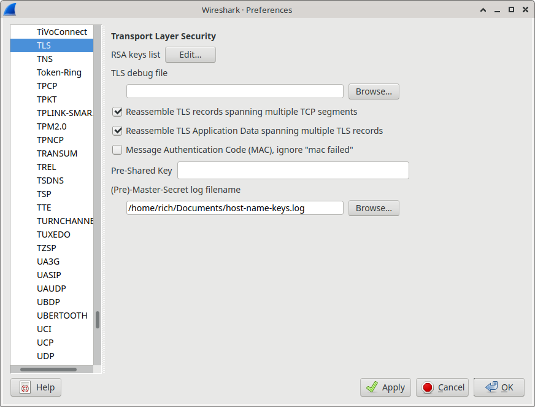

---

### 2. Decrypted HTTP Stream & Rate Limit Transition
Opening `irule-rate-limit.pcap` with the decrypted session keys and applying display filter `http` exposes the exact packet sequence:

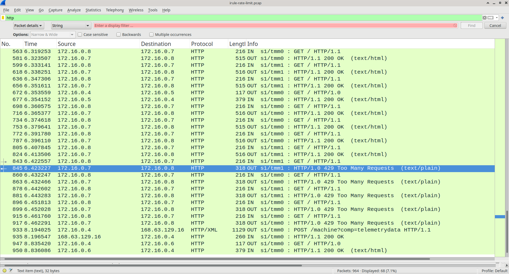

#### Sequence Analysis:
- **Frames 563 – 824:** Client (`172.16.0.8`) sends rapid `GET /` requests. BIG-IP forwards them to backend pool members (`172.16.0.5` / `172.16.0.6`), returning `HTTP/1.1 200 OK (text/html)`.
- **Frame 843:** Client initiates the 21st HTTP request: `GET / HTTP/1.1`.
- **Frame 845:** BIG-IP immediately returns `HTTP/1.0 429 Too Many Requests (text/plain)` via `OUT s1/tmm1`.
- **Frames 860 – 917:** Subsequent client requests are persistently rejected with `HTTP/1.0 429 Too Many Requests`.
- **Zero Backend Leakage:** Backend communication frames completely cease for the throttled client.

---

### 3. Layer 7 Synthetic Response Timing & Header Breakdown
Inspecting packet details for Frame 845 in Wireshark reveals the performance metrics of the iRule response:

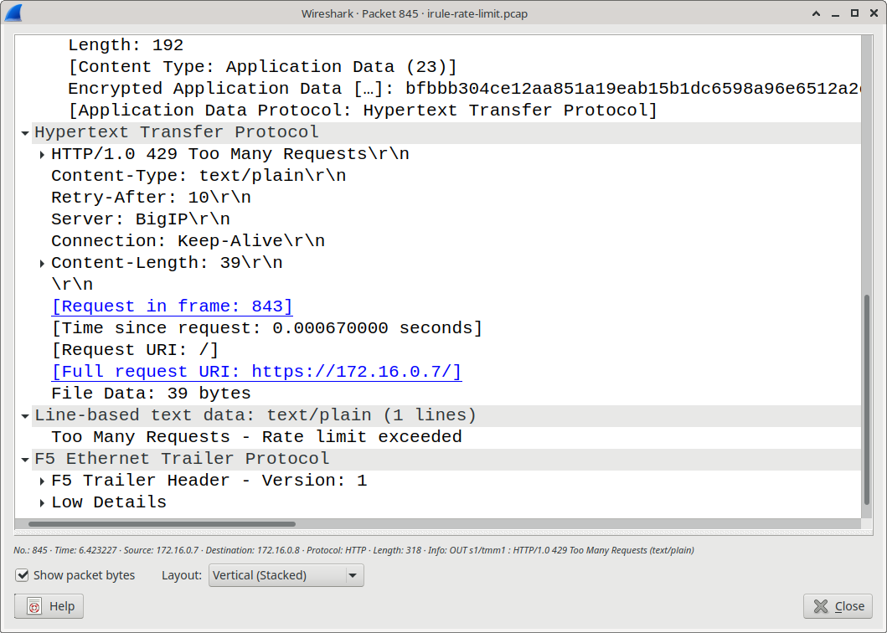

#### Header & Latency Analysis:
- **`Time since request: 0.000670000 seconds` (670 Microseconds):** BIG-IP received the client request in Frame 843 and synthesized the full HTTP 429 response in Frame 845 in just **0.67 milliseconds**, demonstrating extreme efficiency in TMM kernel space.
- **Status Line:** `HTTP/1.0 429 Too Many Requests\r\n`
- **Headers:** `Content-Type: text/plain`, `Retry-After: 10`, `Server: BigIP`, `Connection: Keep-Alive`, `Content-Length: 39`
- **Payload:** `Too Many Requests - Rate limit exceeded` (39 bytes).

---

### 4. F5 Ethernet Trailer Protocol Analysis
Examining Wireshark's proprietary **F5 Ethernet Trailer Protocol (Low Details)** for Frame 845 confirms the exact internal routing path within BIG-IP hardware:

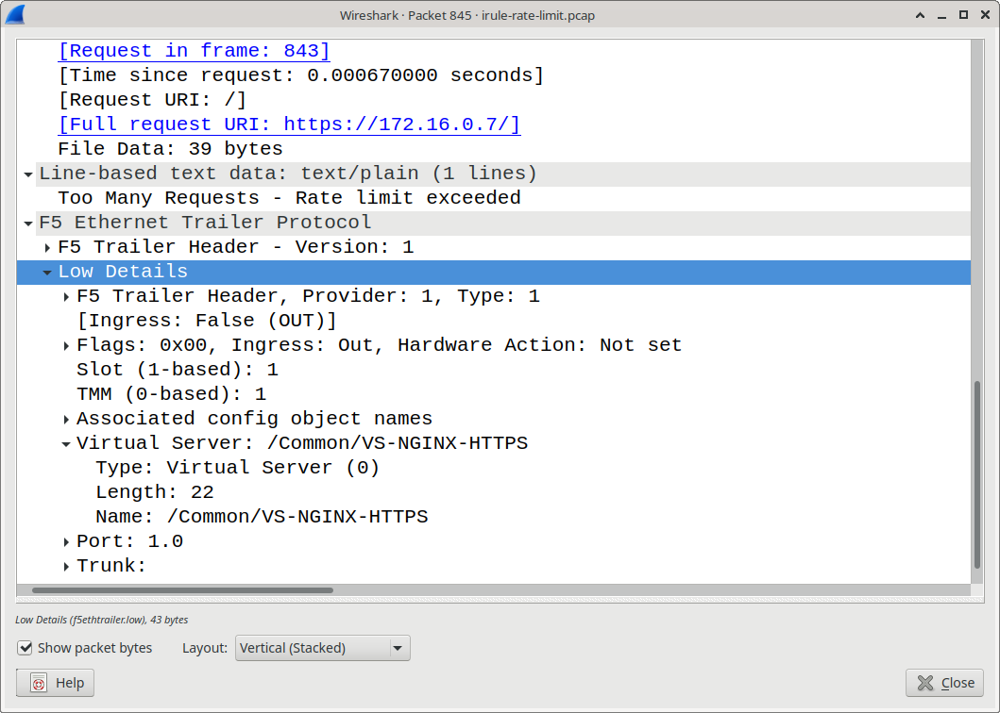

#### Low Details Inspection:
- **`Ingress: False (OUT)`:** The packet is an egress packet originating directly from the BIG-IP system.
- **`Slot (1-based): 1` / `TMM (0-based): 1`:** Executed on Slot 1, Core `tmm1`.
- **`Virtual Server: /Common/VS-NGINX-HTTPS`:** The packet was synthesized and bound directly by Virtual Server `VS-NGINX-HTTPS`.
- **Architectural Proof:** Because `Ingress` is false and the associated configuration object is the Virtual Server itself, this proves packet synthesis occurred in TMM memory without ever touching backend pool members or traversing internal VLANs.

---

## Phase 5: Kernel Performance & Execution Telemetry

### 1. TMOS CLI Rule Telemetry (`show ltm rule`)
To measure the CPU overhead introduced by executing TCL evaluation on every incoming HTTP request, runtime metrics were captured via TMOS CLI:

```bash
azureuser@(localhost)(pid-1590)(cfg-sync Standalone)(Active)(/Common)(tmos)# show ltm rule IRULE-HTTP-RATE-LIMIT

-------------------------------------------------------------
Ltm::Rule Event: IRULE-HTTP-RATE-LIMIT:HTTP_REQUEST
-------------------------------------------------------------
Priority                                                 100
Executions
  Total                                                   83
  Failures                                                 0
  Aborts                                                   0
CPU Cycles on Executing
  Average                                              55.8K
  Maximum                                             140.5K
  Minimum                                              19.5K
```

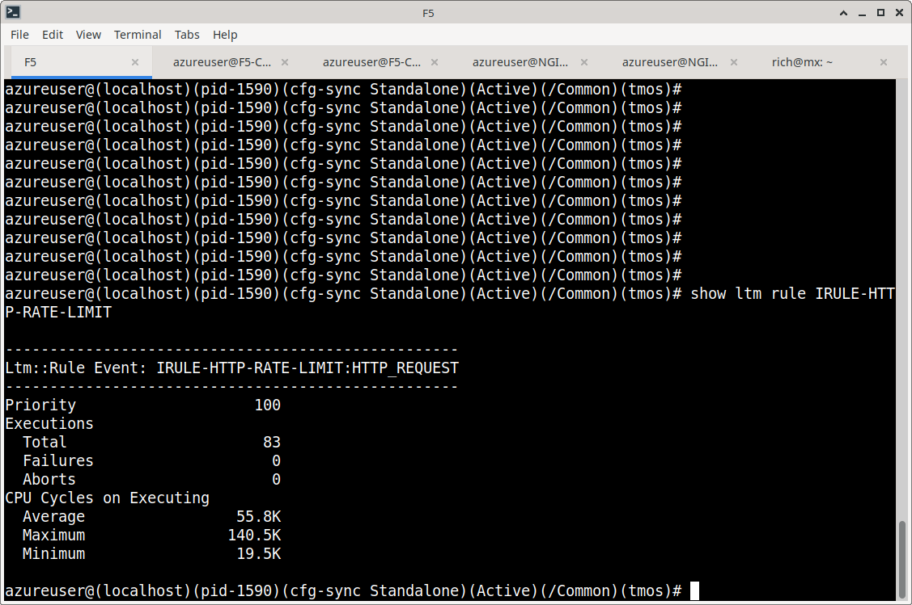

#### Metric Breakdown:
- **Total Executions: 83:** Corresponds to cumulative test runs conducted from the client.
- **Failures & Aborts: 0:** Zero syntax errors, runtime crashes, or TCL exceptions occurred.
- **Average CPU Cycles: 55.8K cycles:** At an average of 55,800 CPU cycles per invocation, the iRule consumes negligible processor time on modern multi-gigahertz processors, easily sustaining high wire speeds without causing CPU spikes.

---

### 2. Web GUI Module Statistics
The execution telemetry was cross-verified in the BIG-IP Web Configuration Utility under **Statistics &rarr; Module Statistics : Local Traffic &rarr; iRules**:

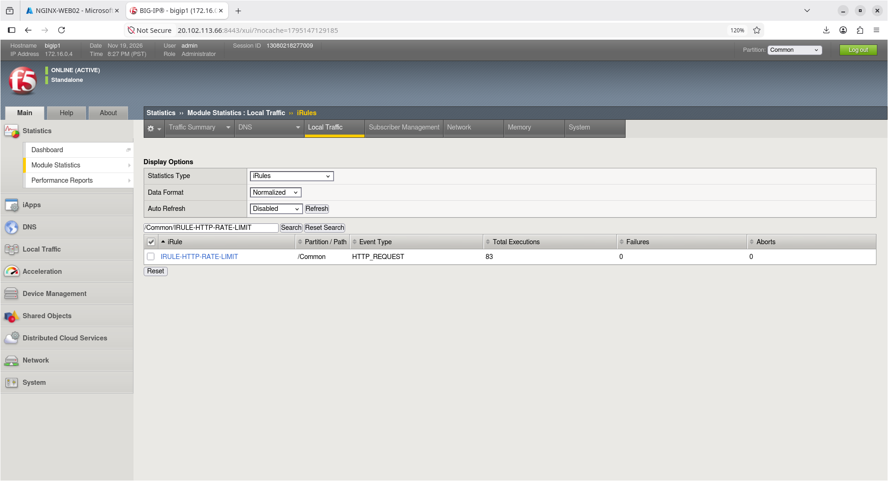

- **iRule Name:** `/Common/IRULE-HTTP-RATE-LIMIT`
- **Event Type:** `HTTP_REQUEST`
- **Total Executions:** `83`
- **Failures:** `0`
- **Aborts:** `0`

---

## Summary of All Lab Screenshots

Every screenshot captured during this lab exercise is cataloged below, mapping each artifact to its specific architectural phase and operational purpose:

| # | Screenshot Filename | Layer | Lab Phase | Technical Purpose & Validated Evidence |
|---|---|---|---|---|
| 1 | `configuring-connection-limit.png` | Layer 4 | Phase 1.1 | TMOS CLI configuration of `connection-limit 50` on `VS-NGINX-HTTPS`. |
| 2 | `connection-details-triggering-100-connections.png` | Layer 4 | Phase 1.2 | `wrk` client benchmark generating 100 concurrent connections, capturing 13,261 connect errors. |
| 3 | `connection-details-only-50-allows.png` | Layer 4 | Phase 1.3 | GUI Pool statistics proving pool concurrency capped at 50 (25 on WEB01, 25 on WEB02). |
| 4 | `connection-limit-rst-172.16.0.4.png` | Layer 4 | Phase 1.4 | Wireshark capture of TCP RST packets originating from F5 Self-IP `172.16.0.4` across `tmm0`/`tmm1`. |
| 5 | `creating-i-rule.png` | Layer 7 | Phase 2.1 | Authoring `IRULE-HTTP-RATE-LIMIT` using TMOS session tables and `HTTP::respond 429`. |
| 6 | `i-rule-overview.png` | Layer 7 | Phase 2.2 | BIG-IP GUI iRules list overview displaying active `/Common` partition rules. |
| 7 | `applying-i-rule.png` | Layer 7 | Phase 2.3 | Resource binding of `IRULE-HTTP-RATE-LIMIT` to Virtual Server `VS-NGINX-HTTPS`. |
| 8 | `i-rule-curl-outcome.png` | Layer 7 | Phase 3.1 | Sequential `curl` test demonstrating 20x HTTP 200 OK followed by HTTP 429 Too Many Requests. |
| 9 | `i-rule-curl-outcome-successful-after-timer.png` | Layer 7 | Phase 3.2 | Verification of client recovery and HTTP 200 OK after 10-second sliding expiration window. |
| 10 | `i-rule-wireshark-preferences-import-key.png` | Layer 7 | Phase 4.1 | Importing TLS pre-master secret key (`host-name-keys.log`) in Wireshark for HTTPS decryption. |
| 11 | `i-rule-wireshark-http-filter-overview.png` | Layer 7 | Phase 4.2 | Decrypted Wireshark HTTP stream showing transition from HTTP 200 to edge-enforced HTTP 429. |
| 12 | `i-rule-wireshark-429-details.png` | Layer 7 | Phase 4.3 | Packet inspection of Frame 845 proving **670 µs turnaround latency** and `Retry-After: 10`. |
| 13 | `i-rule-wireshark-429-details-virtual-server.png` | Layer 7 | Phase 4.4 | F5 Ethernet Trailer Low Details proving packet origination from `/Common/VS-NGINX-HTTPS` on `tmm1`. |
| 14 | `show-ltm-rule.png` | Telemetry | Phase 5.1 | TMOS CLI `show ltm rule` displaying 83 executions, 0 failures, and 55.8K avg CPU cycles. |
| 15 | `statistics.png` | Telemetry | Phase 5.2 | GUI Module Statistics confirming 83 executions with zero failures or aborts. |

---

## Conclusion & Operational Best Practices

1. **Defense-in-Depth Layering:** Layer 4 connection limits (`connection-limit`) prevent socket pool starvation from volumetric TCP floods, while Layer 7 session table rate limiting (`IRULE-HTTP-RATE-LIMIT`) protects application compute resources from high-frequency HTTP abuse.
2. **Sub-Millisecond Wire Response:** By synthesizing HTTP 429 responses directly within TMM memory in **670 microseconds**, BIG-IP completely isolates backend application servers from malicious or runaway traffic.
3. **Session Table Scalability:** Leveraging F5 TMOS session tables (`table` command) provides atomic, lockless, multi-core rate limiting with built-in sliding expiration timers, eliminating the overhead of external key-value stores.
4. **RFC 6585 Compliance:** Supplying standardized `HTTP 429` status codes alongside `Retry-After` headers provides clear guidance for well-behaved API consumers and mobile clients, promoting automatic client-side throttling.
