# HTTP Rate Limiting & Connection Limiting — Screenshot Catalog & Walkthrough

This directory contains visual artifacts, configuration captures, packet analysis traces, and execution telemetry for the **Layer 4 Connection Limiting & Layer 7 HTTP Rate Limiting** lab on F5 BIG-IP LTM.

For the comprehensive engineering report, architecture sequence diagrams, and configuration steps, see the master documentation in [../README.md](../README.md).

---

## Screenshot Inventory & Visual Walkthrough

### 1. TMOS Connection Limit Configuration
- **File:** [configuring-connection-limit.png](./configuring-connection-limit.png)
- **Layer:** Layer 4 (Transport / TCP)
- **Description:** Configuring a strict ceiling of 50 concurrent client connections on Virtual Server `VS-NGINX-HTTPS` via the TMOS command line (`modify ltm virtual VS-NGINX-HTTPS connection-limit 50`).

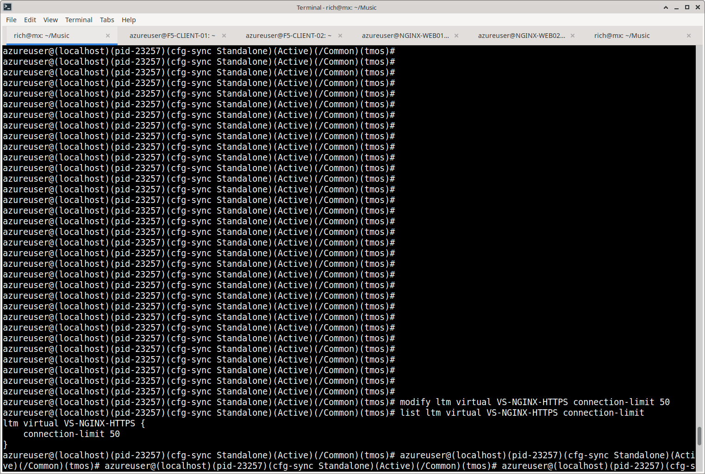

---

### 2. High-Concurrency Stress Benchmark (`wrk`)
- **File:** [connection-details-triggering-100-connections.png](./connection-details-triggering-100-connections.png)
- **Layer:** Layer 4 (Transport / TCP)
- **Description:** Multi-threaded stress testing executed from `F5-CLIENT-01` (`172.16.0.8`) using `wrk -t4 -c100 -d30s https://172.16.0.7/`. Breaching the 50-connection ceiling triggers 13,261 connect socket errors due to edge TCP resets by BIG-IP.

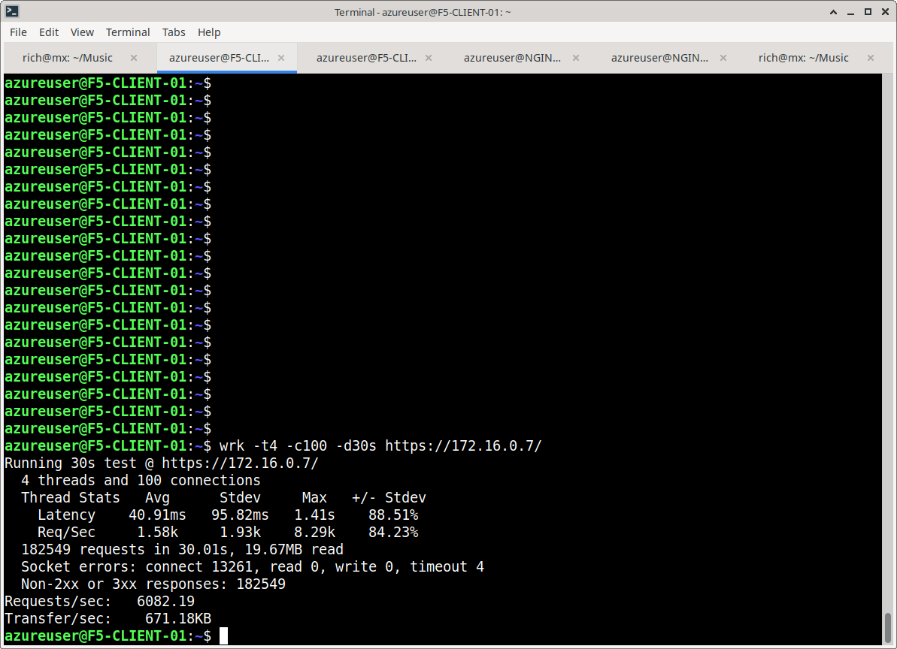

---

### 3. BIG-IP Pool Concurrency Enforcement
- **File:** [connection-details-only-50-allows.png](./connection-details-only-50-allows.png)
- **Layer:** Layer 4 (Transport / TCP)
- **Description:** BIG-IP Web Configuration Utility under **Statistics » Module Statistics : Local Traffic » Pools** showing that `POOL-NGINX-HTTPS` strictly enforced the 50-connection ceiling (Current Connections = 50), distributing active sockets equally across backend nodes (25 on `NGINX-WEB01:443`, 25 on `NGINX-WEB02:443`).

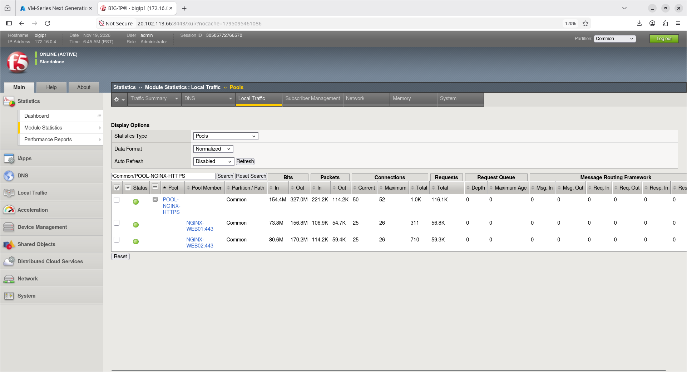

---

### 4. Wire-Level TCP RST Analysis
- **File:** [connection-limit-rst-172.16.0.4.png](./connection-limit-rst-172.16.0.4.png)
- **Layer:** Layer 4 (Transport / TCP)
- **Description:** Wireshark capture of `connection-limit.pcap` with filter `(tcp.flags.reset == 1) && (ip.src == 172.16.0.4)`. Demonstrates F5 TMM microkernel cores (`s1/tmm0`, `s1/tmm1`) shedding excess TCP connection attempts with immediate `[RST, ACK]` packets originating from internal Self-IP `172.16.0.4`.

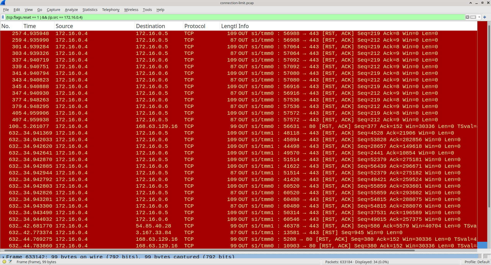

---

### 5. Authoring Rate Limiting iRule (`IRULE-HTTP-RATE-LIMIT`)
- **File:** [creating-i-rule.png](./creating-i-rule.png)
- **Layer:** Layer 7 (Application / HTTP)
- **Description:** Authoring the rate limiting iRule in BIG-IP GUI utilizing native session tables (`table lookup`, `table set -notouch`, `table incr -notouch`). Tracks request velocity per client IP over a 10-second sliding expiration window, synthesizing an RFC 6585 `HTTP 429 Too Many Requests` response with `Retry-After: 10` when requests exceed 20.

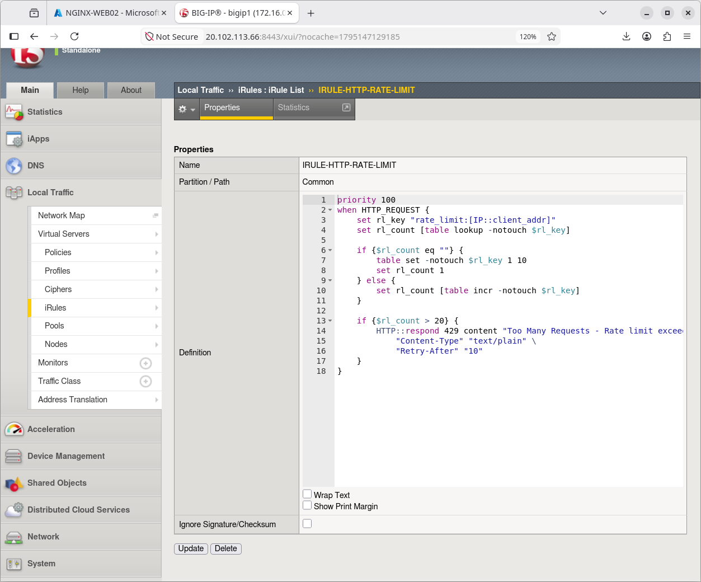

---

### 6. BIG-IP iRule Repository List
- **File:** [i-rule-overview.png](./i-rule-overview.png)
- **Layer:** Layer 7 (Application / HTTP)
- **Description:** Catalog of compiled and active iRules under **Local Traffic » iRules : iRule List** in the `/Common` partition, showing `IRULE-HTTP-RATE-LIMIT`.

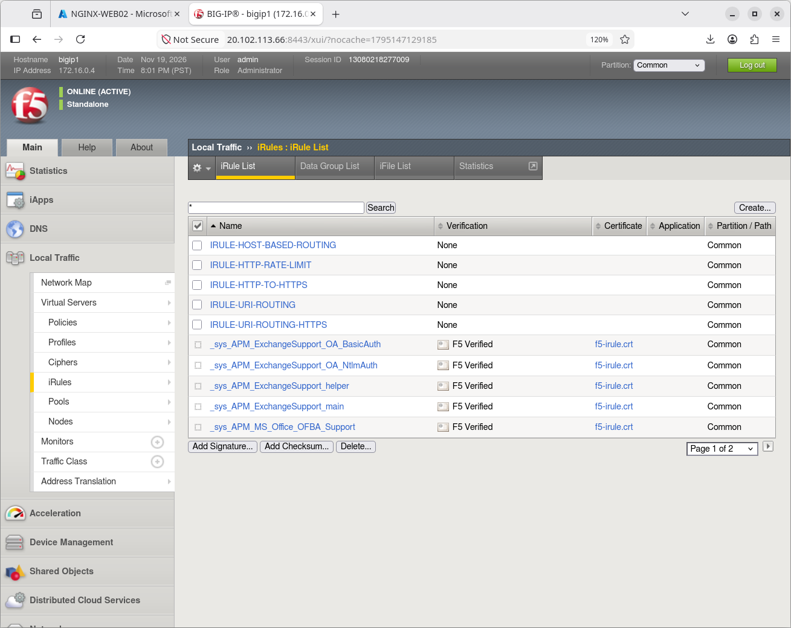

---

### 7. Binding iRule to Virtual Server
- **File:** [applying-i-rule.png](./applying-i-rule.png)
- **Layer:** Layer 7 (Application / HTTP)
- **Description:** Binding `IRULE-HTTP-RATE-LIMIT` under **Local Traffic » Virtual Servers : Virtual Server List » VS-NGINX-HTTPS » Resources** alongside `IRULE-URI-ROUTING-HTTPS`.

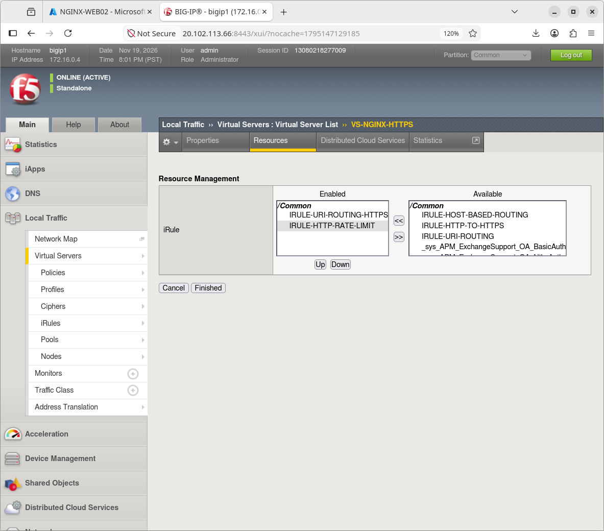

---

### 8. Sequential Client Throttling Verification
- **File:** [i-rule-curl-outcome.png](./i-rule-curl-outcome.png)
- **Layer:** Layer 7 (Application / HTTP)
- **Description:** Client-side bash loop (`seq 1 25`) executing sequential HTTPS requests. Requests 1 through 20 succeed with `HTTP 200 OK`. Request 21 breaches the threshold and returns `HTTP/1.0 429 Too Many Requests` with `Server: BigIP` and `Retry-After: 10`.

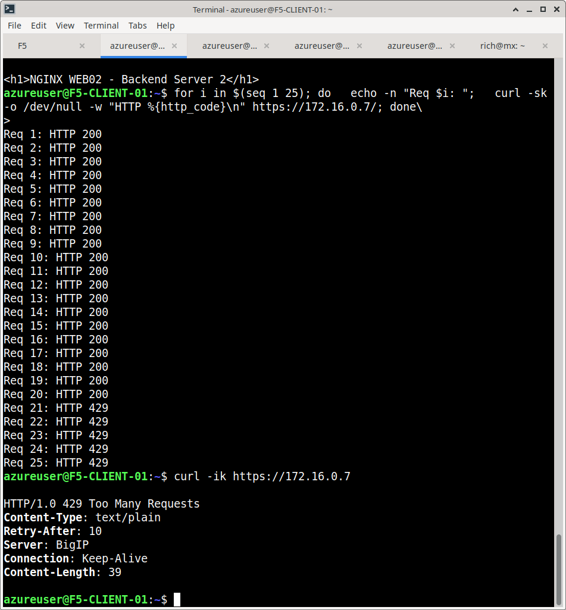

---

### 9. Sliding Window Expiration & Automatic Recovery
- **File:** [i-rule-curl-outcome-successful-after-timer.png](./i-rule-curl-outcome-successful-after-timer.png)
- **Layer:** Layer 7 (Application / HTTP)
- **Description:** Validating automatic traffic recovery after the 10-second sliding expiration timer elapses. Subsequent `curl` request succeeds with `HTTP/1.1 200 OK` from backend server `NGINX WEB01` with application payload and persistence cookie.

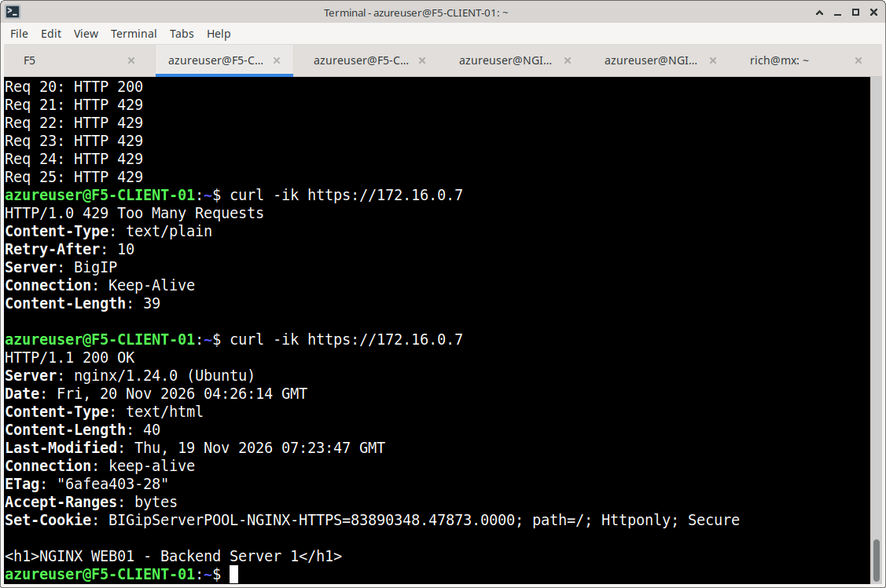

---

### 10. Wireshark TLS Decryption Configuration
- **File:** [i-rule-wireshark-preferences-import-key.png](./i-rule-wireshark-preferences-import-key.png)
- **Layer:** Layer 7 (Application / TLS)
- **Description:** Configuring Wireshark **Preferences » Protocols » TLS** with pre-master secret log `/home/rich/Documents/host-name-keys.log` to decrypt HTTPS application data in `irule-rate-limit.pcap`.

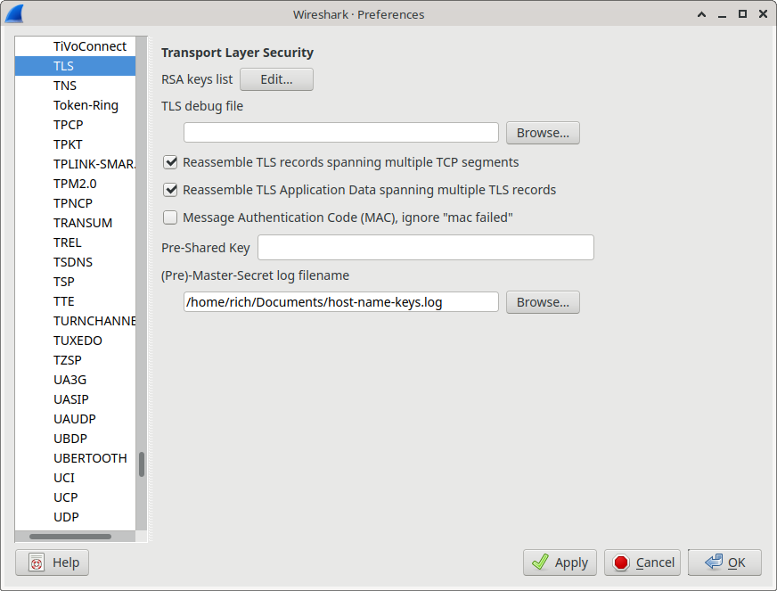

---

### 11. Decrypted HTTP Stream & 429 Transition
- **File:** [i-rule-wireshark-http-filter-overview.png](./i-rule-wireshark-http-filter-overview.png)
- **Layer:** Layer 7 (Application / HTTP)
- **Description:** Decrypted HTTP packet overview in Wireshark displaying the transition from initial `HTTP/1.1 200 OK` responses to edge-synthesized `HTTP/1.0 429 Too Many Requests` (Frame 845 onwards) once the rate limit threshold is crossed.

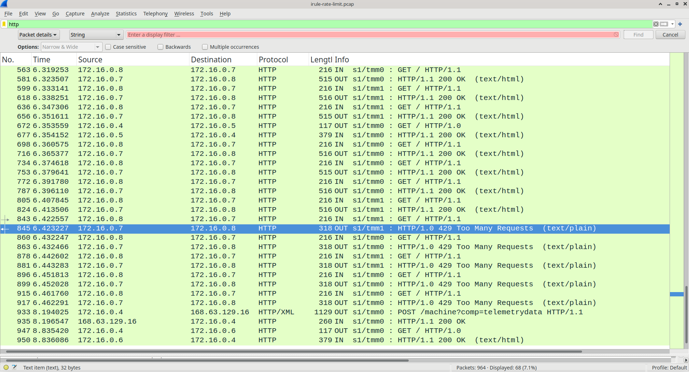

---

### 12. Synthetic HTTP 429 Response Latency & Headers
- **File:** [i-rule-wireshark-429-details.png](./i-rule-wireshark-429-details.png)
- **Layer:** Layer 7 (Application / HTTP)
- **Description:** Packet-level inspection of Frame 845 demonstrating sub-millisecond edge synthesis (**670 microseconds / 0.00067s turnaround**), HTTP status `429 Too Many Requests`, `Retry-After: 10`, `Server: BigIP`, and custom payload `Too Many Requests - Rate limit exceeded`.

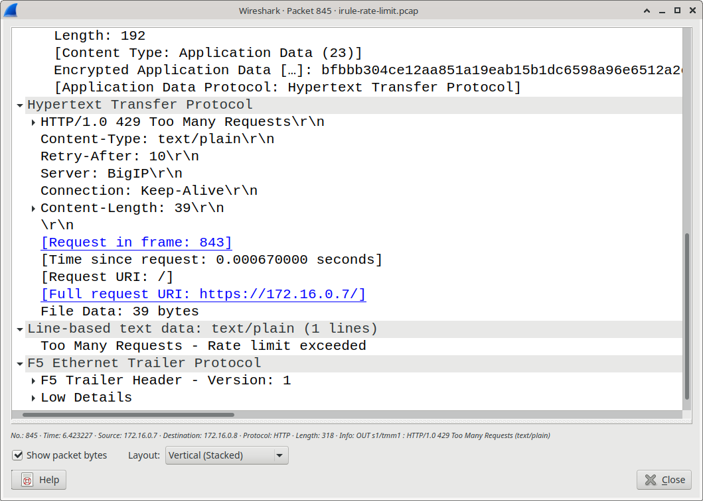

---

### 13. F5 Ethernet Trailer Protocol Dissection
- **File:** [i-rule-wireshark-429-details-virtual-server.png](./i-rule-wireshark-429-details-virtual-server.png)
- **Layer:** Network / Microkernel Telemetry
- **Description:** F5 Ethernet Trailer Protocol (Low Details) dissection in Wireshark proving egress packet generation directly by Virtual Server `/Common/VS-NGINX-HTTPS` on `tmm1` (`Ingress: False (OUT)`), confirming backend isolation.

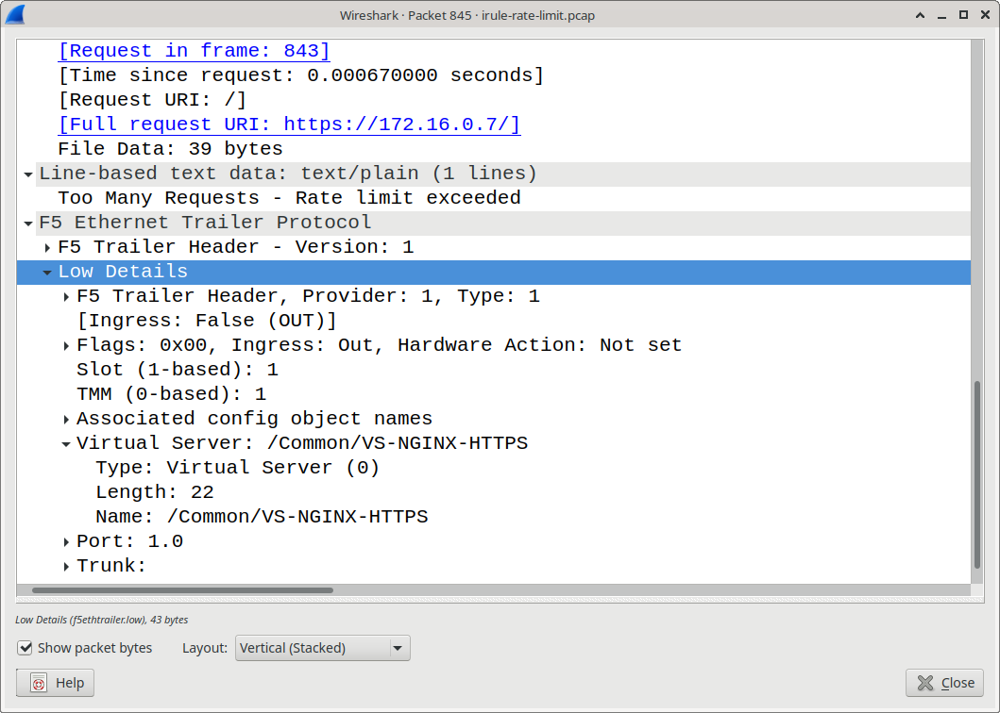

---

### 14. TMOS Kernel Execution Statistics
- **File:** [show-ltm-rule.png](./show-ltm-rule.png)
- **Layer:** Telemetry / Microkernel
- **Description:** Output of TMOS CLI command `show ltm rule IRULE-HTTP-RATE-LIMIT` showing 83 total executions, 0 failures, 0 aborts, and an average CPU cost of only 55.8K CPU cycles per execution.

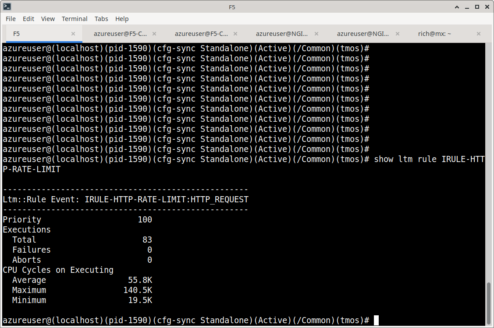

---

### 15. Web Configuration Utility iRule Statistics
- **File:** [statistics.png](./statistics.png)
- **Layer:** Telemetry / Management GUI
- **Description:** BIG-IP GUI verification under **Statistics » Module Statistics : Local Traffic » iRules** confirming 83 executions with zero failures or aborts for `/Common/IRULE-HTTP-RATE-LIMIT`.

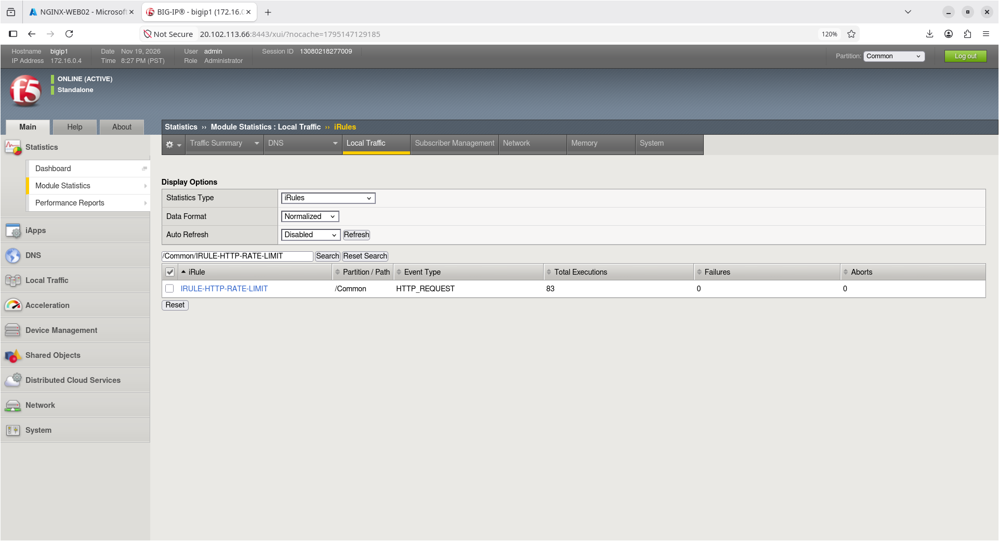
