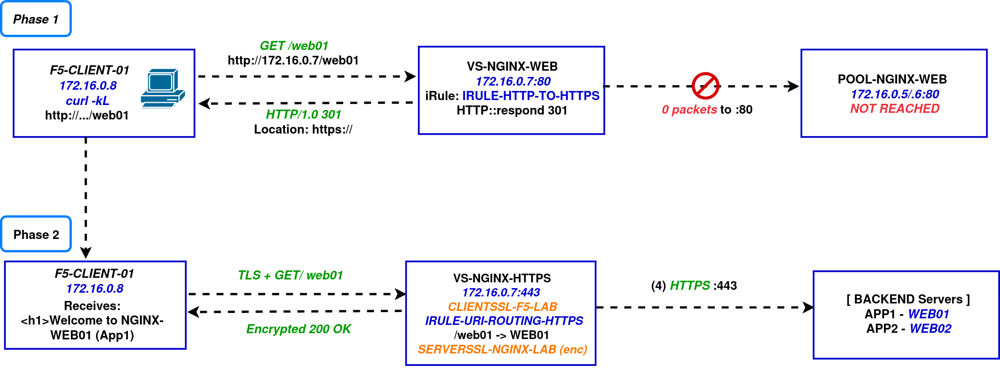
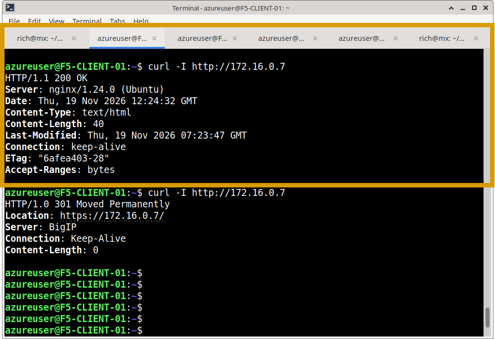
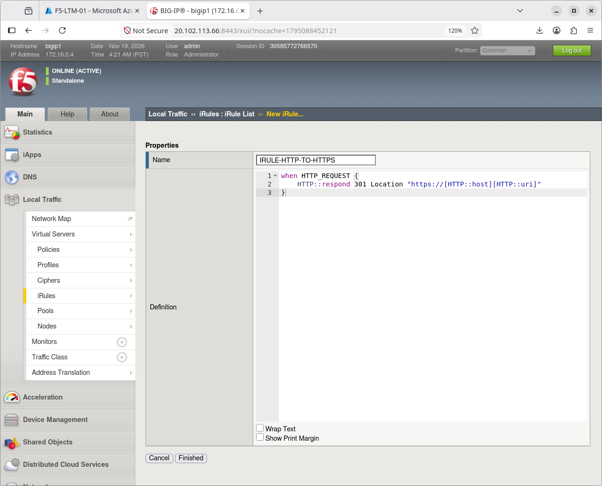
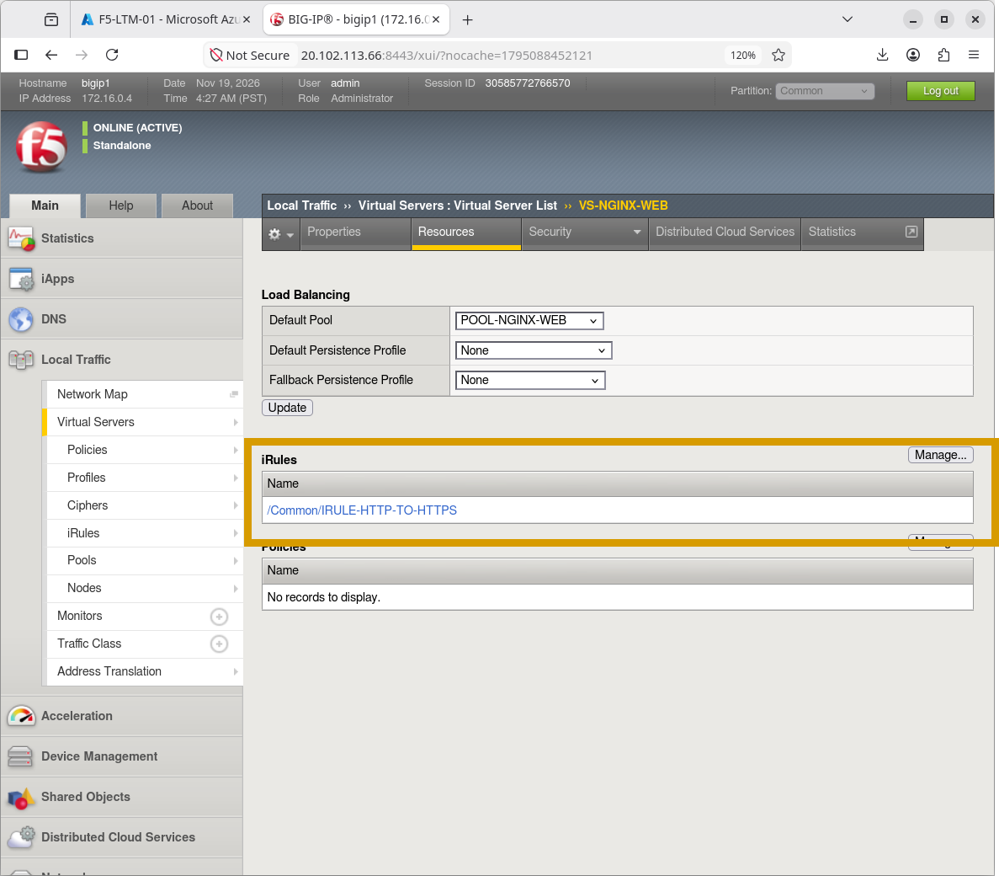
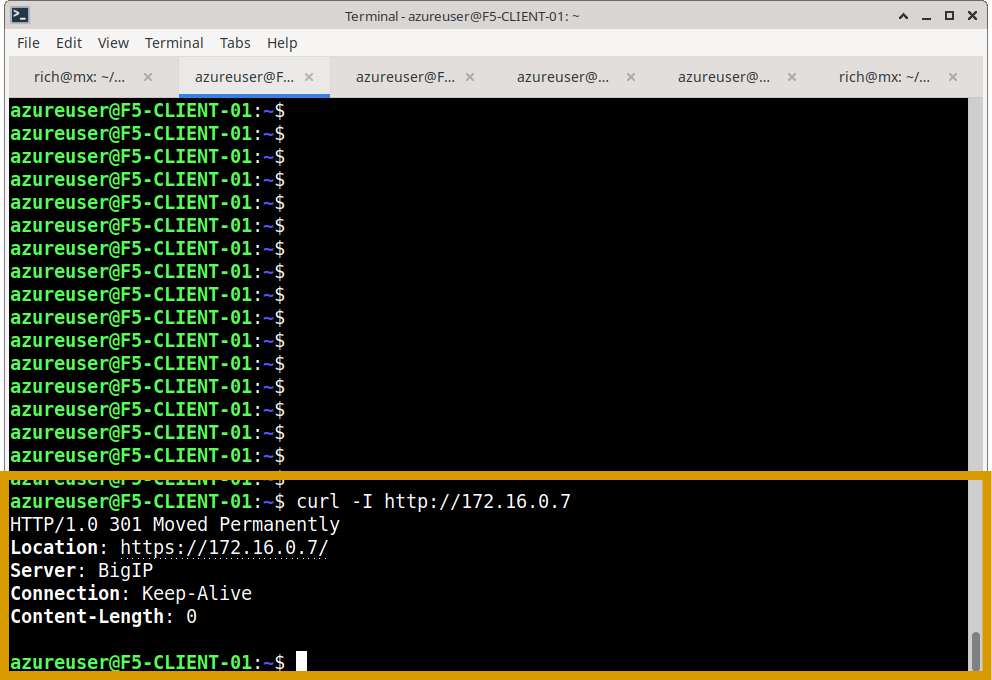
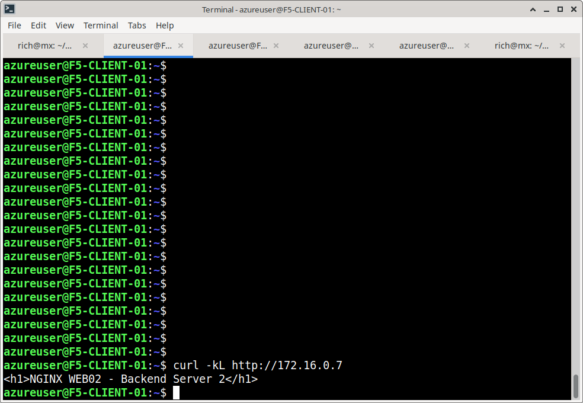
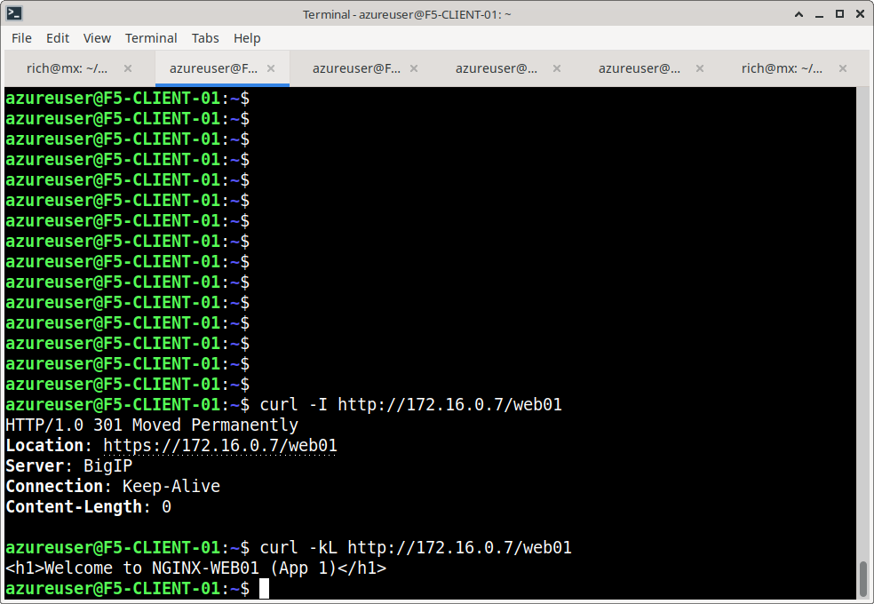
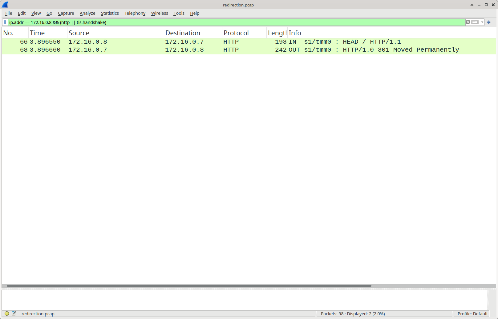
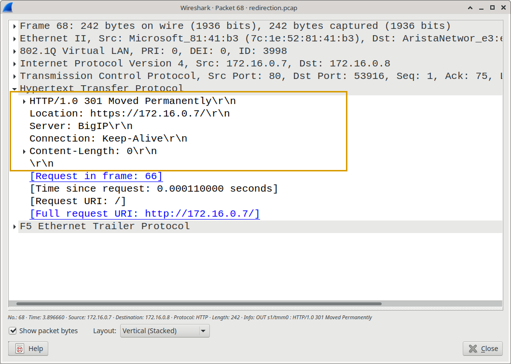

# Automated HTTP-to-HTTPS Redirection via iRules 

## Summary & Engineering Objectives

This project documents the architectural design, implementation, and packet-level verification of automated **HTTP-to-HTTPS Redirection** on an **F5 BIG-IP Local Traffic Manager (LTM)** deployed in Microsoft Azure.

In modern enterprise architectures, transmitting unencrypted web traffic over cleartext HTTP (`TCP/80`) poses severe security vulnerabilities, including credential theft, session hijacking, eavesdropping, and Man-in-the-Middle (MitM) tampering. Compliance frameworks (such as PCI-DSS 4.0, NIST SP 800-52r2, and HIPAA) mandate universal TLS encryption for all public-facing and internal web services.

However, end users and legacy client applications routinely initiate connections using plain `http://`. To enforce transport security without degrading user experience or burdening backend application servers, the Application Delivery Controller (ADC) must intercept inbound cleartext requests at the network perimeter and automatically upgrade the connection to `https://`.

### Core Engineering Objectives:
1. **Perimeter Redirection Architecture:** Establish a dedicated HTTP listener Virtual Server (`VS-NGINX-WEB`) listening on port 80 to terminate cleartext traffic, preventing unencrypted requests from reaching backend servers.
2. **RFC 7231 Compliant Permanent Redirection (`301 Moved Permanently`):** Implement a high-performance **iRule** (`IRULE-HTTP-TO-HTTPS`) that intercepts HTTP requests and immediately synthesizes an HTTP 301 response directly from BIG-IP kernel memory.
3. **Dynamic Host & URI Preservation:** Utilize F5 Traffic Management Microkernel (TMM) expansion variables (`[HTTP::host]` and `[HTTP::uri]`) to preserve full directory paths, query parameters, and subdomains dynamically without hardcoding static URLs.
4. **End-to-End Encryption Traversal:** Validate that client applications following the redirect (`curl -kL`) seamlessly establish an encrypted TLS 1.2 session with the HTTPS Virtual Server (`VS-NGINX-HTTPS`) and reach backend applications.
5. **Wire-Level Latency Verification:** Empirically analyze packet captures (`redirection.pcap`) in Wireshark to prove microsecond response turnaround and zero backend resource utilization.

---

## Architecture & Traffic Flow Topology

The deployment utilizes a dual-tier Virtual Server architecture. Port 80 traffic hits `VS-NGINX-WEB`, where the iRule executes an immediate 301 redirect. The client's subsequent HTTPS request connects directly to `VS-NGINX-HTTPS` on port 443.
Azure VNet: vnet-eastus-1  |  Subnet: snet-eastus-1 (172.16.0.0/24)



### Infrastructure Addressing & Role Matrix

| Component | IP Address | Port / Protocol | Profile / Mechanism | Description & Role |
|---|---|---|---|---|
| **F5-CLIENT-01** | `172.16.0.8` | Ephemeral &rarr; `80`/`443` | Ubuntu Linux Client | Generates baseline verification and redirect tests via `curl` |
| **VS-NGINX-WEB** | `172.16.0.7` | `TCP/80` (HTTP) | Standard Virtual Server | Inbound HTTP listener; applies `IRULE-HTTP-TO-HTTPS` |
| **VS-NGINX-HTTPS** | `172.16.0.7` | `TCP/443` (HTTPS) | Standard Virtual Server | Secure endpoint terminating TLS (`CLIENTSSL-F5-LAB`) and routing traffic |
| **F5 BIG-IP Self-IP** | `172.16.0.4` | System / Self-IP | Internal Gateway | Originates health monitoring probes and internal routing |
| **NGINX-WEB01** | `172.16.0.5` | `TCP/443` (HTTPS) / `80` | Backend Node 1 | Production web server hosting App 1 (`/web01`) |
| **NGINX-WEB02** | `172.16.0.6` | `TCP/443` (HTTPS) / `80` | Backend Node 2 | Production web server hosting App 2 (`/web02`) |

---

## Phase 1: Pre-Implementation Baseline (Cleartext Vulnerability)

Prior to applying the redirection iRule, `VS-NGINX-WEB` passed incoming HTTP requests directly to backend application servers over cleartext port 80.

From test client `F5-CLIENT-01`, a baseline HTTP request was executed against the Virtual Server:

```bash
azureuser@F5-CLIENT-01:~$ curl -I http://172.16.0.7
HTTP/1.1 200 OK
Server: nginx/1.24.0 (Ubuntu)
Date: Thu, 19 Nov 2026 12:24:32 GMT
Content-Type: text/html
Content-Length: 40
Last-Modified: Thu, 19 Nov 2026 07:23:47 GMT
Connection: keep-alive
ETag: "6afea403-28"
Accept-Ranges: bytes
```



### Vulnerability Analysis:
1. **Unencrypted In-Transit Data:** Payloads, cookies, and headers were transmitted across the network in cleartext, vulnerable to packet sniffing.
2. **Server Fingerprinting:** The backend response exposed internal application server metadata (`Server: nginx/1.24.0 (Ubuntu)`), aiding reconnaissance by potential attackers.
3. **Wasted Backend Compute:** Backend NGINX workers processed and logged unencrypted requests that should have been secured at the load balancer.

---

## Phase 2: iRule Design & Compilation (`IRULE-HTTP-TO-HTTPS`)

To automate redirection, a custom Tool Command Language (TCL) iRule named `IRULE-HTTP-TO-HTTPS` was authored under **Local Traffic &rarr; iRules &rarr; iRule List**:

```tcl
when HTTP_REQUEST {
    HTTP::respond 301 Location "https://[HTTP::host][HTTP::uri]"
}
```



### Technical Deep Dive:
- **`when HTTP_REQUEST`:** Triggers as soon as the client finishes transmitting the HTTP request line and headers, before any backend pool member selection occurs.
- **`HTTP::respond 301`:** Directly constructs an RFC 7231 compliant `301 Moved Permanently` status line and terminates the request within TMM memory.
- **`Location "https://[HTTP::host][HTTP::uri]"`:**
  - `[HTTP::host]`: Dynamically extracts the client's requested `Host:` header (e.g., `172.16.0.7` or `app1.f5-lab.local`).
  - `[HTTP::uri]`: Dynamically captures the full request URI including the path and query string (e.g., `/web01`, `/search?id=123`).
  - `https://`: Prepend scheme switch, forcing the client's next connection to port 443.
- **Why `HTTP::respond 301` over `HTTP::redirect`:** The default `HTTP::redirect` command issues a `302 Found` (temporary redirect). Browsers do not cache 302 responses, forcing repeated cleartext round-trips on every subsequent visit. A `301 Moved Permanently` informs browsers, proxies, and search engines to update their internal address cache, automatically upgrading future sessions to HTTPS directly on the client side.

---

## Phase 3: Virtual Server Resource Binding

The iRule was bound to the port 80 HTTP Virtual Server `VS-NGINX-WEB` under **Local Traffic &rarr; Virtual Servers &rarr; Virtual Server List &rarr; VS-NGINX-WEB &rarr; Resources**:



### Configuration Architecture:
- **Virtual Server Name:** `VS-NGINX-WEB`
- **Destination:** `172.16.0.7:80`
- **Profiles:** `http` (required for Layer 7 HTTP parsing and iRule event triggering)
- **Active iRules:** `/Common/IRULE-HTTP-TO-HTTPS`
- **Default Pool:** `POOL-NGINX-WEB` (remains configured as fallback, but bypassed by the iRule's early response)

---

## Phase 4: Empirical Client Verification (`curl`)

From `F5-CLIENT-01` (`172.16.0.8`), multiple tests were conducted to validate header structure, redirect traversal, and URI preservation.

### 1. HTTP 301 Header Validation
Testing basic root requests confirmed that BIG-IP immediately intercepts the connection and returns the expected `301 Moved Permanently` header:

```bash
azureuser@F5-CLIENT-01:~$ curl -I http://172.16.0.7
HTTP/1.0 301 Moved Permanently
Location: https://172.16.0.7/
Server: BigIP
Connection: Keep-Alive
Content-Length: 0
```



- **`Server: BigIP`:** Confirms the response originated directly from the F5 ADC edge, never touching the backend NGINX server.
- **`Location: https://172.16.0.7/`:** Confirms successful protocol upgrade from `http://` to `https://`.
- **`Content-Length: 0`:** Zero bandwidth overhead for redirection payload.

---

### 2. Automated Redirect Traversal (`curl -kL`)
Using curl's `-L` (follow redirects) and `-k` (allow self-signed lab certificates) flags verified the full end-to-end user experience:

```bash
azureuser@F5-CLIENT-01:~$ curl -kL http://172.16.0.7
<h1>NGINX WEB02 - Backend Server 2</h1>
```



The client transparently received the 301 redirect on port 80, initiated an encrypted TLS handshake on port 443 with `VS-NGINX-HTTPS`, and received the backend application content.

---

### 3. Path & URI Preservation (`/web01`)
To ensure deep links are not truncated to the root domain during redirection, requests targeting specific subpaths were tested:

```bash
# Verify Location Header with Path
azureuser@F5-CLIENT-01:~$ curl -I http://172.16.0.7/web01
HTTP/1.0 301 Moved Permanently
Location: https://172.16.0.7/web01
Server: BigIP
Connection: Keep-Alive
Content-Length: 0

# Verify End-to-End Application Delivery
azureuser@F5-CLIENT-01:~$ curl -kL http://172.16.0.7/web01
<h1>Welcome to NGINX-WEB01 (App 1)</h1>
```



#### Architectural Significance:
1. `[HTTP::uri]` perfectly retained `/web01` in the `Location: https://172.16.0.7/web01` header.
2. When the client followed the redirect to `VS-NGINX-HTTPS`, the HTTPS Virtual Server's URI routing iRule (`IRULE-URI-ROUTING-HTTPS`) evaluated the path and routed the request directly to `NGINX-WEB01:443`, proving seamless inter-iRule interoperability.

---

## Phase 5: Wire-Level Packet Analysis (`redirection.pcap`)

A packet capture was recorded on BIG-IP during test execution to verify wire-level behavior and measure response latency.

Capture file reference: [redirection.pcap](file:///home/rich/Documents/f5-big-ip-ltm-lab/http-to-https-redirection/pcaps/redirection.pcap)

### Wireshark Filter: `ip.addr == 172.16.0.8 && (http || tls.handshake)`

| Packet List: HTTP Request & Immediate 301 Response | Deep Packet Inspection of Frame 68 (`301 Moved Permanently`) |
|---|---|
|  |  |

### Wire-Level Telemetry Breakdown:

```text
No.  Time      Source        Destination   Protocol Length Info
66   3.896550  172.16.0.8    172.16.0.7    HTTP     193    IN  s1/tmm0 : HEAD / HTTP/1.1
68   3.896660  172.16.0.7    172.16.0.8    HTTP     242    OUT s1/tmm0 : HTTP/1.0 301 Moved Permanently
```

### Critical Observations:
1. **Sub-Millisecond Turnaround (110 µs):**
   - Frame 66 (`HEAD / HTTP/1.1`) entered TMM at `3.896550` seconds.
   - Frame 68 (`HTTP/1.0 301 Moved Permanently`) was transmitted at `3.896660` seconds.
   - **Total processing latency:** **0.000110 seconds (110 microseconds)**. Because the response is generated directly in TMM kernel memory without initiating a server-side TCP handshake, processing latency is virtually zero.
2. **F5 Ethernet Trailer Protocol (FETP):**
   - Wireshark decodes the F5 internal diagnostic trailer showing traffic handled by Traffic Management Microkernel core 0 (`s1/tmm0`).
3. **Zero Backend Packet Transmission:**
   - In the packet capture, zero packets with destination `172.16.0.5:80` or `172.16.0.6:80` were generated for these client requests, verifying 100% backend compute isolation.

---

## Security Best Practices & Threat Model Considerations

### 1. HTTP 301 vs. HTTP 308 (Method Preservation for REST APIs)
- While `301 Moved Permanently` is standard for browser GET requests, RFC 7231 allows user agents to change the HTTP method from `POST` to `GET` upon following a 301 redirect.
- In production REST API environments handling incoming `POST`, `PUT`, or `PATCH` payloads, using **`HTTP 308 Permanent Redirect`** is recommended to guarantee that clients do not drop their request body or mutate the HTTP method upon redirecting.

### 2. HTTP Strict Transport Security (HSTS) Integration
Redirection on port 80 protects benign traffic, but an active Man-in-the-Middle attacker could intercept the initial cleartext request before the 301 arrives (SSL Stripping attack). To permanently close this window:
- Configure the **`Strict-Transport-Security`** header on `VS-NGINX-HTTPS`:
  ```text
  Strict-Transport-Security: max-age=31536000; includeSubDomains; preload
  ```
- Once the browser connects over HTTPS once, it will enforce HTTPS internally for all future visits, never attempting port 80 again.

### 3. Open Redirect Prevention
In custom iRules that construct redirect targets, never concatenate unvalidated user-controlled query strings directly into the destination host. By referencing `[HTTP::host]`, the iRule strictly retains the domain name already validated by DNS resolution and Virtual Server listener bindings, preventing external phishing redirects.
