# F5 BIG-IP LTM — SNAT Pools, Cloud Network Architecture & OneConnect Connection Multiplexing

## Executive Summary & Engineering Objectives

This project documents the architectural design, cloud infrastructure integration, and empirical verification of **Source Network Address Translation (SNAT)** and **F5 OneConnect Connection Pooling** on an **F5 BIG-IP Local Traffic Manager (LTM)** deployed in Microsoft Azure.

In public cloud and single-arm (one-arm) network designs, SNAT is a critical routing requirement. Because backend application servers reside on the same subnet as the load balancer or use the cloud fabric's default gateway, non-SNAT responses would route directly back to the client IP rather than returning through the BIG-IP proxy. This causes **asymmetric routing** and immediate TCP resets on the client. 

This project explores:
1. **Asymmetric Routing Remediation & SNAT Auto Map:** Evaluating baseline source translation via the BIG-IP Self-IP.
2. **Enterprise Scale-Out with Dedicated SNAT Pools:** Provisioning secondary Azure NIC private IP configurations (`172.16.0.10`, `172.16.0.11`) and binding them into an F5 SNAT Pool to prevent ephemeral port exhaustion under heavy traffic concurrency.
3. **F5 OneConnect Connection Pooling & Multiplexing:** Transforming connection management by decoupling client-side requests from server-side TCP handshakes, validated through controlled stress testing across multiple connection reuse thresholds.
4. **Wire-Level Packet Capture Analysis:** Empirical proof of address translation and connection reuse through Wireshark packet captures.

---

## Infrastructure Topology & Azure Cloud NIC Integration

In Microsoft Azure, an F5 virtual appliance cannot arbitrarily transmit packets from unassigned IP addresses; the Azure Software Defined Network (SDN) fabric drops traffic originating from IPs not registered on the virtual network interface controller (NIC).

To deploy a dedicated multi-member SNAT pool, the Azure NIC was expanded with secondary private static IP configurations matching the BIG-IP SNAT pool definition.

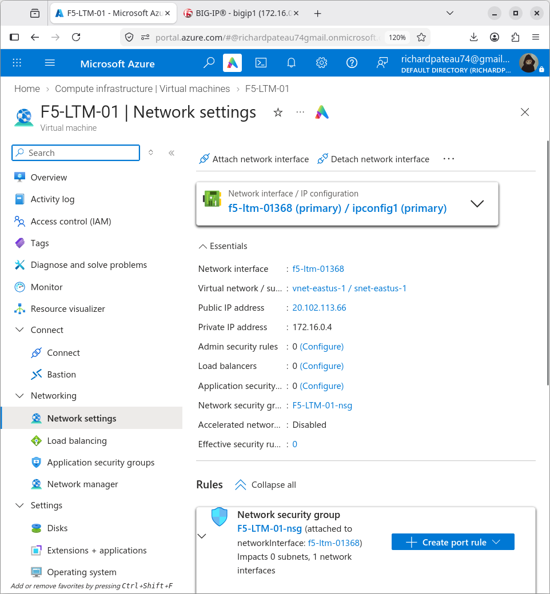

### Addressing & Infrastructure Topology

| Component | IP Address | Port / Scope | NIC Configuration | Role & Architectural Purpose |
|---|---|---|---|---|
| **F5-CLIENT-01** | `172.16.0.8` | Ephemeral &rarr; `80`/`443` | `F5-CLIENT-01-nic` | Linux client generating baseline and high-concurrency `wrk` traffic |
| **VS-NGINX-WEB / HTTPS** | `172.16.0.7` | `TCP/80`, `TCP/443` | `Second-ipv4` (Secondary Static) | Virtual Server endpoints terminating client connections |
| **F5 Self-IP (Primary)** | `172.16.0.4` | System / Self-IP | `ipconfig1` (Primary Dynamic + PIP) | Management GUI/SSH, monitor health probes, baseline Auto Map |
| **SNAT Pool Member 1** | `172.16.0.10` | Egress Translation | `SNAT-1` (Secondary Static) | Dedicated pool address for backend source translation |
| **SNAT Pool Member 2** | `172.16.0.11` | Egress Translation | `SNAT-2` (Secondary Static) | Dedicated pool address for backend source translation |
| **NGINX-WEB01** | `172.16.0.5` | `TCP/80`, `TCP/443` | `nginx-web01-nic` | Backend Pool Member 1 |
| **NGINX-WEB02** | `172.16.0.6` | `TCP/80`, `TCP/443` | `nginx-web02-nic` | Backend Pool Member 2 |

### Azure NIC Multi-IP Allocation
Secondary private IP configurations (`SNAT-1` at `172.16.0.10` and `SNAT-2` at `172.16.0.11`) were provisioned on Azure network interface `f5-ltm-01368` within subnet `snet-eastus-1` (`172.16.0.0/24`):

| Provisioning `SNAT-1` (`172.16.0.10`) | Azure NIC IP Configurations Overview |
|---|---|
| 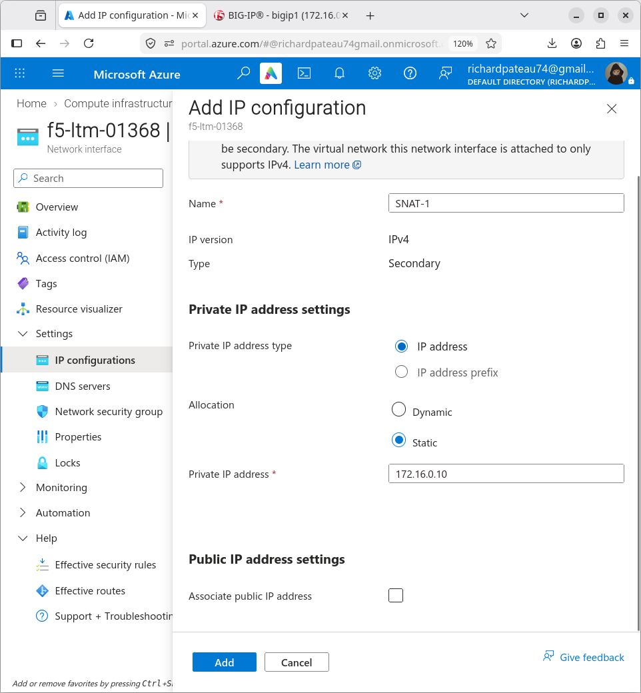 | 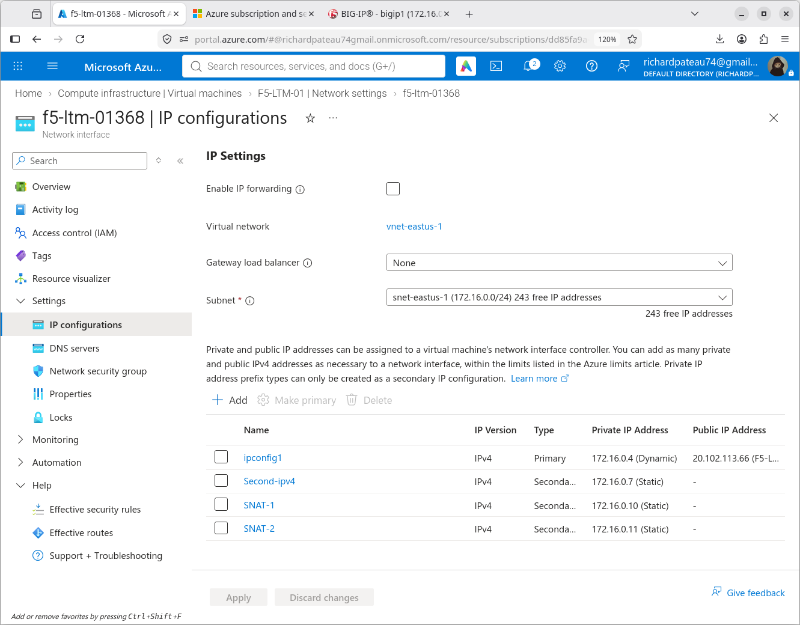 |

---

## Phase 1: SNAT Baseline — Auto Map Evaluation

By default, BIG-IP Virtual Servers utilize **SNAT Auto Map**. When client traffic hits the VIP, BIG-IP translates the source IP to the Self-IP of the egress VLAN interface (`172.16.0.4`).

```bash
azureuser@(localhost)(tmos)# list ltm virtual VS-NGINX-WEB
```

```text
ltm virtual VS-NGINX-WEB {
    destination 172.16.0.7:http
    ip-protocol tcp
    pool POOL-NGINX-WEB
    source-address-translation {
        type automap
    }
}
```

| GUI Auto Map Configuration | TMSH Virtual Server Baseline |
|---|---|
| 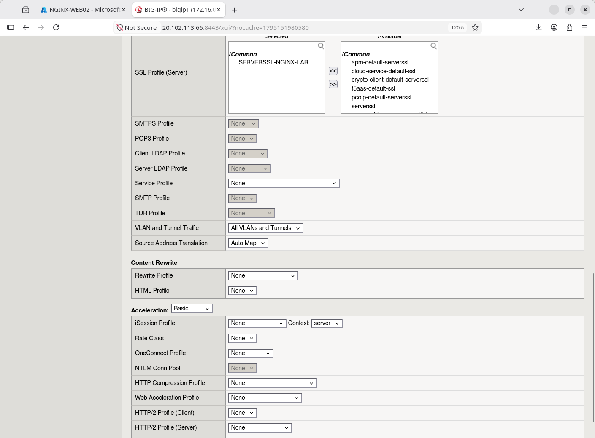 | 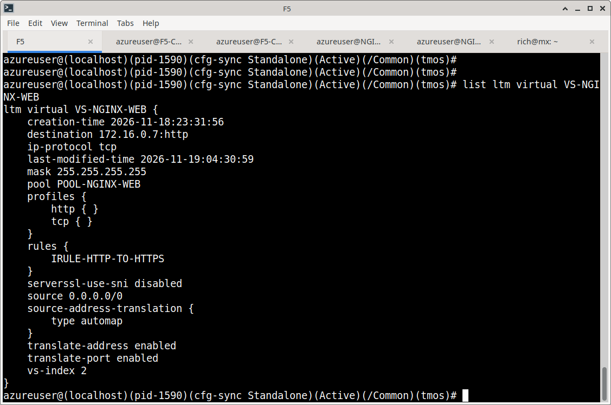 |

### Baseline Packet Capture Analysis (`snat.pcap`)
Capturing traffic on the network interface confirms that under Auto Map:
- Client `172.16.0.8` connects to VIP `172.16.0.7` on the client-facing segment.
- BIG-IP translates the source address to Self-IP `172.16.0.4` when initiating connections to backend servers `172.16.0.5` and `172.16.0.6`.

| Client to Virtual Server (`ip.addr == 172.16.0.7`) | Backend Auto Map Translation (`ip.addr == 172.16.0.4`) |
|---|---|
| 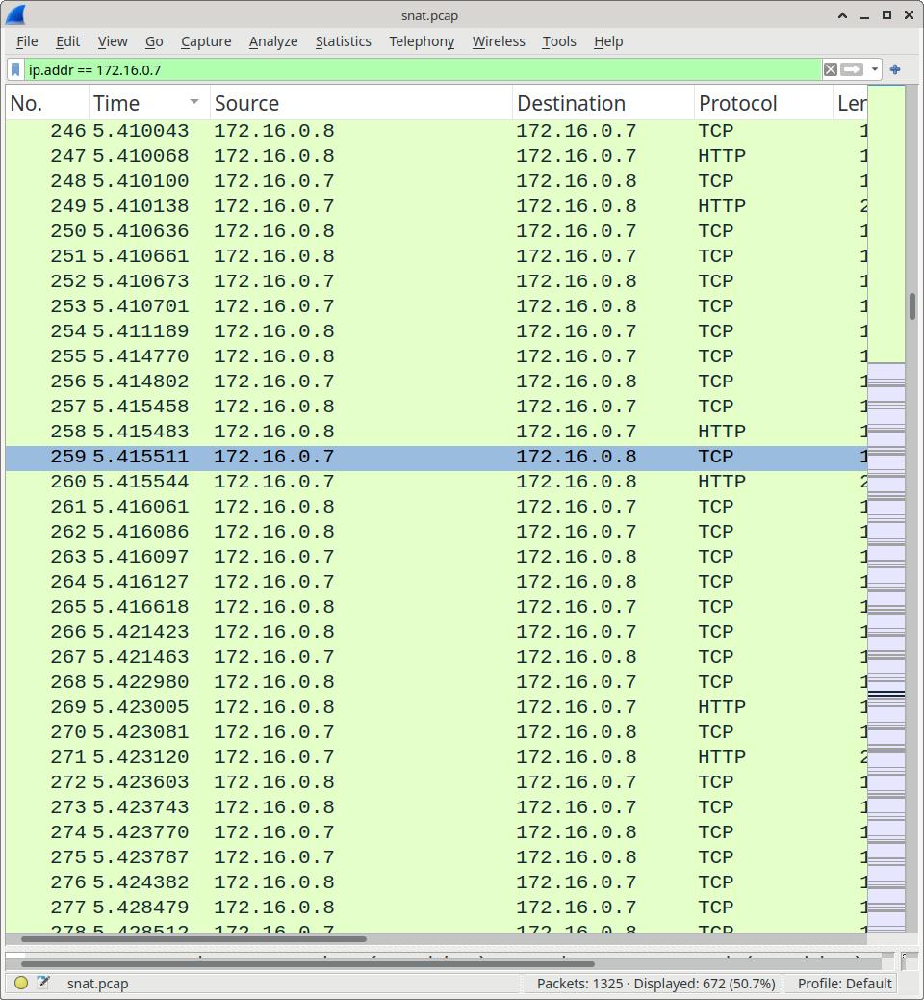 | 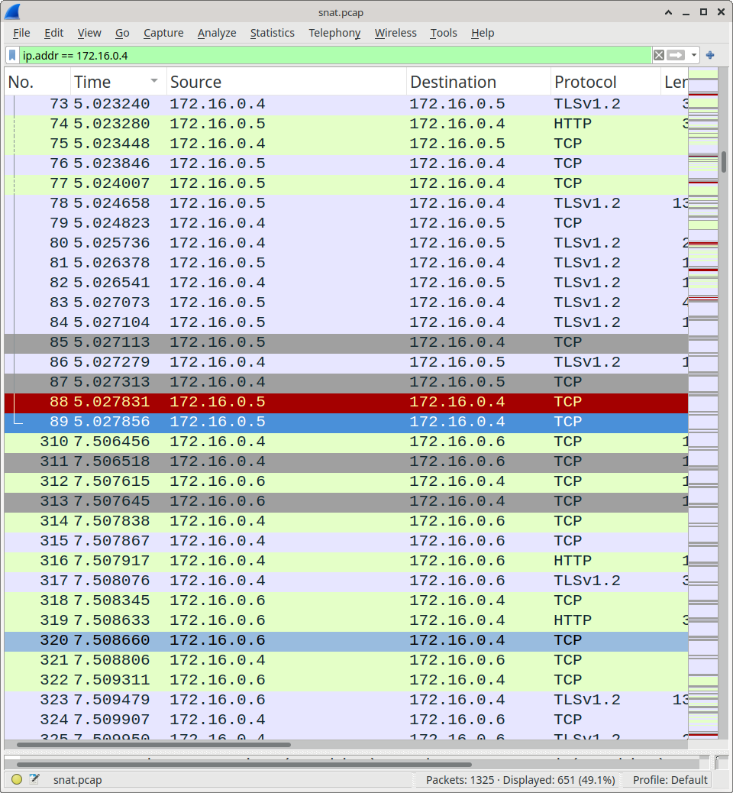 |

> **Engineering Constraint of Auto Map:** A single Self-IP provides approximately 64,511 usable ephemeral source ports. In high-throughput cloud environments with thousands of concurrent sessions, a single translation IP risks **SNAT Port Exhaustion**, resulting in dropped client connection handshakes.

---

## Phase 2: Enterprise Scale-Out with Dedicated SNAT Pools

To eliminate port exhaustion bottlenecks and separate system management traffic from application traffic, a dedicated SNAT pool (`SNAT-POOL`) was constructed containing `172.16.0.10` and `172.16.0.11`.

### 1. Defining `SNAT-POOL` on BIG-IP
Configured under **Local Traffic &rarr; Address Translation &rarr; SNAT Pool List**:

```bash
azureuser@(localhost)(tmos)# create ltm snatpool SNAT-POOL members add { 172.16.0.10 172.16.0.11 }
azureuser@(localhost)(tmos)# list ltm snatpool SNAT-POOL
```

```text
ltm snatpool SNAT-POOL {
    members {
        172.16.0.10
        172.16.0.11
    }
}
```

| Creating `SNAT-POOL` | Active SNAT Pool Overview |
|---|---|
| 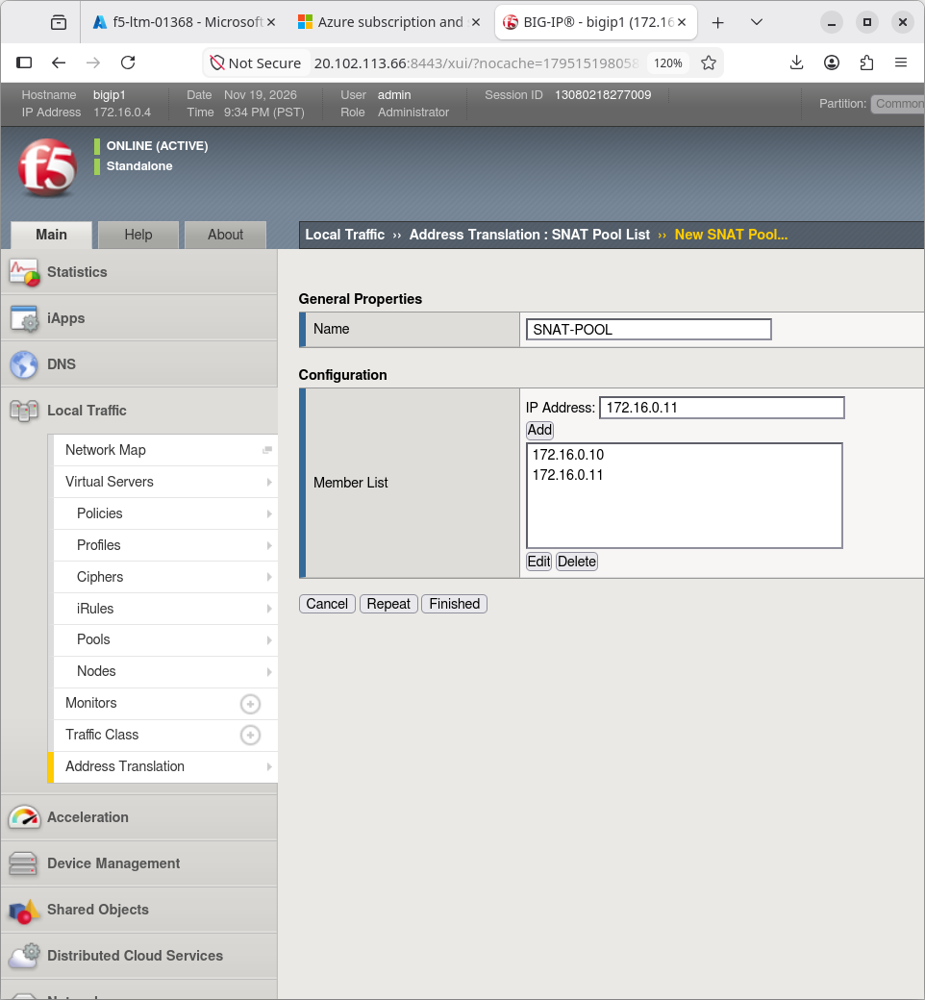 | 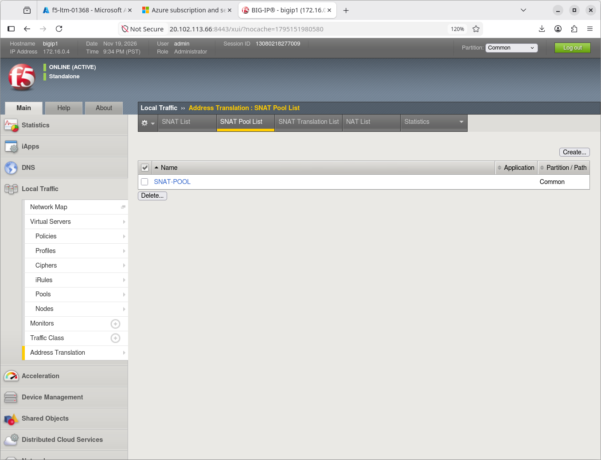 |

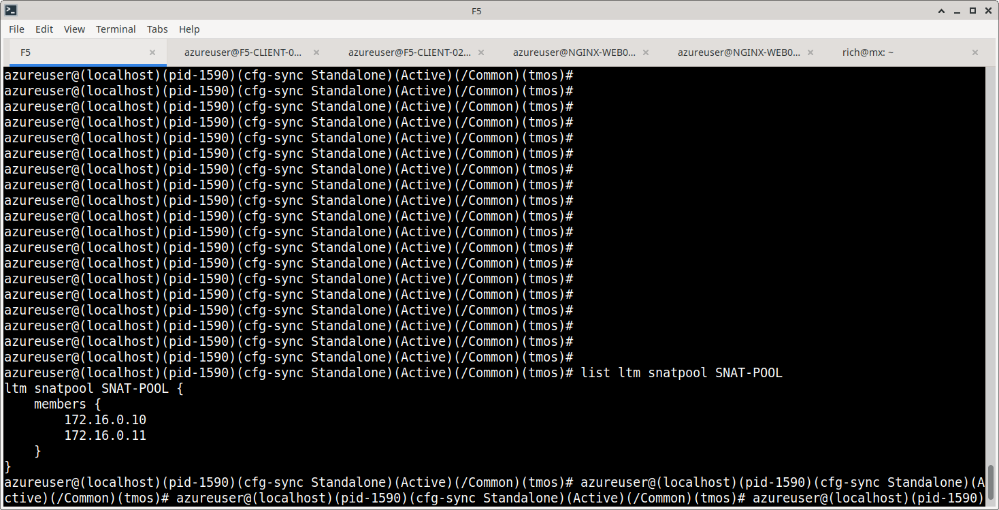

---

### 2. Attaching `SNAT-POOL` to Virtual Servers
The virtual servers (`VS-NGINX-WEB` and `VS-NGINX-HTTPS`) were updated from `Auto Map` to `SNAT`, specifying `SNAT-POOL`:

| GUI SNAT Pool Assignment | TMSH Virtual Server Configuration |
|---|---|
| 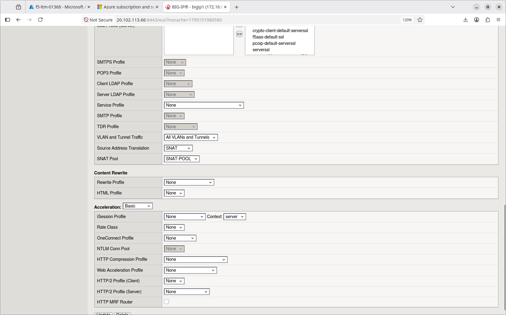 | 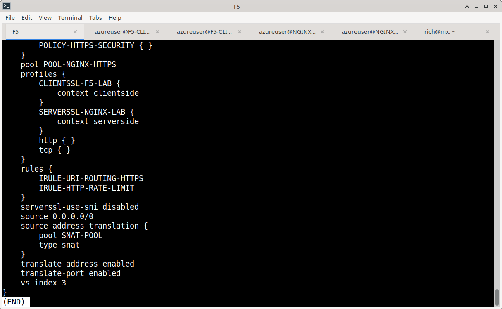 |

---

### 3. Wire-Level Verification of SNAT Pool Operation (`snat-post-change.pcap`)

Deep packet inspection of `snat-post-change.pcap` proves that BIG-IP now translates backend connections using the dedicated pool:

#### A. Translation Address `172.16.0.10` in Action (`ip.src == 172.16.0.10`)
Requests routed to `NGINX-WEB01` (`172.16.0.5`) originate from translated source `172.16.0.10`:
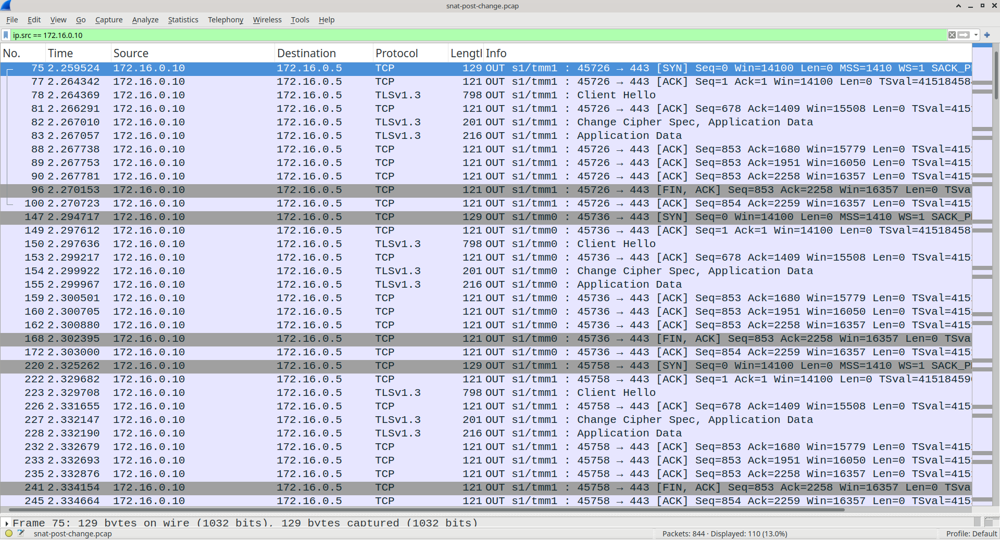

#### B. Translation Address `172.16.0.11` in Action (`ip.src == 172.16.0.11`)
Requests routed to `NGINX-WEB02` (`172.16.0.6`) originate from translated source `172.16.0.11`:
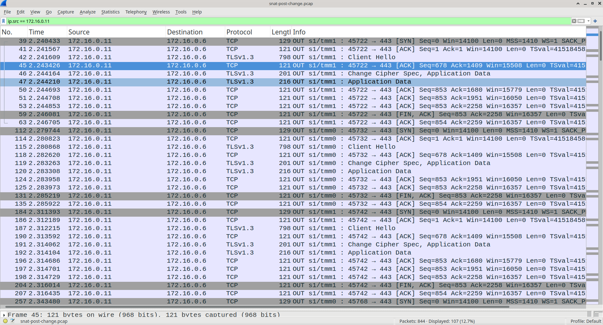

#### C. Multi-IP Bidirectional Translation (`ip.addr == 172.16.0.10 || ip.addr == 172.16.0.11`)
Filtering for both SNAT IPs simultaneously proves concurrent load distribution across pool members and validates that backend servers return traffic directly to the translated IP:
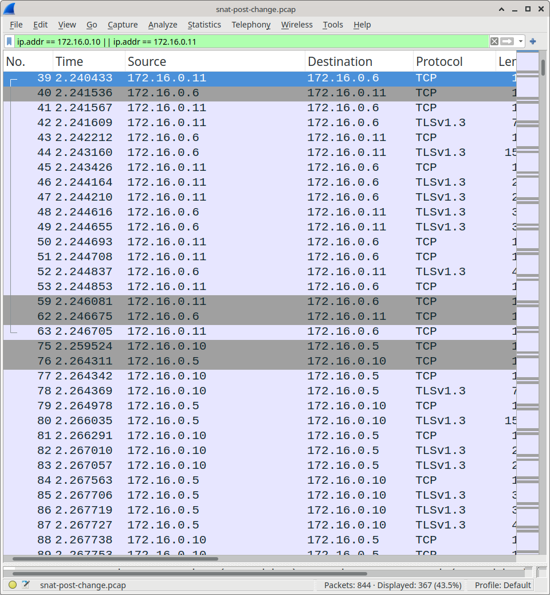

#### D. Isolation of System Self-IP (`ip.src == 172.16.0.4`)
Filtering for Self-IP `172.16.0.4` displays only 13 packets out of 844 (1.5%), strictly limited to administrative SSH and local health probes (`GET / HTTP/1.0`). **Application traffic has been 100% offloaded from the Self-IP to the SNAT pool:**
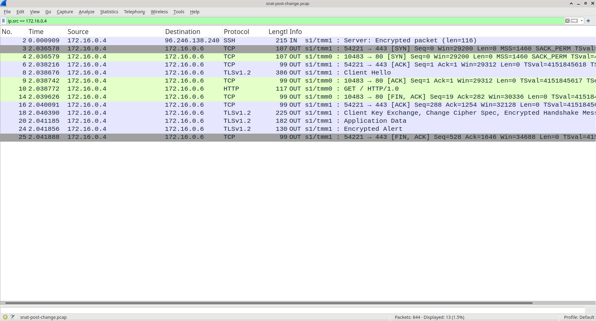

---

## Phase 3: F5 OneConnect Connection Pooling & Multiplexing

### Architectural Principle
While SNAT resolves routing, establishing a new backend TCP 3-way handshake and TLS session for every incoming HTTP request causes severe backend socket churn and accelerates ephemeral port consumption.

**F5 OneConnect** decouples client-side connections from server-side connections:
- BIG-IP maintains a pool of pre-established, persistent TCP connections to backend pool members.
- As new client HTTP requests arrive, BIG-IP multiplexes multiple client requests over existing idle backend connections using HTTP Keep-Alive.
- **Synergy with SNAT:** Reusing backend TCP sessions significantly lowers the number of concurrent SNAT translation ports required on `172.16.0.10` and `172.16.0.11`.

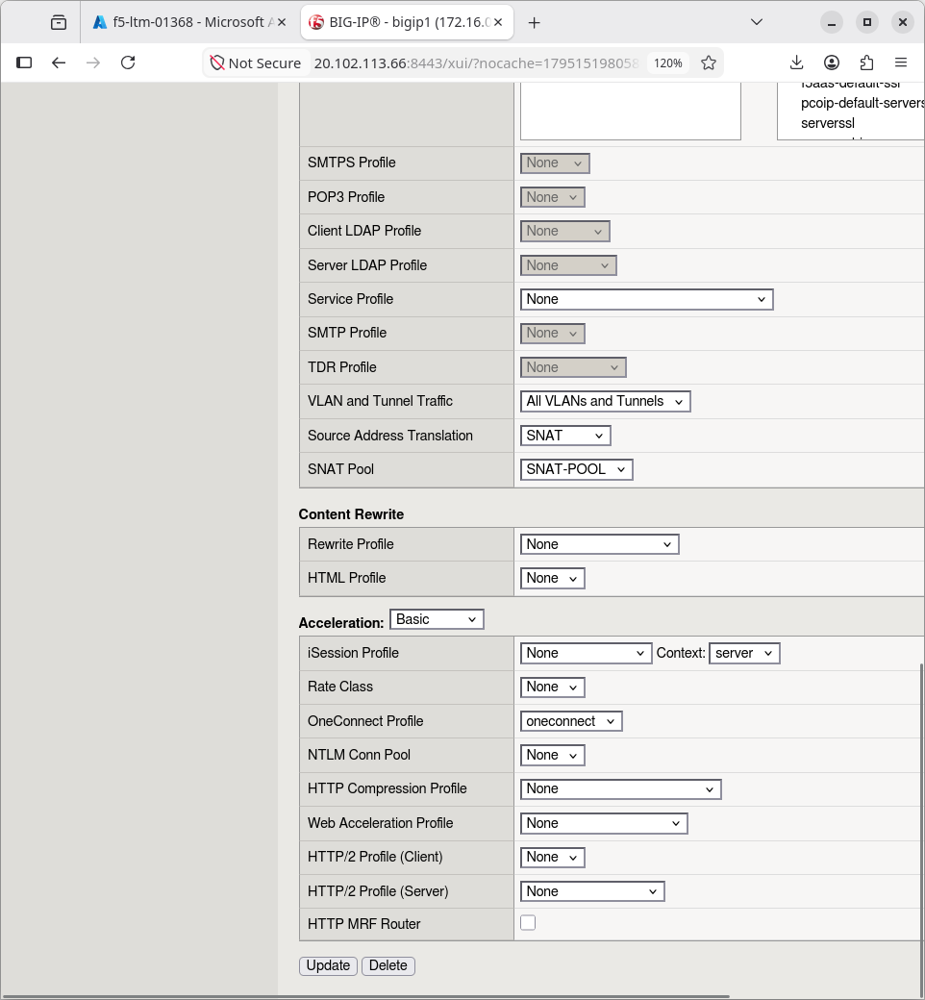

---

### Empirical Testing & Parametric Tuning

To measure OneConnect's real-world impact, controlled benchmark tests were conducted using `wrk` from `F5-CLIENT-01`:
```bash
azureuser@F5-CLIENT-01:~$ wrk -t4 -c100 -d30s https://172.16.0.7/
```
Before each test phase, pool statistics were cleared on BIG-IP via TMSH to guarantee clean, unskewed measurement:
```bash
azureuser@(localhost)(tmos)# reset-stats ltm pool POOL-NGINX-HTTPS
```

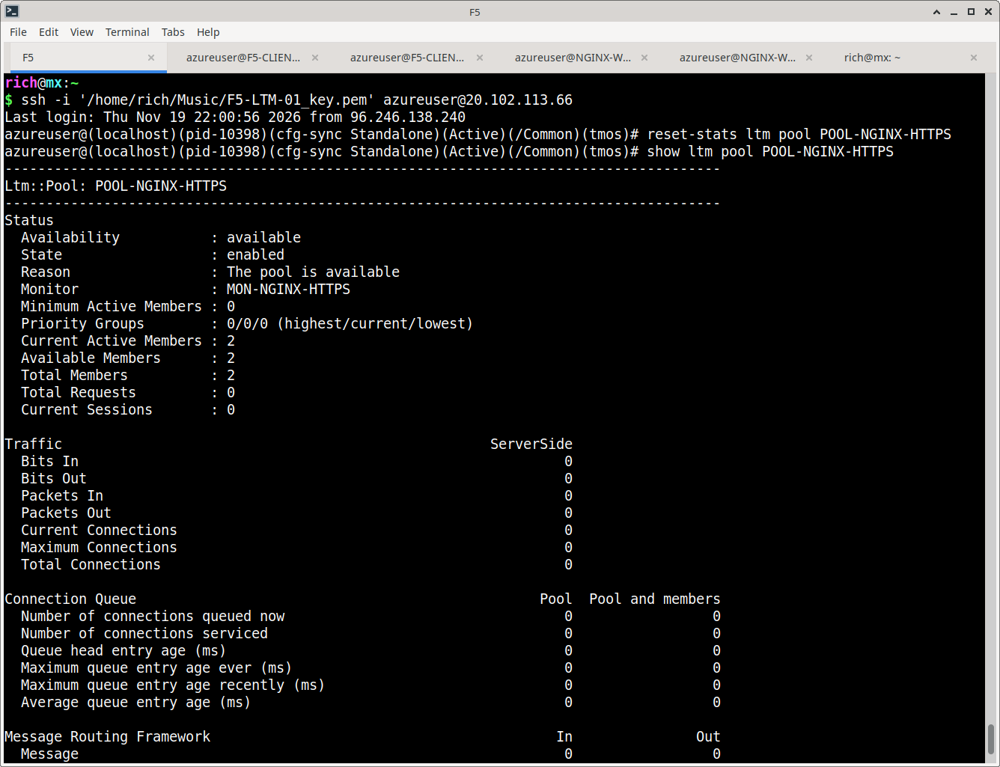

---

### Comparative Test Results

#### 1. OneConnect OFF (Baseline)
With OneConnect disabled, BIG-IP must open fresh backend TCP connections for client requests:
- **Backend TCP Connections:** `120`
- **Total Requests Handled:** `105,000`
- **Requests per Connection:** ~`875`

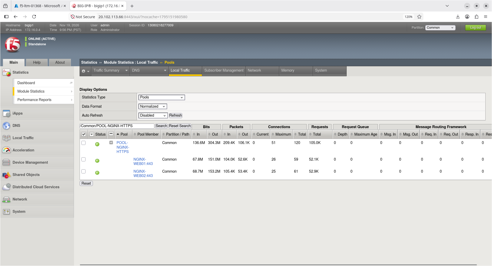

---

#### 2. OneConnect ON (Default `Maximum Reuse: 1000`)
With the default OneConnect profile enabled, connection pooling immediately reduces backend socket demand:
- **Backend TCP Connections:** `90` (45 to WEB01, 45 to WEB02)
- **Total Requests Handled:** `80,100`
- **Requests per Connection:** ~`890`

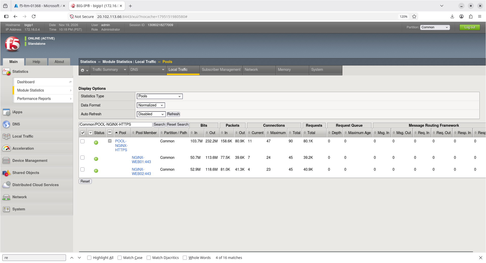

---

#### 3. Parametric Stress Test A — Aggressive Retirement (`Maximum Reuse: 10`)
To empirically prove the connection reuse mechanism, a custom profile (`ONECONNECT-LAB`) was configured with `Maximum Reuse: 10` (retiring server-side TCP sockets after only 10 requests):

| Profile Configuration (`Max Reuse: 10`) | Resulting Backend Sockets Explosion |
|---|---|
| 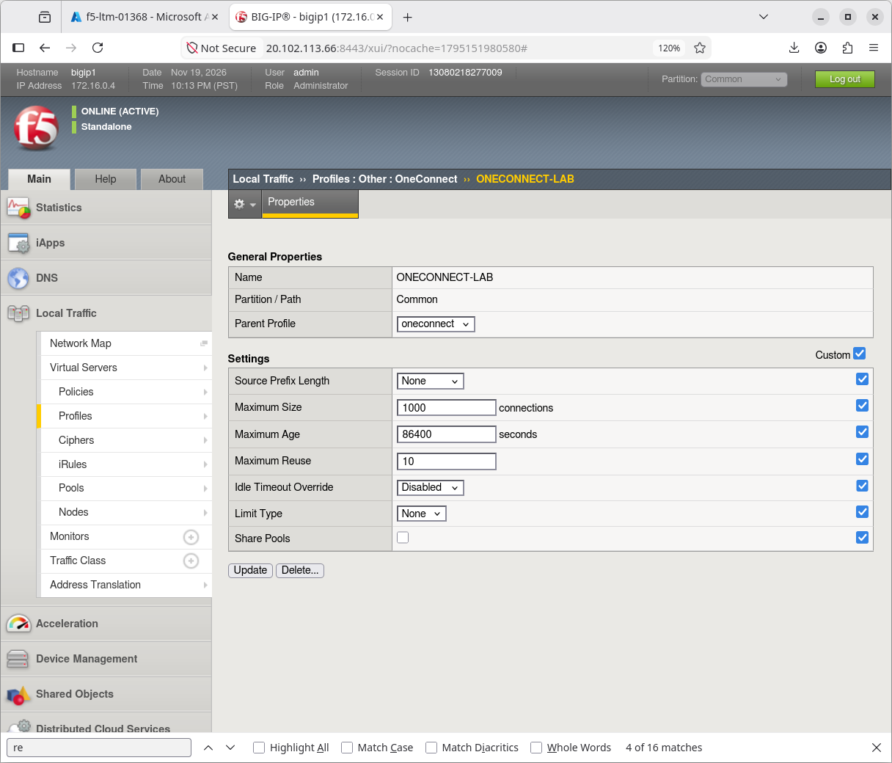 | 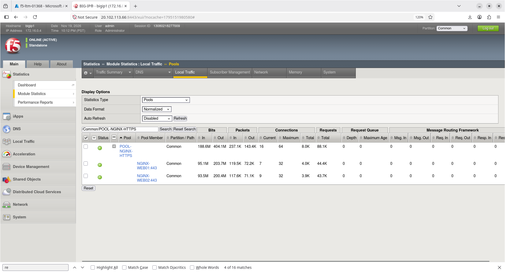 |

- **Backend TCP Connections Created:** **`8,000`** (4.0K on WEB01, 3.9K on WEB02)
- **Total Requests Handled:** `88,100`
- **Requests per Connection Ratio:** **`11.0`** (mathematically validating that connections were forcefully torn down and recreated every 10 requests).

---

#### 4. Parametric Stress Test B — Moderate Pooling (`Maximum Reuse: 100`)
Increasing `Maximum Reuse` to `100` allowed sockets to stay open for 100 requests before retirement:

| Profile Configuration (`Max Reuse: 100`) | Measured Reduction in Sockets |
|---|---|
|  |  |

- **Backend TCP Connections Created:** **`809`** (411 on WEB01, 398 on WEB02)
- **Total Requests Handled:** `79,700`
- **Requests per Connection Ratio:** **`98.5`** (matching the 100-reuse threshold).

---

### OneConnect Performance & Multiplexing Summary

| Test Mode | Profile / Config | Max Reuse Setting | Total Requests | Backend TCP Connections | Ratio (Reqs/Conn) | Socket Load Reduction vs Reuse-10 |
|---|---|---|---|---|---|---|
| **High Churn Stress** | `ONECONNECT-LAB` | `10` | 88,100 | **8,000** | 11.0 | Baseline (Highest Churn) |
| **Moderate Pooling** | `ONECONNECT-LAB` | `100` | 79,700 | **809** | 98.5 | **89.9% reduction** |
| **Default Production** | `oneconnect` | `1000` | 80,100 | **90** | 890.0 | **98.8% reduction** |
| **OneConnect OFF** | None | N/A | 105,000 | **120** | 875.0 | Baseline |

---

## Packet Capture Repository & Downloads

The raw packet captures supporting this project are preserved in the repository for independent verification and packet analysis.

| Capture Artifact | File Size | Packet Count | Download Link | Recommended Wireshark Filter | Primary Analytical Finding |
|---|---|---|---|---|---|
| **Baseline SNAT Capture** | 349 KB | 1,325 | [`snat.pcap`](pcaps/snat.pcap) | `ip.addr == 172.16.0.4` | Proves SNAT Auto Map translates all client traffic to BIG-IP Self-IP `172.16.0.4`. |
| **Post-Change SNAT Pool Capture** | 240 KB | 844 | [`snat-post-change.pcap`](pcaps/snat-post-change.pcap) | `ip.addr == 172.16.0.10 \|\| ip.addr == 172.16.0.11` | Proves traffic is translated exclusively through SNAT pool members (`.10` & `.11`), isolating Self-IP. |

---

## Architectural Comparison & Key Engineering Takeaways

| Feature / Metric | SNAT Auto Map | Dedicated SNAT Pool | Without SNAT (Inline / Routed) |
|---|---|---|---|
| **Egress IP Selection** | Egress VLAN Self-IP (`172.16.0.4`) | Dedicated IP List (`172.16.0.10`, `.11`) | Client Source IP Preserved (`172.16.0.8`) |
| **Max Ephemeral Sockets** | ~64,511 ports per Self-IP | ~64,511 &times; *N* pool members | Unlimited (governed by server socket limit) |
| **Routing Requirement** | Single-arm / Any topology | Single-arm / Any topology | Servers **must** use BIG-IP as Default Gateway |
| **Cloud Fabric Suitability** | High (instant setup) | **Optimal** (scale-out without port exhaustion) | Incompatible with native Azure VNet flat routing |
| **Client IP Visibility** | Hidden (Requires `X-Forwarded-For`) | Hidden (Requires `X-Forwarded-For`) | Directly visible in IP header |

### Core Takeaways:
1. **Azure SDN Routing Mandate:** In flat cloud VNets, SNAT is non-negotiable for single-arm ADCs. Without SNAT, NGINX replies directly to the client's IP via Azure's internal default route, bypassing the load balancer and causing client TCP resets due to sequence number and IP mismatch.
2. **Preventing SNAT Port Exhaustion:** Enterprise environments running high concurrent volumes must avoid Auto Map. Deploying a multi-IP SNAT pool distributes source translations across multiple IP addresses, multiplying the available ephemeral port space by 64k per member.
3. **Synergy of OneConnect + SNAT:** OneConnect acts as a direct multiplier of SNAT efficiency. By multiplexing hundreds of client HTTP requests over persistent backend TCP sockets, OneConnect drastically reduces the rate of ephemeral port consumption on SNAT pool addresses.
4. **Preserving Client Identity:** Because SNAT masks the original client IP at Layer 3, an HTTP Profile must be configured on the Virtual Server to insert the `X-Forwarded-For` HTTP header, ensuring backend applications and security logging retain true client visibility.
