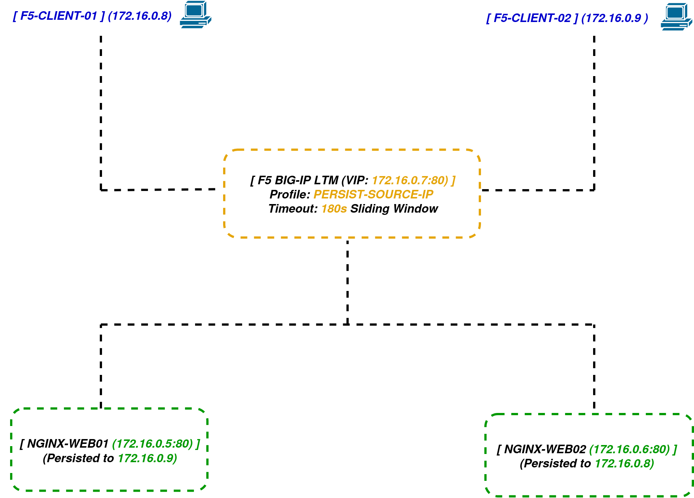
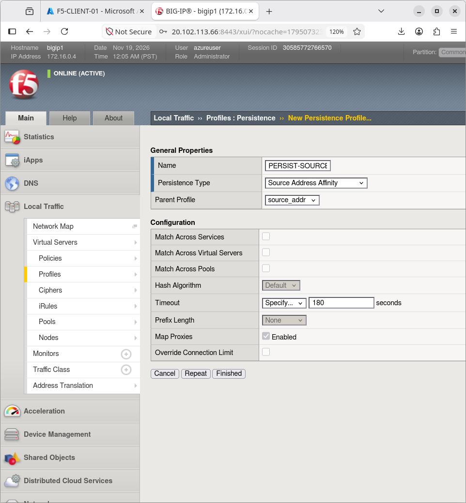
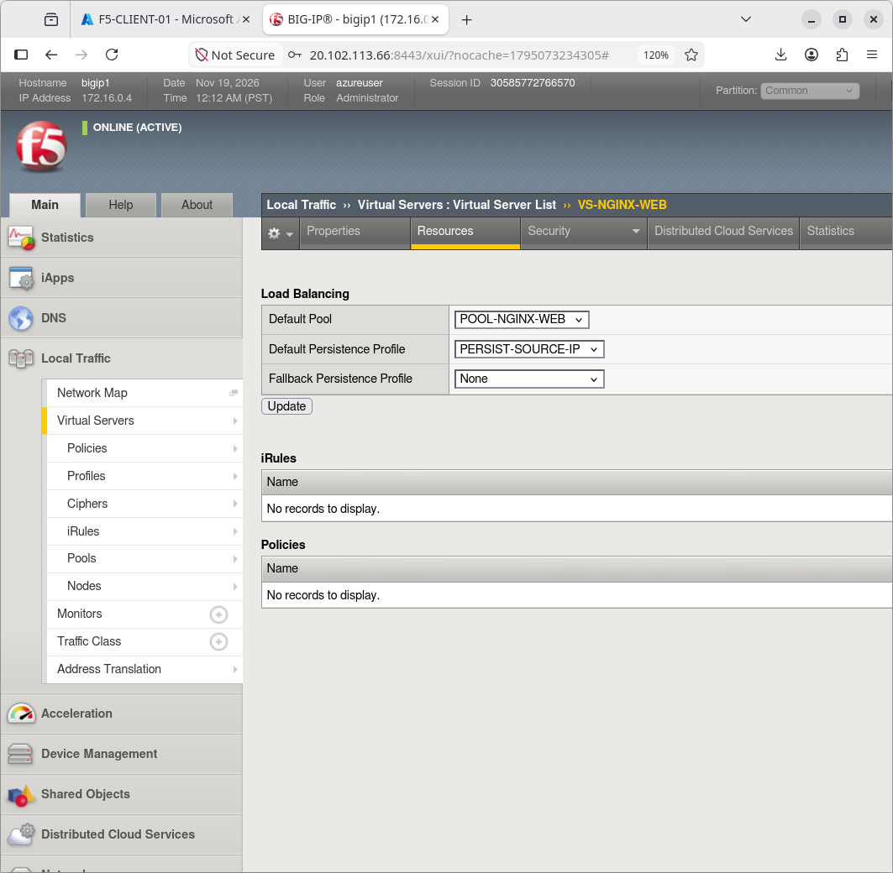
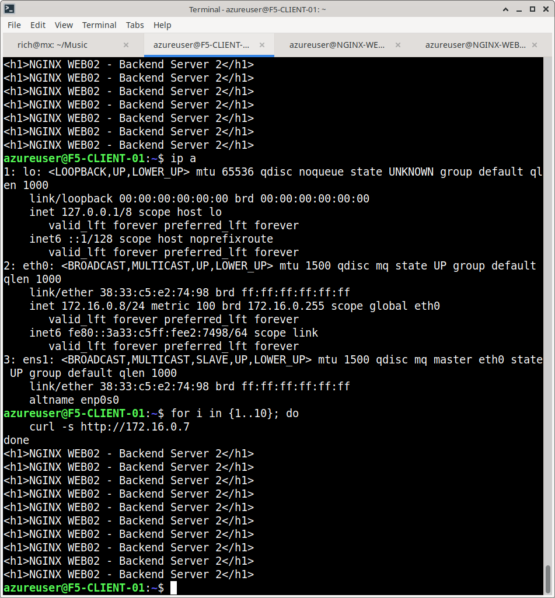
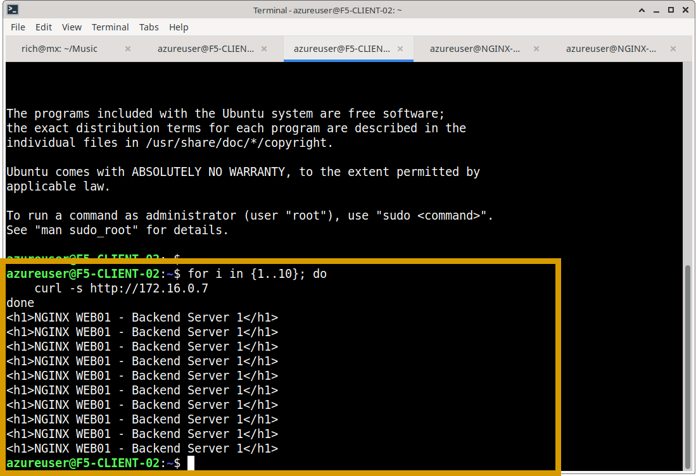
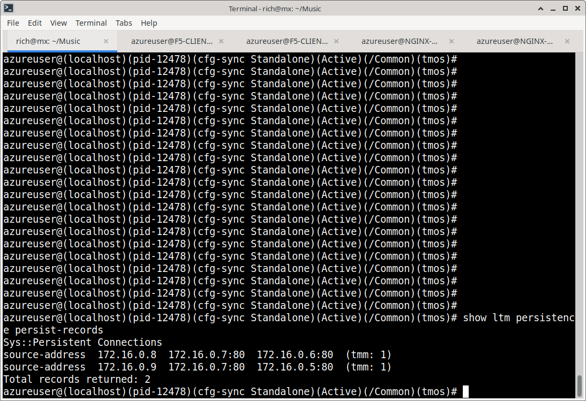

# F5 BIG-IP LTM — Source Address Persistence (Session Affinity)

## Executive Summary & Engineering Objective

This project demonstrates the design, deployment, and empirical verification of **Source Address Affinity Persistence** on an **F5 BIG-IP Local Traffic Manager (LTM)** deployed in Microsoft Azure.

In distributed application environments, standard Layer 4 and Layer 7 load-balancing algorithms (such as Round Robin or Least Connections) distribute client requests evenly across all available backend pool members. However, stateful applications—including legacy ERPs, shopping carts, authentication portals, and multi-step transaction workflows—require a client to maintain continuity with the exact backend server where their session was instantiated.

**Source Address Persistence** (session stickiness) resolves this by hashing the client's source IP address and recording an affinity mapping in the BIG-IP Traffic Management Microkernel (TMM) memory table. Subsequent requests from the same client IP within a configurable sliding window are deterministically steered to the identical backend node, bypassing standard load-balancing distribution while preserving failover resilience.

---

## Architecture & Addressing Topology

The test topology consists of two distinct client endpoints (`F5-CLIENT-01` and `F5-CLIENT-02`) initiating concurrent HTTP sessions against the Virtual Server (`VS-NGINX-WEB`). BIG-IP independently binds each client IP to a distinct backend pool member and maintains session stickiness across repeated requests.



### Infrastructure & Addressing Schema

| Component | IP Address | Port / Protocol | Profile / Mechanism | Role & Architectural Purpose |
|---|---|---|---|---|
| **F5-CLIENT-01** | `172.16.0.8` | Ephemeral &rarr; `80` | Linux Client 1 | Originates repeated validation traffic for Client 1 |
| **F5-CLIENT-02** | `172.16.0.9` | Ephemeral &rarr; `80` | Linux Client 2 | Originates concurrent traffic to verify multi-client distribution |
| **VS-NGINX-WEB** | `172.16.0.7` | `TCP/80` (HTTP) | `Standard` Virtual Server | Listens on port 80; applies `PERSIST-SOURCE-IP` persistence profile |
| **F5 BIG-IP Self-IP** | `172.16.0.4` | Internal (`TCP/80`) | Self-IP / Gateway | Internal interface conducting health checks and session tracking |
| **NGINX-WEB01** | `172.16.0.5` | `TCP/80` (HTTP) | Backend Pool Member | Node 1 in `POOL-NGINX-WEB` (App 1) |
| **NGINX-WEB02** | `172.16.0.6` | `TCP/80` (HTTP) | Backend Pool Member | Node 2 in `POOL-NGINX-WEB` (App 2) |

---

## Configuration Architecture

### 1. Persistence Profile Provisioning (`PERSIST-SOURCE-IP`)
Under **Local Traffic &rarr; Profiles &rarr; Persistence**, a custom profile was engineered inheriting from the base `source_addr` parent:
- **Profile Name:** `PERSIST-SOURCE-IP`
- **Persistence Type:** Source Address Affinity
- **Parent Profile:** `source_addr`
- **Timeout:** `180` seconds (sliding window; resets on every active request from the client)
- **Prefix Length:** `None` (full `/32` host address granularity to ensure exact IP-to-node matching)
- **Map Proxies:** `Enabled` (optimizes tracking for upstream reverse proxy addresses)



---

### 2. Virtual Server Attachment (`VS-NGINX-WEB`)
The custom persistence profile was bound to the HTTP Virtual Server (`VS-NGINX-WEB` at `172.16.0.7:80`) under **Resources**:
- **Default Pool:** `POOL-NGINX-WEB` (Round Robin load-balancing method across both NGINX nodes)
- **Default Persistence Profile:** `PERSIST-SOURCE-IP`
- **Fallback Persistence Profile:** `None`



---

## Empirical Verification & Proof of Persistence

Validation required confirming three critical behaviors:
1. Sequential requests from a single client stick to the assigned backend server without round-robin alternation.
2. Concurrent requests from a second client are independently balanced to another backend node.
3. Active persistence records exist within BIG-IP's kernel memory table.

### 1. Client 1 Affinity Verification (`F5-CLIENT-01`)
From `F5-CLIENT-01` (`172.16.0.8`), network identity was verified via `ip a`, followed by an automated burst of 10 sequential HTTP requests:

```bash
azureuser@F5-CLIENT-01:~$ ip a
# eth0 inet 172.16.0.8/24

azureuser@F5-CLIENT-01:~$ for i in {1..10}; do curl -s http://172.16.0.7; done
```

#### Observed Result:
All 10 requests deterministically returned:
```html
<h1>NGINX WEB02 - Backend Server 2</h1>
```
Without persistence, Round Robin would alternate 50/50 between WEB01 and WEB02. With persistence active, **100% of requests stayed locked to `NGINX-WEB02` (`172.16.0.6:80`)**.



---

### 2. Client 2 Multi-Client Distribution Verification (`F5-CLIENT-02`)
A potential flaw in poorly configured persistence is routing *all* traffic globally to a single backend server. To prove that BIG-IP maintains proper load balancing across distinct clients, a second client (`F5-CLIENT-02` at `172.16.0.9`) executed an identical test:

```bash
azureuser@F5-CLIENT-02:~$ for i in {1..10}; do curl -s http://172.16.0.7; done
```

#### Observed Result:
All 10 requests from Client 2 deterministically returned:
```html
<h1>NGINX WEB01 - Backend Server 1</h1>
```
This empirically proves that BIG-IP balanced Client 2 to `NGINX-WEB01` (`172.16.0.5:80`) while simultaneously holding Client 1 pinned to `NGINX-WEB02` (`172.16.0.6:80`).



---

### 3. BIG-IP Kernel Memory Session Table Proof (TMSH)
The definitive operational proof of persistence is inspecting the live session table within BIG-IP's Traffic Management Shell (TMSH):

```bash
azureuser@(localhost)(tmos)# show ltm persistence persist-records
```

#### Kernel Session Records Output:
```text
Sys::Persistent Connections
source-address  172.16.0.8  172.16.0.7:80  172.16.0.6:80  (tmm: 1)
source-address  172.16.0.9  172.16.0.7:80  172.16.0.5:80  (tmm: 1)
Total records returned: 2
```



#### Technical Analysis of Kernel Records:
- **Record 1:** Client `172.16.0.8` connecting to Virtual Server `172.16.0.7:80` is pinned to pool member `172.16.0.6:80` on core `tmm: 1`.
- **Record 2:** Client `172.16.0.9` connecting to Virtual Server `172.16.0.7:80` is pinned to pool member `172.16.0.5:80` on core `tmm: 1`.
- **Sliding Timeout:** Each incoming packet matching the source IP resets the 180-second countdown timer. If no traffic is received within 180 seconds, TMM automatically expires the record and returns the client to normal pool load-balancing evaluation.

---

## Architectural Comparison & Engineering Considerations

| Persistence Method | Layer | Key Tracking Attribute | Pros | Cons / Constraints |
|---|---|---|---|---|
| **Source Address Affinity** *(Implemented)* | Layer 4 | Client IPv4/IPv6 Address (`/32` or subnet) | Protocol-agnostic (works with non-HTTP, TCP, UDP, SSL); zero client-side dependencies | "Mega-Proxy" hot-spotting: all clients behind an enterprise NAT or CGNAT share one IP and hit one backend |
| **HTTP Cookie Persistence** | Layer 7 | `BIGipServer<pool_name>` cookie or hash | Immune to NAT/proxy consolidation; granular per-browser session tracking | Requires HTTP/HTTPS termination; unsupported on raw TCP/UDP or non-browser clients |
| **SSL Session ID** | Layer 4/7 | TLS Session ID / Ticket | Reuses TLS handshake session caches | Ephemeral; renegotiated frequently in TLS 1.3 |
| **Destination Address Affinity** | Layer 4 | Destination IP address | Directs forward-proxy traffic through specific gateway firewalls | Unsuitable for reverse-proxy server load balancing |

### Key Engineering Takeaways:
1. **The Mega-Proxy / NAT Dilemma:** Because Source Address Persistence binds by IP address, if thousands of corporate users connect through a single corporate forward-proxy or carrier-grade NAT (CGNAT), all users will be pinned to a single backend server, causing severe load imbalance. In web applications with HTTP traffic, **Cookie Persistence** is preferred for this reason.
2. **Failover Precedence Over Persistence:** If a backend server fails its health check (`MON-NGINX-HTTP`), BIG-IP's health monitor immediately marks the pool member down. BIG-IP's state engine bypasses the persistence record and automatically re-routes subsequent client requests to the remaining healthy server, preventing client outages.
3. **Subnet Mask Aggregation (`Prefix Length`):** In environments where mobile clients frequently hop cellular towers (changing the last octet of their IP), configuring a `Prefix Length` (e.g. `/24`) groups client subnets into a single persistence entry to preserve session continuity.
