# F5 BIG-IP LTM — SSL Termination (HTTPS Offloading) & Layer 7 URI Routing

## Executive Summary & Engineering Objective

This project documents the architectural design, implementation, and empirical verification of **SSL Termination (HTTPS Offloading)** and **Layer 7 Content-Based Routing** on an **F5 BIG-IP Local Traffic Manager (LTM)** deployed in Microsoft Azure.

In modern enterprise architectures, SSL/TLS termination offloads the computationally expensive asymmetric cryptographic handshakes and bulk cipher processing from backend application servers onto specialized Application Delivery Controllers (ADCs). Centralizing TLS processing on F5 BIG-IP provides critical operational and architectural advantages:
- **Compute Optimization:** Eliminates TLS handshake overhead and session state management from backend compute nodes, maximizing NGINX CPU capacity for application workloads.
- **Unified Certificate Lifecycle:** Eliminates multi-host certificate deployment drift by consolidating certificate and private key management onto BIG-IP.
- **Full Layer 7 Visibility:** Terminating the TLS session on the client-facing proxy exposes cleartext HTTP headers and request URIs, enabling deep packet inspection, iRule-driven application routing, and advanced security policies.

---

## Architecture & Topology

The topology features a dual-tier deployment where inbound HTTPS traffic (`TCP/443`) is terminated at the BIG-IP Virtual Server (`VS-NGINX-HTTPS`), evaluated against an L7 iRule, and dispatched across backend pools over plain HTTP (`TCP/80`).

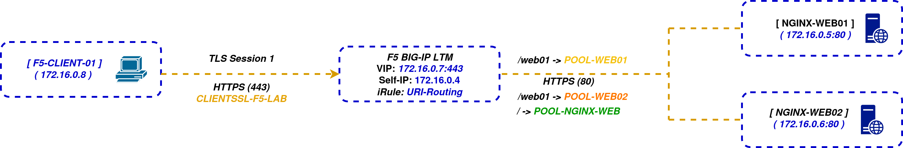

### Addressing & Infrastructure Topology

| Component | IP Address | Port / Protocol | Profile / Mechanism | Description & Role |
|---|---|---|---|---|
| **F5-CLIENT-01** | `172.16.0.8` | Ephemeral &rarr; `443` / `80` | Client Host | Linux test client generating functional validation requests via `curl` |
| **VS-NGINX-HTTPS** | `172.16.0.7` | `TCP/443` (HTTPS) | `Standard` VIP | TLS termination endpoint; applies `CLIENTSSL-F5-LAB` & `IRULE-URI-ROUTING` |
| **VS-NGINX-WEB** | `172.16.0.7` | `TCP/80` (HTTP) | `Standard` VIP | Cleartext HTTP endpoint applying `IRULE-URI-ROUTING` and Round Robin fallback |
| **F5 BIG-IP (Self-IP)** | `172.16.0.4` | Internal (`TCP/80`) | Self-IP / SNAT | Internal gateway initiating TCP handshakes and HTTP health monitor probes |
| **F5 SNAT Pool** | `172.16.0.10`, `172.16.0.11` | Ephemeral &rarr; `80` | SNAT Translation | Source NAT IP addresses translating client connections to the backend |
| **NGINX-WEB01** | `172.16.0.5` | `TCP/80` (HTTP) | Backend Pool Member | Dedicated pool member for `/web01` (`POOL-WEB01`) & default pool (`POOL-NGINX-WEB`) |
| **NGINX-WEB02** | `172.16.0.6` | `TCP/80` (HTTP) | Backend Pool Member | Dedicated pool member for `/web02` (`POOL-WEB02`) & default pool (`POOL-NGINX-WEB`) |

---

## Traffic Management Implementation

### 1. Cryptographic Key & Certificate Provisioning
A dedicated 2048-bit RSA cryptographic keypair and self-signed X.509 certificate were provisioned directly on the BIG-IP system under **System &rarr; Certificate Management &rarr; Traffic Certificate Management**:
- **Certificate Identifier:** `f5-lab` (Subject: `CN=f5-lab.local`, Signature Algorithm: SHA256withRSA)
- **Private Key:** `f5-lab-key` (2048-bit RSA)
- **Lifecycle / Validity:** Provisioned with a 1-year validity window; monitored through BIG-IP certificate expiration tracking.

**Certificate Generation**

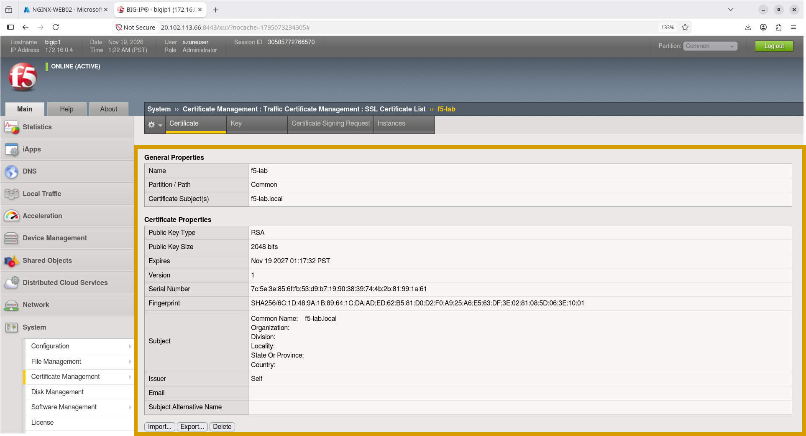

**Certificate Overview**

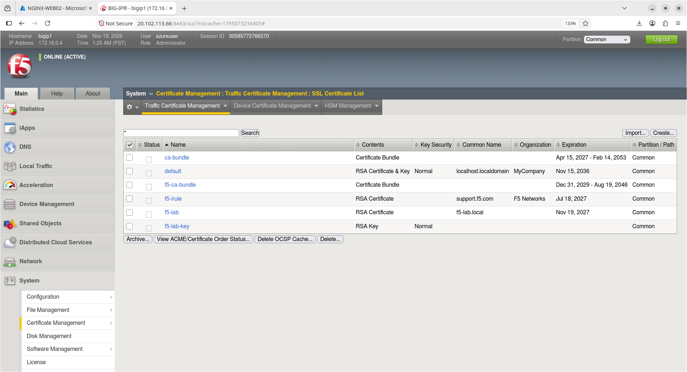

---

### 2. Client SSL Profile Architecture (`CLIENTSSL-F5-LAB`)
To terminate inbound TLS on the proxy, a custom Client SSL profile was constructed inheriting from the base `clientssl` template:
- Bound the `f5-lab` certificate and `f5-lab-key` private key chain to the profile.
- Allowed BIG-IP to advertise TLS 1.2 and TLS 1.3 capabilities, negotiate ciphers, and decrypt incoming application payloads prior to LTM inspection.
- Client authentication set to `ignore` for standard one-way TLS offloading.

**Creating SSL Profile**
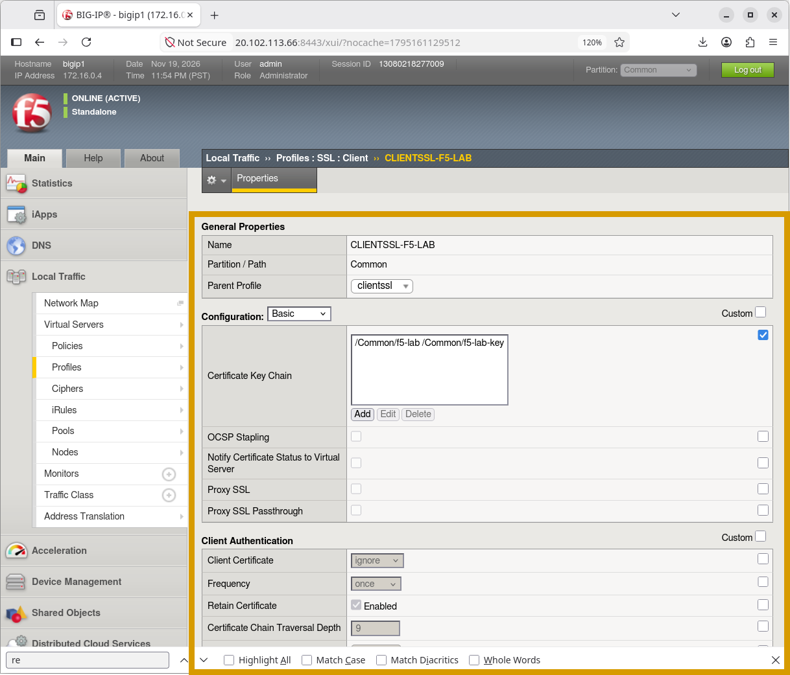

**Applying Certificates To Profile**

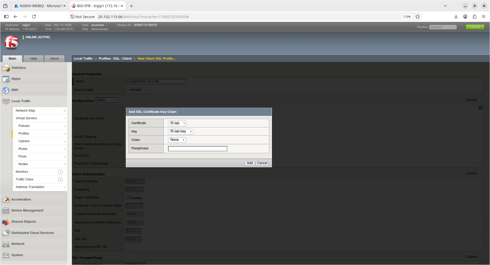

**SSL Profile Overview**

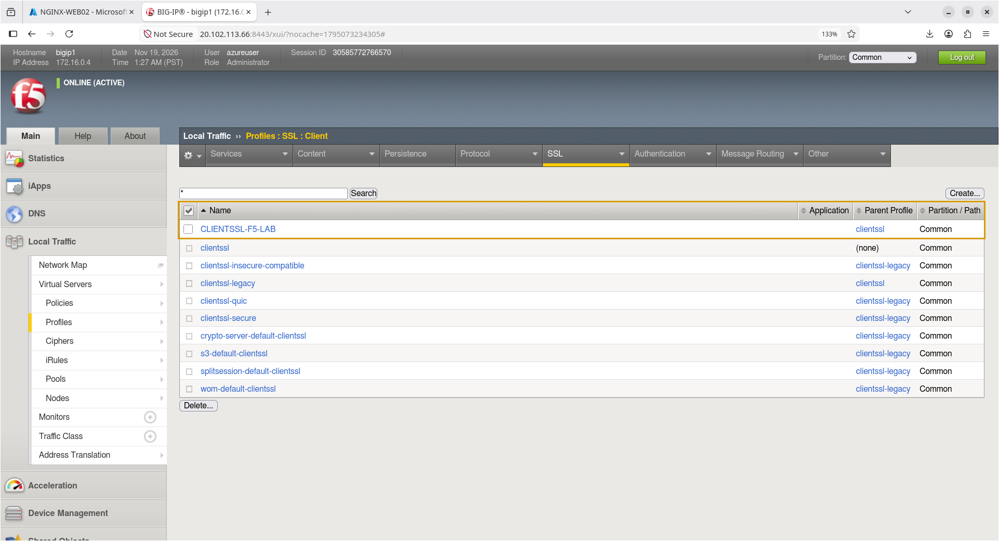
 
---

### 3. Backend HTTP Server Pools & Active Probing
Three distinct backend pools were configured to decouple application routing from physical infrastructure, backed by the active health monitor `MON-NGINX-HTTP`:
1. **`POOL-WEB01`:** Single-member pool mapped to `NGINX-WEB01` (`172.16.0.5:80`).
2. **`POOL-WEB02`:** Single-member pool mapped to `NGINX-WEB02` (`172.16.0.6:80`).
3. **`POOL-NGINX-WEB`:** Dual-member pool (`172.16.0.5:80` and `172.16.0.6:80`) utilizing **Round Robin** load balancing for default traffic.

**Provisioning `POOL-WEB01`**

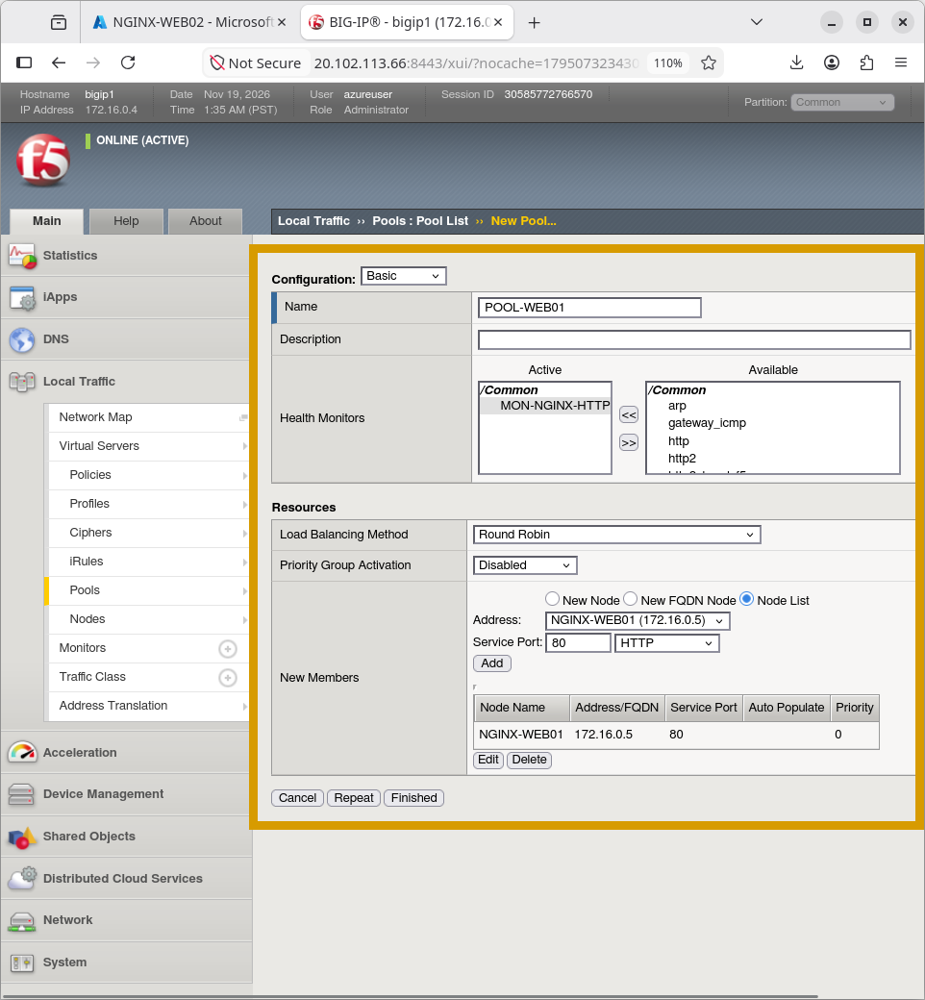

**Provisioning `POOL-WEB02`**

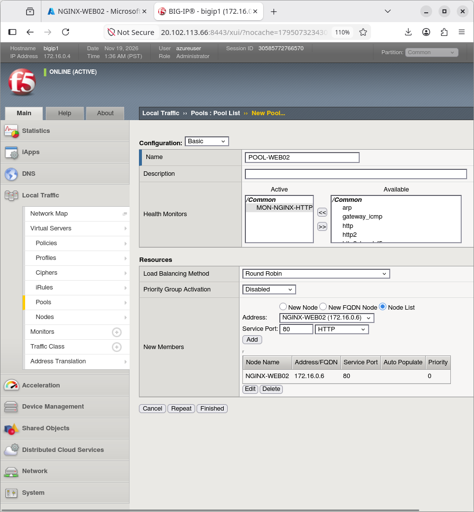

**Pool List Overview**

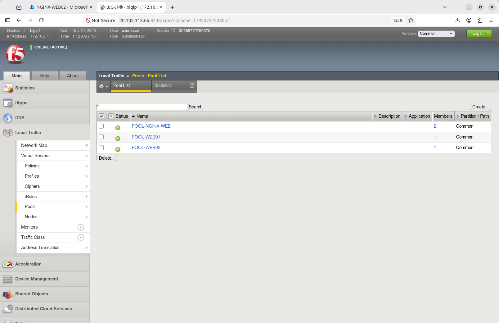

> **Health Monitoring Note:** Active health checks (`MON-NGINX-HTTP`) send periodic HTTP `GET /` requests every 5 seconds from the Self-IP (`172.16.0.4`) and require a `200 OK` response before marking pool members available.

---

### 4. Layer 7 URI Routing Engine (iRule) & Virtual Server Configuration
Because BIG-IP terminates TLS at the proxy edge, the HTTP payload is decrypted into memory, allowing the Traffic Management Microkernel (TMM) to evaluate Layer 7 HTTP events:

```tcl
when HTTP_REQUEST {
    if { [HTTP::path] starts_with "/web01" } {
        pool POOL-WEB01
    } elseif { [HTTP::path] starts_with "/web02" } {
        pool POOL-WEB02
    } else {
        pool POOL-NGINX-WEB
    }
}
```

#### Key Architecture Nuances:
- **Server SSL Profile Omission (Offloading Proof):** On `VS-NGINX-HTTPS`, the **Client SSL Profile** is populated with `CLIENTSSL-F5-LAB`, but the **Server SSL Profile remains unassigned (`None`)**. This is the architectural boundary defining **SSL Termination** versus **SSL Bridging**: outbound connections to the backend pool are initiated strictly over plain HTTP (`TCP/80`).
- **HTTP Profile Attachment:** The default `http` profile is attached to both virtual servers to parse RFC-compliant HTTP requests and expose the `HTTP_REQUEST` event to TMM.

**iRule Definition (`IRULE-URI-ROUTING`)**

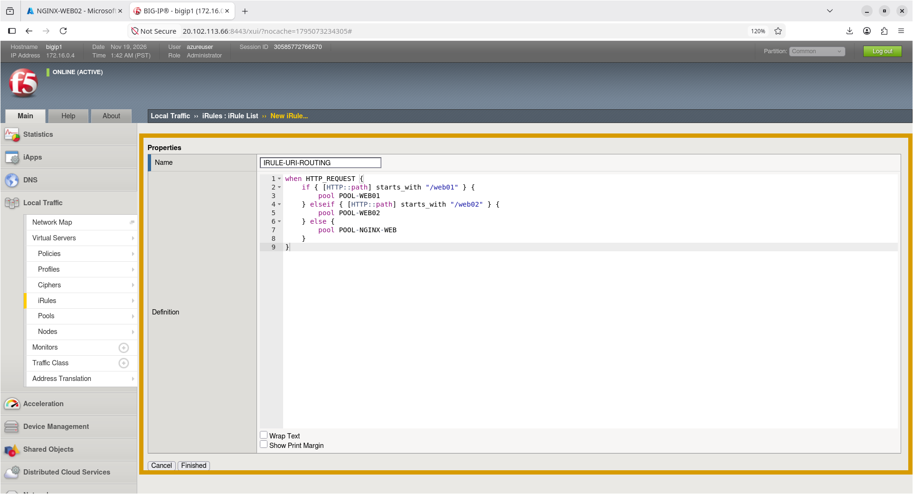

**iRule Overview**

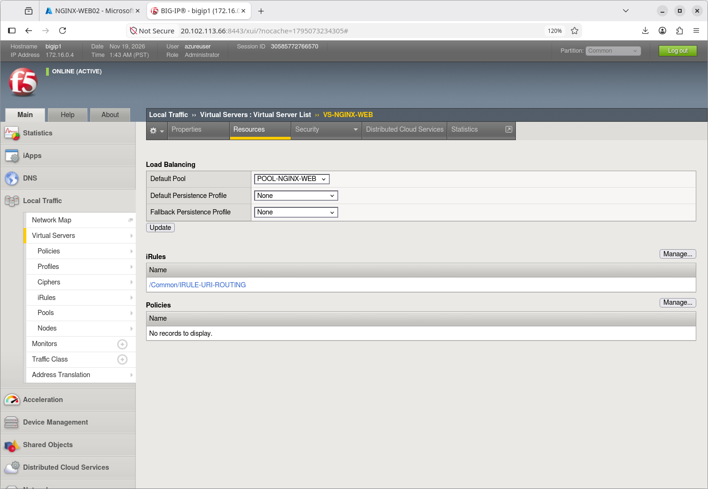

**Binding Client SSL Profile to `VS-NGINX-HTTPS`**

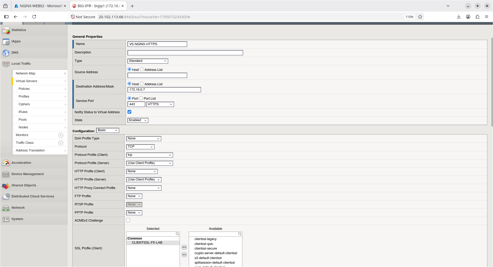

---

## Empirical Verification & Proof of Offloading

To validate production readiness, the configuration was subjected to functional application testing and wire-level packet analysis using Wireshark and F5 TMM packet captures.

### 1. Functional Application Routing Validation (`curl`)
Automated client requests from `F5-CLIENT-01` (`172.16.0.8`) confirmed deterministic URI-based routing and Round-Robin load distribution across both HTTPS (`:443`) and HTTP (`:80`):

```bash
# URI routing to App 1
curl -kL https://172.16.0.7/web01
Output: <h1>Welcome to NGINX-WEB01 (App 1)</h1>

# URI routing to App 2
curl -kL https://172.16.0.7/web02
Output: <h1>Welcome to NGINX-WEB02 (App 2)</h1>

# Default path round-robin distribution
curl -kL https://172.16.0.7
<h1>NGINX WEB01 - Backend Server 1</h1>
<h1>NGINX WEB02 - Backend Server 2</h1>
```
**HTTPS (`:443`) Offloading Verification**

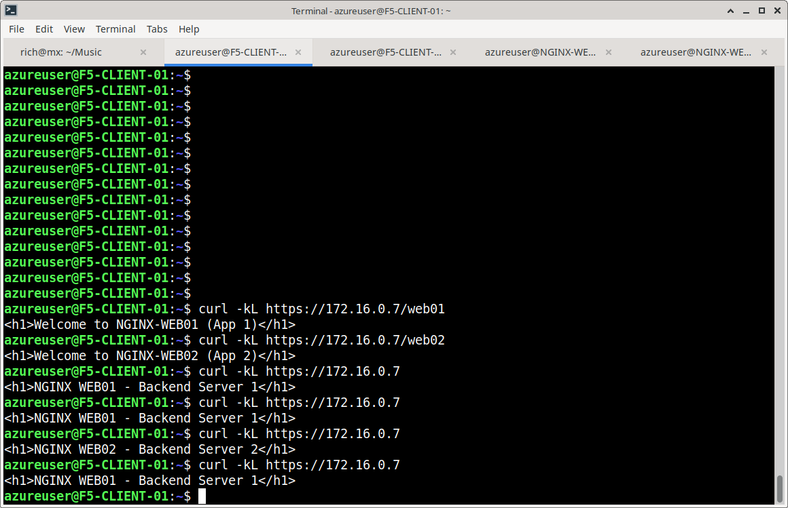

**HTTP (`:80`) Baseline Verification**

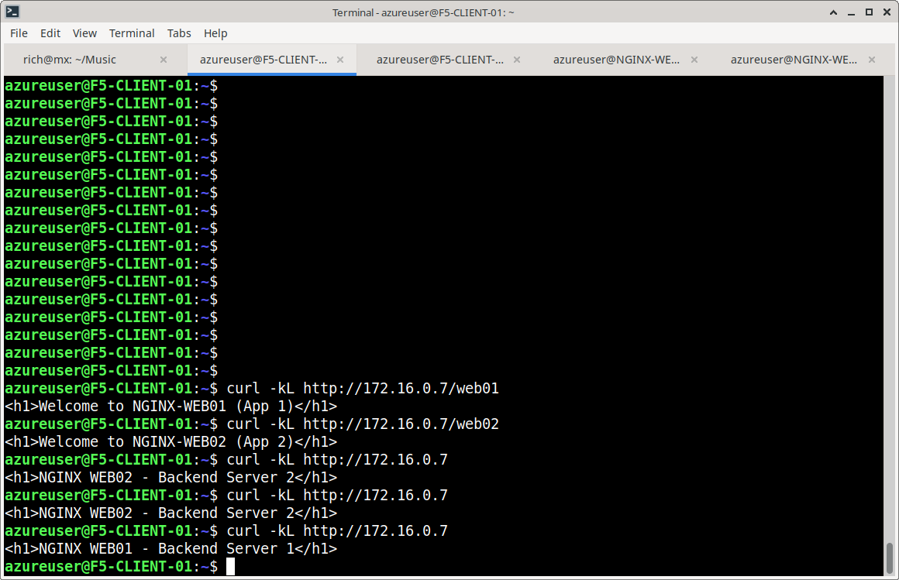

---

### 2. Deep Packet Inspection & Wire-Level Cryptographic Proof (Wireshark)
The definitive technical proof of SSL Termination lies in examining network captures (`http-termination.pcap`) recorded simultaneously at the F5 TMM interface level (`s1/tmm0`, `s1/tmm1`).

#### Proof Phase A: Client-Side Encrypted TLS Session (`ip.addr == 172.16.0.8`)
Filtering for the client IP address verifies that the client communicates **exclusively via encrypted TLS 1.3** across the public/external network segment:

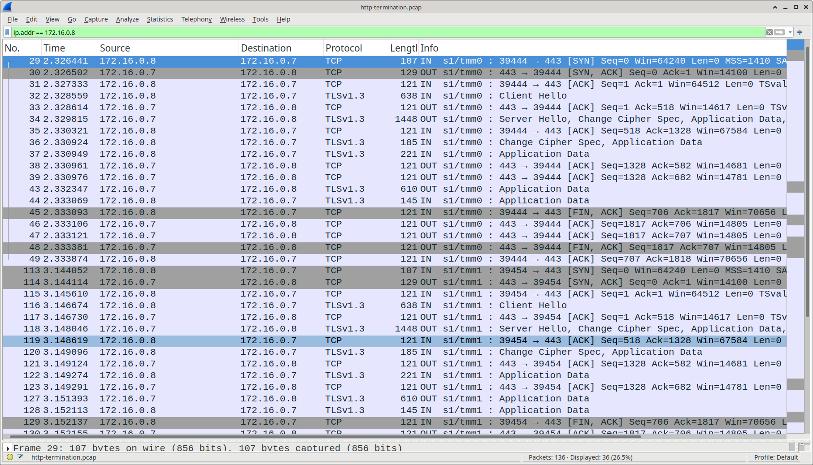

- **Handshake Verification:** Packets 29–31 complete the standard TCP 3-way handshake (`39444 -> 443 [SYN]`, `[SYN, ACK]`, `[ACK]`).
- **Cryptographic Negotiation:** Packets 32–35 show TLS 1.3 `Client Hello`, `Server Hello`, and `Change Cipher Spec` negotiation.
- **Payload Privacy:** Subsequent data exchanges (Packets 37–44) are classified entirely as opaque `Application Data` (`Length: 221`, `610`, `145`). At no point does cleartext application data leave the client.

---

#### Proof Phase B: Backend Plaintext Cleartext Offloading (`http`)
Filtering the identical capture file for the `http` protocol proves that the backend network tier operates **strictly over plain cleartext HTTP**:

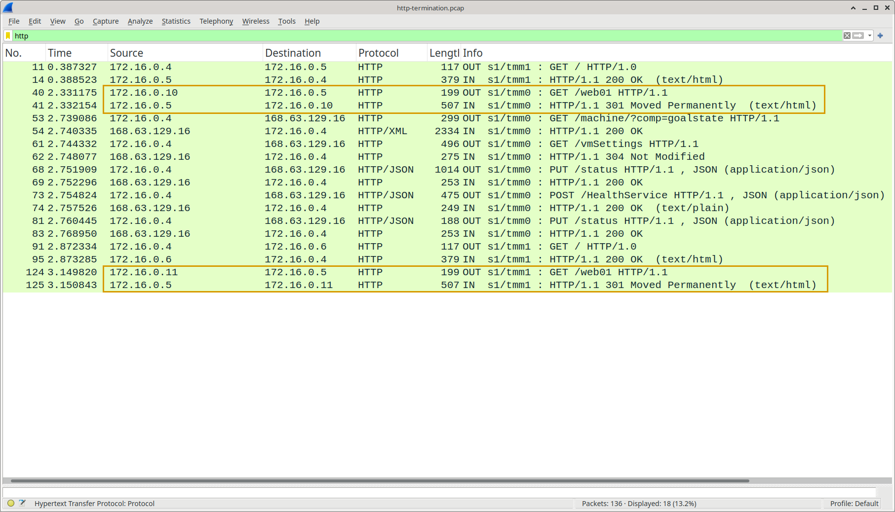

- **Cleartext L7 Visibility:** Unlike the client-side session, requests passing between BIG-IP's internal interfaces/SNAT IPs (`172.16.0.4`, `172.16.0.10`, `172.16.0.11`) and backend NGINX hosts (`172.16.0.5`, `172.16.0.6`) appear as unencrypted `GET /web01 HTTP/1.1` and HTTP status responses (`200 OK`, `301 Moved Permanently`).
- **Health Probes:** Packet 11 and 91 capture BIG-IP Self-IP (`172.16.0.4`) sending unencrypted `GET / HTTP/1.0` probes to `172.16.0.5:80` and `172.16.0.6:80`.
- **Architectural Conclusion:** The coexistence of TLS 1.3 on the client segment and cleartext HTTP on the internal segment provides empirical proof that BIG-IP terminated the TLS session, offloaded all cryptographic decryption from the backend servers, and routed cleartext HTTP to NGINX.

---

## Architectural Comparison & Engineering Takeaways

| Architecture Model | Client-Side Protocol | Proxy L7 Inspection | Backend Protocol | Backend Cryptographic Load | Primary Use Case |
|---|---|---|---|---|---|
| **SSL Passthrough** | HTTPS (`TCP/443`) | No (Layer 4 TCP) | HTTPS (`TCP/443`) | High (Servers perform full TLS) | E2E encryption where proxy cannot hold keys (e.g. strict regulatory requirements) |
| **SSL Termination (Offloading)** *(Implemented)* | HTTPS (`TCP/443`) | Yes (`HTTP_REQUEST`, headers, URI) | HTTP (`TCP/80`) | **Zero** (Plaintext HTTP) | High-performance enterprise web tiers, internal trusted clouds, WAF/ADC inspection |
| **SSL Bridging** | HTTPS (`TCP/443`) |  Yes (`HTTP_REQUEST`, headers, URI) | HTTPS (`TCP/443`) | Moderate (Servers perform re-encrypted TLS) | Zero Trust architectures, cross-VPC untrusted segments, strict compliance (HIPAA/PCI-DSS) |

### Key Engineering Observations:
1. **CPU Overhead Elimination:** By stripping TLS processing at BIG-IP, backend servers avoid asymmetric mathematical operations (RSA/ECDSA key exchange) and symmetric encryption algorithms (AES-GCM/ChaCha20), yielding higher concurrent request throughput per backend compute instance.
2. **Layer 7 Inspection Capability:** Operating in termination mode grants BIG-IP full visibility into request headers and paths. This enables fine-grained Layer 7 policy enforcement (URI routing, cookie persistence, bot defense, rate limiting, and WAF inspection) that is impossible under Layer 4 SSL Passthrough.
3. **Upstream Protocol Awareness:** When offloading SSL, backend web applications see cleartext HTTP requests. To prevent backend services from generating insecure redirect loops (`http://` URLs), production deployments typically configure BIG-IP to inject the `X-Forwarded-Proto: https` and `X-Forwarded-For` HTTP headers into the server-side request flow.

---

### What's Next?

With foundational SSL Termination and Layer 7 URI routing fully validated, the next step is to ensure that traffic is only ever sent to healthy, responsive backend applications. 

Continue to the next task to explore proactive application health checks:
- **[Task 2: Application Health Monitoring & High-Availability Failover](../http-health-monitoring/)** – Configuring custom Layer 7 HTTP probes to detect application-level failures and dynamically evict unhealthy nodes without dropping active client connections.
